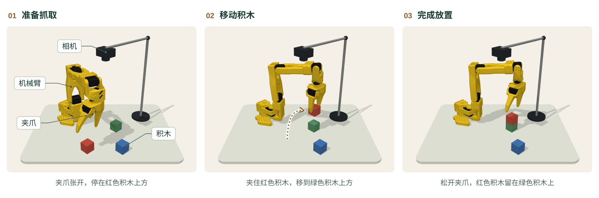
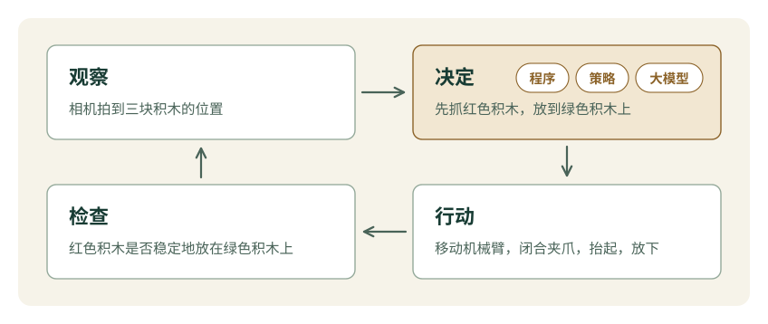
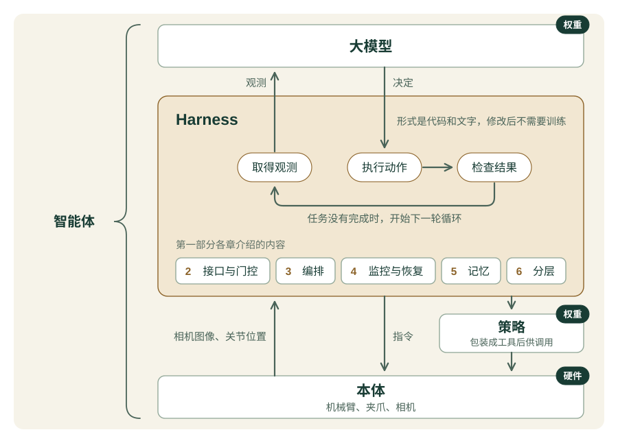
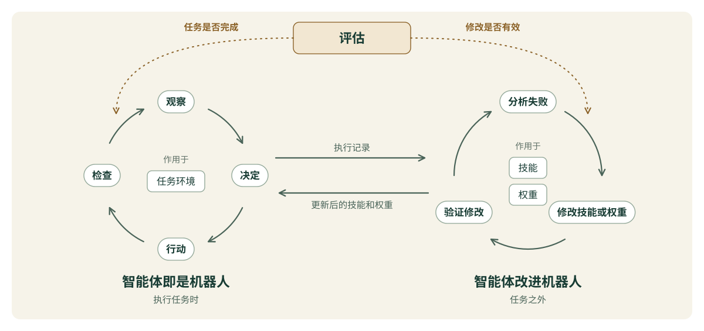

# 第 01 章 导论

人们一直希望能用自然语言指挥机器人，让它完成复杂的任务。以往这很难做到。以叠积木为例，要让机械臂把桌上的几块积木叠起来，通常有两种做法。第一种是工程师编写程序，把每一步怎么做都写清楚。第二种是先请操作者控制机械臂，把任务示范很多遍，记录下整个过程，再用这些记录训练一个模型。这两种做法都只能用于叠积木这一个任务，换一个任务，就要重新编写程序，或者重新示范和训练。

大模型出现以后，情况有了变化。2026 年下半年，先后有几个研究团队把通用大模型接到机械臂上做实验。实验中没有为任务采集示范，也没有训练模型，只给出一句文字指令，机械臂便完成了叠积木等任务 [1–3]。

不过，要完成这样的任务，只有大模型是不够的。大模型接收的是文字和图像，输出的是文字，它既不能自己读取相机的图像，也不能直接控制机械臂。所以，在大模型和机器人之间还要有一部分，把相机拍到的画面送给大模型，把大模型的决定变成机械臂的动作，再检查任务有没有完成。这一部分称为 Harness。这个词的本义是马具，马的力气要靠马具才能用来拉车。大模型的能力也要靠 Harness 才用得上：同一个大模型，配上不同的 Harness，结果可能相差很大。

这样由大模型做决定、通过 Harness 指挥机器人完成任务的系统，称为机器人智能体（agentic robot）。本教程介绍怎样搭建机器人智能体，搭建好以后怎样改进，以及这种改进能在多大程度上由智能体自己完成。

本章先用叠积木这个例子，说明机器人是怎样完成一个任务的，以及大模型在其中负责哪一步。然后介绍 Harness 的作用和组成。最后说明任务完成以后，怎样让机器人下一次做得更好，以及这项工作怎样交给智能体。后面各章也按这个顺序安排，本章末尾列出了全教程的内容。

## 1.1 机器人智能体

机器人完成一个任务，一般要经过观察、决定、行动、检查四个步骤，这四个步骤往往还要重复很多轮。下面以叠积木为例来说明。

桌上放着红、绿、蓝三块积木。机械臂的末端装有一个夹爪，桌子上方有一台相机。给机器人的指令是“把红色的放到绿色的上面”。图 1.1 显示了执行这个任务时三个时刻的画面。

图 1.1 叠积木任务的三个时刻：准备抓取、移动积木、完成放置。第二幅中的虚线表示红色积木移动的路径。画面由仿真软件 MuJoCo 生成，用作示意。

机器人先要观察，通过相机找到红色积木和绿色积木的位置。然后要决定下一步做什么，这里是先抓起红色积木，再放到绿色积木上。接着是行动，机械臂移到红色积木上方，夹爪闭合，夹住积木抬起来，移到绿色积木上方，再放下。最后还要检查红色积木是否稳定地放在了绿色积木上。如果没有放好，就重新观察，再决定下一步怎么做。

观察、决定、行动、检查依次进行，然后又回到观察，如图 1.2 所示。一个任务通常要经过很多轮这样的循环才能完成。

图 1.2 机器人执行任务的循环。四个步骤按箭头方向依次进行，每个步骤下面的小字是它在叠积木任务中的具体内容。“决定”这一步里列出的是下文比较的三种做法。

不同的机器人系统，区别主要在“决定”这一步。开篇提到的编写程序和训练模型是其中两种做法，让大模型来决定是第三种。

第一种做法是工程师预先编写程序。工程师把任务拆成若干步骤，写明每一步的操作：先识别积木的颜色，计算它们的位置，再规划机械臂的运动路径，然后执行。这样的程序运行得快，结果可以预料，出了问题也容易查找原因。但它只能处理编写时考虑到的情况。如果指令换成“把最小的那块放到最上面”，程序里又没有比较大小的步骤，工程师就得修改程序。

第二种做法是训练一个**策略**（policy）。策略是一个模型，输入的是相机图像等观测，输出的是机械臂的动作。训练之前，先请操作者控制机械臂，把任务完成很多次，记录下每一时刻的图像和动作，这些记录称为示范数据。再用示范数据训练策略，让它看到类似的图像时给出类似的动作。训练得到的策略动作连贯，还能学会一些难以写成步骤的操作，例如怎样抓取才不容易滑落。但策略主要适用于训练时见过的任务。要完成新的任务，通常得重新采集示范数据，重新训练。策略出了错，也不容易找出原因。

第三种做法是让**大模型**（large language model，LLM）来决定。现在的大模型大多也能读取图像，把指令和相机图像输入大模型，它便根据这些信息判断下一步该做什么。大模型能理解没有见过的指令，知道“最小的那块”指的是哪一块积木，还能说明每一步的理由。不过它也有不足。它每判断一次，往往需要几秒甚至更长的时间。它不擅长对准、抓稳这类精细的操作。它对图像的判断也会出错，有时任务没有完成，它却报告已经完成。

三种做法各有长处和不足，没有哪一种在每一项上都比另外两种好，见表 1.1。

表 1.1 “决定”这一步的三种做法

| | 预先编写的程序 | 训练得到的策略 | 大模型 |
|---|---|---|---|
| 为任务做的准备 | 工程师编写并调试程序 | 采集示范数据，训练策略 | 一句指令 |
| 遇到新的指令 | 需要修改程序 | 通常需要重新采集数据和训练 | 通常可以直接执行 |
| 执行速度 | 快 | 快，动作连贯 | 慢，每次判断需要几秒或更久 |
| 精细操作 | 取决于程序写得多细 | 较强 | 弱 |
| 出错时查找原因 | 容易 | 困难 | 可以查看每一步的理由，但它的报告不一定可靠 |

这三种做法是先后出现的，后出现的并没有取代先前的。目前能够稳定完成任务的系统，通常让三者分层配合。大模型在上层，负责安排任务的步骤。程序和策略在下层，负责完成每一步里的移动和抓取，供大模型调用。

能够感知环境并作用于环境的系统，称为智能体（agent）[4]。叠积木的机器人按观察、决定、行动、检查的循环完成任务，就是一个智能体。本教程讨论的智能体，都由大模型来做决定。它围绕任务的目标选择行动，再根据每一步执行的结果调整后面的步骤。智能体通过机器人来观察和行动，便是开篇所说的**机器人智能体**。研究机器人智能体的领域，英文称为 Agentic Robotics，本教程也以此为名。

在这个循环里，大模型只负责“决定”这一步。观察、行动和检查这三步，都要靠大模型之外的部分来完成，这一部分就是本章开头提到的 Harness。Harness 还要安排每一轮循环的开始和结束。

## 1.2 Harness

机器人智能体由三部分组成：大模型，机器人本体，以及两者之外的 **Harness**。本体指机械臂、夹爪、相机等硬件。Harness 负责循环中除了“决定”以外的三个步骤：它取得观测并交给大模型，把大模型的决定变成机器人的动作，再检查任务是否完成，没有完成便开始下一轮循环。

开篇提到，Harness 的本义是马具。马具的作用有两个，一是让马的力气能用来拉车，二是让人能够驾驭马。这里借用的正是这两层意思：Harness 让大模型的能力用得上，也让它的行为受到约束。

从形式上看，Harness 的内容有代码和文字两种。代码包括供大模型调用的工具、让循环运行起来的程序和各种检查，文字包括工具的说明和调用工具的规则。工具的实现也属于 Harness，例如根据图像计算积木位置的代码、规划机械臂运动的代码。这些内容修改以后都不需要训练便能生效。大模型的权重和策略的权重则不属于 Harness，修改它们要靠训练。训练得到的策略可以包装成一个工具，供大模型调用。图 1.3 画出了这几部分的关系。

图 1.3 Harness 与大模型、本体的关系。三个部分从上到下排列，Harness 在中间。Harness 框内的第一行是循环中由它完成的三个步骤，“决定”这一步交给框外的大模型，用一去一回两个箭头表示。第二行是 Harness 的组成部分，各部分所标的数字是介绍这一部分的章号。右上角标着“权重”的部分要靠训练来修改，标着“硬件”的部分是本体。

以抓取红色积木为例。大模型输出的只是一句话，例如“下一步抓起红色积木”。执行之前，还要确定红色积木的位置、夹爪张开的宽度和移动的速度。执行之后，还要确认积木确实被夹住了。这些都要靠 Harness 来完成，所以 Harness 对结果的影响很大。在 2026 年的多项评测中，大模型保持不变，只更换 Harness，同一批任务的结果便可以从多数失败变为多数成功 [2, 5, 6]。

Harness 承担的工作可以分为五个方面。[第 2 章](./chapter-02.md)到[第 6 章](./chapter-06.md)每章介绍一个方面，这五章是第一部分“执行”。

**[第 2 章 能力接口与门控](./chapter-02.md)**介绍怎样让大模型取得观测、发出动作。机器人的观测和动作要整理成工具，供大模型调用，每个工具都要写明输入、输出和适用范围。例如，大模型输出“向前移动 10”，这个 10 的单位是厘米还是米，就要在工具的说明里规定。观测也是这样。只给大模型一张图像，它只知道桌上有一块红色积木，给出积木的位置并注明单位和坐标系以后，它才能指挥机械臂去抓。此外，大模型给出的动作可能是错的，而动作一旦执行，后果往往无法撤销，被推倒的积木不会自己复位。所以在动作执行之前，Harness 还要检查它是否在允许的范围内。这项检查本教程称为门控（gating），介绍智能体的资料里常称为护栏（guardrails）。已经有真机评测因为大模型多次给出不安全的动作而中止 [5]。

**[第 3 章 编排](./chapter-03.md)**介绍怎样组织多步任务。叠积木要经过很多轮循环才能完成。安排各轮的先后顺序称为编排（orchestration），其中有的顺序可以预先固定下来，有的要留给大模型根据情况决定。

**[第 4 章 监控与恢复](./chapter-04.md)**介绍循环中的检查。动作指令发出以后，任务并不一定就完成了，例如夹爪报告已经闭合时，积木仍可能没有被夹住。这一章说明执行前、执行中和执行后分别要检查什么，以及失败以后怎样在重试、更换做法和停止之间选择。

**[第 5 章 记忆](./chapter-05.md)**介绍各轮循环之间需要保留的信息。相机一次只能看到场景的一部分，被机械臂挡住的积木就拍不到，它的位置要靠之前的观测来确定。这一章说明应当记录哪些信息，以及记录下来的信息在多长时间内还能使用。

**[第 6 章 分层系统](./chapter-06.md)**介绍快慢不同的几层怎样配合。大模型判断一次需要几秒，电机每秒却要接收几十到上千次指令。因此，下层的程序和策略以较高的频率持续控制机械臂，大模型在上层以较低的频率做决定。这一章说明各层怎样衔接，以及上层出现停顿或错误时下层怎样处理。

有了 Harness，机器人可以完成一次任务，但任务完成以后系统本身没有变化，下一次遇到同样的情况，它仍然会重复这一次的错误。所以，能够执行任务还不够，系统还要能够改进。

## 1.3 从执行到改进

机器人在一次任务中纠正了错误，这种纠正并不会保留到下一次任务。例如，机器人把红色积木放偏以后，重新观察，调整位置，再放一次，这次放正了。这种调整发生在一次任务之内，属于 [4.4 节](./chapter-04.md#sec-4-4)介绍的恢复。下一次执行同样的任务，机器人仍然会先放偏，再纠正。

要让机器人下一次不再放偏，就得在任务完成以后修改系统，把改进保留下来。可以修改的有技能和权重两类。

本教程所说的**技能**（skill），是写成说明或者代码、可以反复使用的做法。例如：“放下积木之前，先对准下方积木的中心。松开夹爪以后，再观察一次。”把这条技能加入系统，机器人下一次便可以直接按它执行。技能属于 Harness，修改以后不需要训练，马上就能生效。它的内容可以阅读和检查，效果不好时还可以退回上一个版本。[第 7 章](./chapter-07.md)介绍怎样把一次有效的做法整理成可以复用的技能。[第 8 章](./chapter-08.md)介绍怎样根据失败的记录修订技能和 Harness 的其他部分，以及怎样判断一次修订是否值得保留。这两章是第二部分“改技能”。

**权重**（weights）是模型内部的参数，策略输出什么动作，取决于这些参数的数值。有些能力很难写成说明或代码，例如把插头对准插孔时怎样细微地调整力度。这类能力要通过训练来获得，训练的过程就是调整策略的权重。训练需要示范数据，也需要可以反复试验的环境。这样的环境通常在计算机中模拟出来，称为仿真环境。训练的每个环节都要判断结果的好坏，也就是都要用到评估，所以第三部分“改权重”从评估讲起。[第 9 章](./chapter-09.md)介绍评估与验证，讨论由谁来判定成功，以及怎样检查评估方法本身是否可靠。[第 10 章](./chapter-10.md)介绍策略的训练，[第 11 章](./chapter-11.md)介绍数据的采集与整理，[第 12 章](./chapter-12.md)介绍仿真场景与任务的搭建。

以往，这些改进工作都是工程师和研究人员来做的。他们阅读机器人执行任务时留下的记录，也就是执行记录，然后修改程序，采集数据，运行训练。现在，这些工作也可以交给智能体。这里的智能体和前面执行任务的机器人智能体不同：它同样由大模型做决定，但处理的是代码、数据和实验，不直接指挥机器人。它阅读执行记录，分析失败的原因，然后修改技能，或者整理数据、安排训练、搭建新的仿真场景。

这样，在机器人领域，智能体便有了两种角色：

> 智能体即是机器人，智能体改进机器人。
>
> Agent is robot. Agent improves robot.

前一句说的是执行任务的时候，大模型、Harness 和机器人本体共同构成一个智能体，负责完成指定的任务。后一句说的是任务之外，这时智能体的工作是改进机器人系统，修改的是技能和权重。图 1.4 画出了这两种角色。

两种角色都离不开评估。机器人报告任务已经完成，要有独立的观测来确认。智能体报告技能已经改好，也要有独立的评估来检验。如果由执行的一方自己判断结果，错误就可能被当作成功保留下来。所以在图 1.4 中，评估画在执行和改进这两个循环之外。

图 1.4 智能体的两种角色。每个圆环中间标出的是这个循环作用的对象，实线箭头表示两个循环之间传递的内容。评估不属于任何一个循环，虚线箭头表示它分别判断任务是否完成和修改是否有效。

两种角色可以由不同的智能体承担，也可以合并到同一个系统里。合并以后，这个系统自己执行任务，自己发现失败，决定修改什么，再验证修改有没有效果。人学习一项技能，大致也是这样的过程。其中最难的是决定修改什么。遇到一次失败，应当修改技能还是修改权重，有时很难判断。有些对精度要求很高的任务，只修订技能就完成了，也有些任务加上技能以后仍然无法完成 [2, 7]。机器人能否自己完成整个过程，需要什么条件，目前也还没有定论。这个方向常被称为**递归自我改进**（recursive self-improvement，RSI）。按严格的说法，系统要连改进的办法也一并改进，而且越改越有效，才算递归 [8]，只是把这个循环多进行几轮还不算。[第 13 章](./chapter-13.md)把前面各章的内容联系起来，讨论一次失败以后应当改动哪一部分、哪些工作可以交给智能体，也讨论机器人离递归自我改进还有多远。

## 本教程的内容安排

本章先以叠积木为例，说明了机器人通过观察、决定、行动、检查的循环完成任务，在机器人智能体中，“决定”这一步由大模型负责。接着介绍了 Harness，循环中的其余工作都由它承担。最后说明了任务完成以后，可以修改技能和权重，把改进保留下来，改进是否有效则要靠独立的评估来检验。

理论部分的各章按同样的顺序安排：先介绍执行，再介绍怎样改技能和改权重，最后介绍怎样把执行和改进连成一个循环，也就是闭环，见表 1.2。

表 1.2 理论部分的内容安排

| 部分 | 章 | 主要问题 |
|---|---|---|
| 导论 | 第 1 章 | 机器人智能体是什么 |
| 第一部分 执行 | 第 2—6 章 | 怎样完成一个任务 |
| 第二部分 改技能 | 第 7—8 章 | 怎样让下一次做得更好 |
| 第三部分 改权重 | 第 9—12 章 | 怎样判断是否真的变好，技能不够时怎样训练策略 |
| 闭环 | [第 13 章](./chapter-13.md) | 应当改进哪一部分，由谁判断 |

除了理论部分，本教程还有仿真实验和真机实战两部分。仿真实验部分在仿真环境里完成一组任务，每个任务都是先执行，再分析失败、修订技能，并验证修订的效果。真机实战部分在真实的机器人上重复同样的过程。读者在这两部分里动手练习理论部分介绍的做法。

学完本教程，读者应当能够搭建一个机器人智能体，让它完成一个任务，在它失败时找出原因，修改技能或策略，并用证据说明这次修改是否有效。

## 参考文献

1. SenseNova Joint Research Team, Cai Z, Cao Z, 等. [Has GPT-6-Astra Achieved Embodied Intelligence?](https://arxiv.org/abs/2610.22471). arXiv:2610.22471, 2026.
2. Gao H, Zeng J, Zhou A, 等. [HexaShell: A Universal Harness for Robot Coding Agents in Simulation and the Real World](https://arxiv.org/abs/2610.23479). arXiv:2610.23479, 2026.
3. Zhou Y, Hou B, Fu Y, 等. [Large Multimodal Models for Direct Robot Control: GPT-6 as a Beginning](https://arxiv.org/abs/2610.28259). arXiv:2610.28259, 2026.
4. Russell S, Norvig P. [Artificial Intelligence: A Modern Approach](https://aima.cs.berkeley.edu/). 4th ed. Pearson, 2020.
5. Zhang W, Wang K, Ouyang Y, 等. [An Unexpected Robot Policy: Early Evaluations of GPT-6 Astra on RoboDojo and Beyond](https://arxiv.org/abs/2609.24170). arXiv:2609.24170, 2026.
6. Wang C, Shi Y, Xu S, 等. [Auriga Technical Report: A Task-Agnostic Agent Harness for Zero-Shot Embodied Manipulation](https://arxiv.org/abs/2611.01112). arXiv:2611.01112, 2026.
7. Yao Y, Zou Y, Gao X, 等. [Review the Episodes, Refine the Lessons: Simple Memory Evolution for Embodied Agents](https://arxiv.org/abs/2611.11509). arXiv:2611.11509, 2026.
8. Zhou H, Yang F, Chen Z, 等. [Who Improves the Robot? Toward Physical Recursive Self-Improvement](https://arxiv.org/abs/2610.18842). arXiv:2610.18842, 2026.
