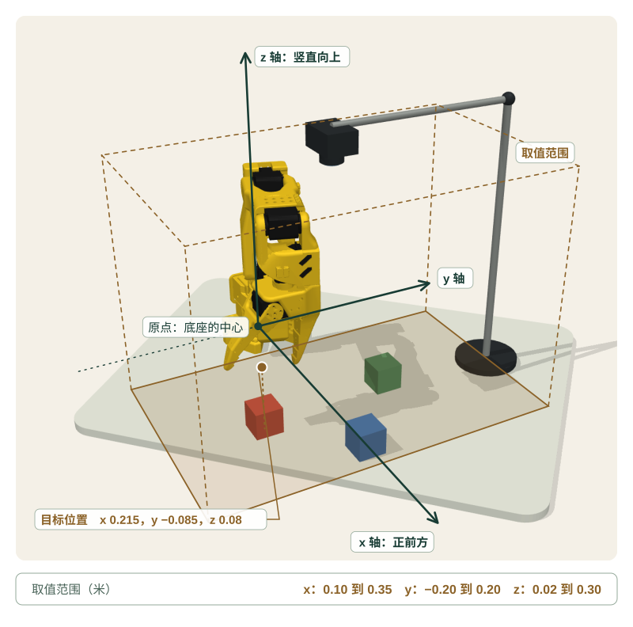
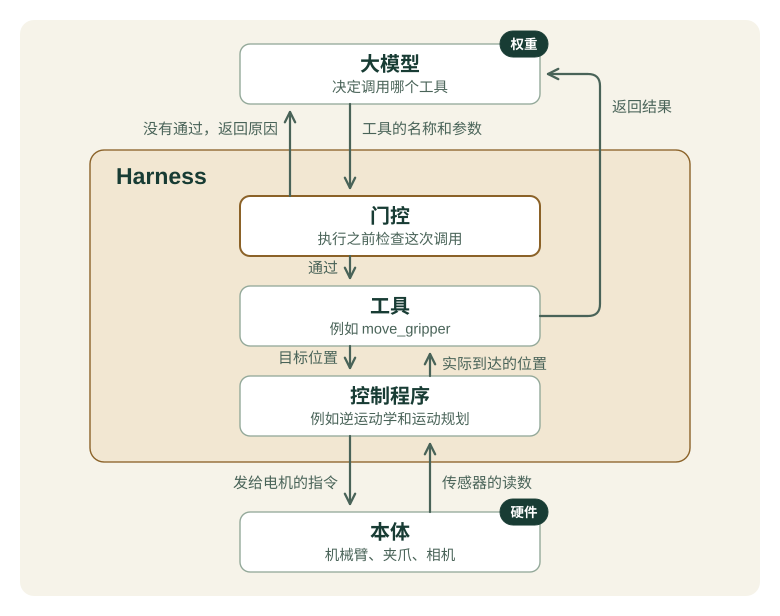

# 第 02 章 能力接口与门控

大模型输出的是文字，机器人的电机接受的却是控制指令。大模型也不能自己去读取相机的画面和传感器的读数。要让大模型指挥机器人，就需要在两者之间做转换。在机器人智能体中，这项工作由 Harness 承担。通行的做法是把机器人的每一项能力做成一个**工具**（tool），例如读取相机的图像，把夹爪移到指定的位置，或者让机器人向前走一段距离。有了工具，大模型在输出中写明调用哪个工具、参数是多少，Harness 便会执行这次调用，再把结果返回给它。这一组工具就是机器人提供给大模型的能力接口。

大模型能够使用机器人的哪些能力，取决于 Harness 提供了哪些工具。大模型只能使用做成了工具的能力，Harness 也只执行符合工具规定的调用。因此，搭建机器人智能体时，先要把工具确定下来。本章依次介绍怎样选择工具、怎样写工具的说明、怎样在执行之前检查调用，最后说明同一组工具怎样用在不同的机器人和仿真环境上。

<a id="sec-2-1"></a>

## 2.1 原子能力与工具

要确定提供哪些工具、每个工具做多少事，先要了解大模型怎样调用工具。下面通过一个例子看一次调用的全过程。在叠积木的任务中，机械臂先要抓起红色积木。假设大模型已经知道红色积木的位置，现在要把夹爪移到它的正上方。大模型输出这样一段文字：

```json
{"tool": "move_gripper", "arguments": {"x": 0.215, "y": -0.085, "z": 0.08}}
```

Harness 读到这段输出，找到名为 `move_gripper` 的工具，让机械臂把夹爪移到指定的位置。运动结束以后，Harness 把结果也写成一段文字，返回给大模型：

```json
{"accepted": true, "reached": true, "position_error": 0.004}
```

大模型读到结果，知道夹爪已经到位，再决定下一步。这样的一个来回称为一次**工具调用**（tool call）。

大模型能够写出这次调用，是因为它事先知道有 `move_gripper` 这个工具，也知道调用时要填 x、y、z 三个数。所以，Harness 要为每个工具准备一份说明，和指令一起放进大模型的输入。说明里至少有名称、用途和参数：名称用来指定调用哪个工具，用途告诉大模型这个工具做什么，参数规定调用时要填写哪些内容。目前大模型调用工具普遍采用这样的约定，常见的函数调用（function calling）和 MCP（Model Context Protocol）都属于这一类。[2.2 节](#sec-2-2)介绍工具的说明里还要写清哪些内容。

抓起红色积木需要取得观测和执行动作的工具，另外还要有一个用于停止的工具，表 2.1 是一组例子。

表 2.1 抓取积木用到的一组工具

| 工具 | 类别 | 作用 |
|---|---|---|
| `get_image` | 观测 | 返回相机当前拍到的图像 |
| `get_robot_state` | 观测 | 返回夹爪的位置和张开的宽度 |
| `locate` | 观测 | 根据图像计算指定物体的位置 |
| `move_gripper` | 动作 | 把夹爪移到指定的位置 |
| `set_gripper` | 动作 | 张开或闭合夹爪 |
| `stop` | 停止 | 立即停止正在进行的运动 |

表中的名称是为了讲解而起的，各个系统的叫法并不相同。取得观测和执行动作这两类工具，各个系统都有。停止则不一定做成单独的工具。本教程把停止单独列为一类，因为机器人的动作开始以后，要能随时让机器人停下。[2.3 节](#sec-2-3)还会讲到这个工具。

**观测工具。** 最基本的观测是相机图像和机器人自身的状态，例如夹爪现在的位置。只有这两项时，大模型能从图像里认出哪一块是红色积木，却不容易准确说出它在桌面上的位置。所以不少系统还提供 `locate` 这样的工具。它利用相机的安装位置和成像参数，把物体在图像中的位置换算成空间中的位置，返回一组带单位的坐标。

**动作工具。** 大模型和电机之间总有一层现成的控制程序，动作工具就建立在这层程序之上。以夹爪移到红色积木上方这个动作为例，工具可以有两种设计。一种是让大模型给出机械臂每个关节的角度。另一种是让大模型只给出夹爪要到达的位置，工具下面的程序再算出各个关节的角度，这种计算称为逆运动学（inverse kinematics）。后一种就是把工具建立在控制程序之上，目前的系统大多这样做。有一项实验在同一批仿真任务上比较了这两种设计，其余设置相同：让大模型给出夹爪的位置时，任务的成功率大约是 16%，改为给出关节角度以后降到大约 10% [1]。

其他机器人的动作工具也是这样，表 2.2 列出了三类机器人的情况。

表 2.2 三类机器人的动作工具

| 机器人 | 大模型通过工具给出 | 工具下面的程序负责 |
|---|---|---|
| 机械臂 | 夹爪的目标位置 | 计算各个关节的角度，规划运动的路径 |
| 行走的机器人 | 前进和转向的速度，或者一次移动的距离 | 控制步态，保持平衡 |
| 提供预设动作的机器人 | 动作的名称，例如挥手 | 按设计好的轨迹驱动各个关节 |

大模型通常不能绕过这层控制程序。行走的机器人尤其如此，绕过了保持平衡的程序，机器人就可能摔倒。

**一个工具做多少事。** 表 2.1 里的每个工具只做一件事，是机器人提供给大模型调用的最小单元，称为**原子能力**（primitive）。一个工具也可以把几项原子能力合在一起，例如直接提供一个抓起指定物体的工具，它一次完成定位、移动、下降和闭合夹爪。这样大模型用起来最方便，可是这个工具便只能处理设计时考虑到的情况，受到的限制和 [1.1 节](./chapter-01.md#sec-1-1)里预先编写的程序相同。至于效果，已有的实验结论并不一致。有的实验里，工具包含的步骤越多，任务的成功率越高 [2]。另一些实验里，换成这样的工具以后，结果并没有改善 [3]。工具的数量也不是越多越好。有的团队发现，增加工具以后，完成任务的开销反而上升了 [4]。因此，比较稳妥的做法是先提供少量必需的工具，等任务确实需要时再增加。

工具和技能这两个词，各种资料里的用法并不一致。有的资料把大模型可以调用的单元叫工具，有的叫技能。在机器人厂商的应用商店里，一段录制好的动作、一个调用机器人接口的程序也都叫技能。在编写代码、处理文档的智能体中，这两个词已经有通行的用法，本教程沿用这种用法。工具给大模型的是能力，它是大模型可以调用的接口，有名称、参数和返回。技能给大模型的是做法，它写成说明或者代码，可以反复使用。技能里的代码提供给大模型时，本身也是一个工具。[7.1 节](./chapter-07.md#sec-7-1)说明两者的关系。

<a id="sec-2-2"></a>

## 2.2 调用契约

大模型是通过工具的说明来了解工具的，说明里没有写到的内容，它便只能猜测。因此，除了名称、用途和参数，说明还要写清参数的含义和取值范围、调用的前提，以及返回的内容。本教程把这几方面合称为工具的**调用契约**（contract）。契约是双方的约定：大模型按说明调用，工具按说明执行并返回结果。仍以 `move_gripper` 为例，完整的说明如下。最后的“使用”和“失败”两项是给大模型的建议，放在后面介绍。

```text
名称  move_gripper
用途  把夹爪移到指定的位置，夹爪保持竖直向下。
参数  x, y, z：夹爪的目标位置，单位是米。
      坐标系以机械臂底座的中心为原点，x 轴指向机械臂的正前方，z 轴竖直向上。
      取值范围：x 为 0.10 到 0.35，y 为 -0.20 到 0.20，z 为 0.02 到 0.30。
前提  机械臂没有正在执行的运动。
返回  accepted：调用是否被受理。没有被受理时，reason 一项给出原因。
      reached：夹爪是否到达了目标位置。
      position_error：夹爪的实际位置与目标位置之间的距离，单位是米。
使用  移动之前先调用 locate 取得物体的位置，不要根据图像估计坐标。
      这个工具只移动夹爪。张开和闭合夹爪用 set_gripper。
失败  accepted 为假时，按 reason 给出的原因修改参数，再调用一次。
      reached 为假时，先调用 get_robot_state 查看夹爪现在的位置，再决定下一步。
```

**参数。** 说明里写明了单位是米，也写明了坐标系，大模型才知道该填什么数。图 2.1 把这个坐标系和取值范围画在了场景里。如果说明里只写“向前移动的距离”，大模型就无从判断该填 10 还是 0.1，也无从判断“向前”指机械臂的前方还是相机画面的前方。各个工具之间还要保持一致：`locate` 返回的位置和 `move_gripper` 接受的位置用的是同一个坐标系和同一个单位，这样大模型便可以把前一个工具的结果直接填进后一个工具的参数。

<p align="center"></p>

图 2.1 `move_gripper` 的坐标系和取值范围。三根箭头是坐标轴，原点在机械臂底座的中心。虚线围成的长方体是夹爪位置的取值范围，底面涂了颜色。圆点是 [2.1 节](#sec-2-1)的例子中 `move_gripper` 的目标位置。画面由仿真软件 MuJoCo 生成，用作示意。

以上关于单位和坐标系的要求，针对的是机械臂这类机器人。有的机器人提供的是一组预设动作，按名称调用，这时参数就是动作的名称，说明里要列出有哪些名称可用。同一系列的不同型号，可用的动作也可能不一样。

**前提。** 指调用之前必须已经成立的条件，例如 `move_gripper` 要求机械臂没有正在执行的运动，抓取积木则要求夹爪已经张开。有的机器人要处在站立状态，才能执行挥手这样的动作。把前提写进说明，大模型就可以先确认条件，再发出调用。

**返回。** 说明里要写明调用是否被受理、没有被受理时的原因，以及执行以后测得的结果。其中没有被受理的原因对大模型最有用，例如看到“目标超出了取值范围”，它便知道该修改哪个参数。

工具返回成功，并不等于动作达到了目的。例如 `set_gripper` 返回成功，只表示夹爪已经闭合，却没有说明积木是否被夹住。又如有的机器人播放动作或语音时，返回成功只表示请求已经排进队列，动作可能还没有开始。因此，说明里要写清楚成功指的是哪一种情况。上面的说明把 `accepted` 和 `reached` 分成两项，就是为了区分调用是否被受理和夹爪是否到达目标。至于动作是否达到了预期的效果，还要靠另外的检查来确认，见[第 4 章](./chapter-04.md)。

**使用和失败。** 这两项是给大模型的建议，告诉它什么情况下应当使用这个工具，什么情况下不要使用，以及调用失败以后可以怎样处理。它们和前面三项的区别在于有没有代码把关：参数和前提不合规定，调用就不会被受理，返回的内容由工具给出；这两项则没有代码去检查，是否照办由大模型决定。本例中，“使用”一项提醒它位置要用 `locate` 取得，开合夹爪要用另一个工具；“失败”一项分别说明没有被受理和没有到达时怎样处理。

<a id="sec-2-3"></a>

## 2.3 入口门控

即使说明写得很清楚，大模型仍然可能给出错误的调用，例如把位置算错，或者没有注意到夹爪里还夹着积木。在软件里，操作出了错多数可以撤销，而机器人的动作一旦执行，往往就无法撤销了。已经有真机评测因为大模型多次给出不安全的动作而中止，其间还损坏了设备 [5]。

因此，每一次调用在执行之前都要先经过检查，通过了才执行。这项检查由 Harness 来做，本教程称为**入口门控**（gating），简称门控。各个系统对它的叫法并不统一，常见的还有校验器（validator）和护栏（guardrails）。检查的内容也不完全相同，常见的有下面几项。

- 调用的工具是否在允许的清单上。这份清单也叫白名单。机器人底层往往还有直接控制关节的接口，它不在清单上，大模型也就无法调用。
- 参数是否在规定的范围内，例如夹爪的目标位置有没有超出取值范围（图 2.1 中的长方体），行走的速度有没有超过上限。
- 当前状态下能否执行，例如调用的前提是否满足，机械臂能否到达目标位置，预设动作在机器人当前的姿态下能否播放。
- 是否与正在执行的动作冲突。不少系统规定，会改变环境的动作一次执行一个，上一个没有结束，就不受理下一个。
- 调用所依据的观测是否已经过时。大模型思考需要时间，在这段时间里场景可能已经变了。
- 在真机上，动作是否经过了预览或人工确认。有的系统先在仿真里演示动作，有的系统要等现场的操作者确认以后才执行。

这些检查要写成代码来执行。事先写给大模型的说明和规则称为提示词（prompt），仅仅在提示词里写明限制是不够的。例如在一组实验里，提示词已经写明不能碰到障碍物，大模型推理时也提到了障碍物，机械臂却在多数情况下碰到了它，避开障碍物的比例只有 34% [6]。在 Harness 里加上由代码执行的检查以后，这个比例提高到了 92%。检查有两项：执行每一段路线之前，先核对它是否会进入障碍物周围的范围，通过了才执行；抓取和放置之前，先检查是否紧挨着障碍物，紧挨着时另选接触的位置。用代码做的检查能够拦住越界的调用：在移动机器人的一组安全测试中，四个大模型分别有 9% 到 43% 的指令引出了越界的调用，这些调用全部被拦了下来 [7]。

调用没有通过门控时，Harness 不执行动作，并把原因返回给大模型，大模型再根据原因修改参数，或者换一种做法。图 2.2 画出了通过门控的调用怎样经过工具和控制程序到达本体，结果又怎样返回给大模型。

<p align="center"></p>

图 2.2 一次工具调用经过的各个部分。向下的箭头是调用，向上的箭头是返回的内容，图中以机械臂的 `move_gripper` 为例。没有通过门控的调用不再向下传递，原因直接返回给大模型。大模型、Harness 和本体的画法与图 1.3 相同。

不过，通过了门控的动作也不一定安全。门控检查的是调用的参数和机器人的状态，有些情况它检查不出来，例如有人把手伸到了夹爪的下方。它也无法保证运动中不发生碰撞 [5, 8]。所以，机器人还需要一层不经过大模型的保护，包括机器人自带的控制器的限位和保护性停止，以及操作者手边的急停开关。

停止的做法也因机器人而异。机械臂通常停在原地就可以了。行走的机器人却不能简单地切断电机，要由它的控制程序决定怎样停下来才稳妥。所以，表 2.1 中的 `stop` 在各种机器人上名称相同，工具下面的实现则要按机器人来写。

门控检查的是执行之前的情况。[4.2 节](./chapter-04.md#sec-4-2)介绍动作执行的过程中和执行以后还要检查什么。

<a id="sec-2-4"></a>

## 2.4 能力适配

前面三节以桌面上的一台机械臂为例，介绍了工具、契约和门控。换一种机器人，或者从仿真换到真机，它们并不需要全部重写。以抓取积木的任务为例，它既可以在仿真环境里做，也可以在真机上做。在这两种情况下，大模型用到的可以是同一组工具，不同的是工具下面的实现。把工具的调用转换成某一种机器人或仿真环境的接口，这部分代码称为**适配层**（adapter）。已有的系统常常为每一种机器人或仿真环境各写一个适配层。

这样一来，更换机器人时只需要更换适配层，工具的名称、参数和返回都保持不变，Harness 的其余部分和已经写好的技能也就可以沿用。

不过，工具相同并不等于行为相同。同一个 `move_gripper`，在仿真里和在真机上，误差和耗时都可能不一样，所以在仿真里完成的任务，换到真机上还要重新验证。至于同一组工具能在多大程度上从仿真沿用到真机，从一种机器人沿用到另一种机器人，目前还没有定论。

没有真机可用时，还可以先写一个测试替身（test double）。它是一个接口，接受同样的调用，按预先设定的内容返回结果，但不驱动任何电机。替身可以用来检查调用的格式和流程是否正确，却不能说明任务能否完成。因此，在替身、仿真和真机上得到的结果要分开记录。

## 小结

本章介绍了 Harness 怎样让大模型观察和行动。机器人的能力以工具的形式提供给大模型，工具建立在现成的控制程序之上。每个工具用调用契约写明参数、前提和返回，每次调用在执行之前先经过门控。工具下面的适配层把同一组工具接到不同的机器人和仿真环境上。

有了这些工具，大模型便可以观察和行动了。不过，每次调用只完成一个动作，而叠积木这样的任务要连续调用很多次才能完成。[下一章](./chapter-03.md)介绍怎样把这些调用组织起来，也就是编排。

## 参考文献

1. SenseNova Joint Research Team, Cai Z, Cao Z, 等. [Has GPT-6-Astra Achieved Embodied Intelligence?](https://arxiv.org/abs/2610.22471). arXiv:2610.22471, 2026.
2. Fu L, Yu J, El-Refai K, 等. [CaP-X: A Framework for Benchmarking and Improving Coding Agents for Robot Manipulation](https://arxiv.org/abs/2603.22435). ICML 2026. arXiv:2603.22435.
3. Wang Z, Dang Y, Shi X, 等. [JustRUA: A Controlled Study of GPT-6 Robot-Use Agents](https://arxiv.org/abs/2611.16009). arXiv:2611.16009, 2026.
4. Dexmate. [An Anatomy of Coding Agents Tackling Robotics Tasks](https://www.dexmate.com/blog/an-anatomy-of-coding-agents-tackling-robotics-tasks). 2026.
5. Zhang W, Wang K, Ouyang Y, 等. [An Unexpected Robot Policy: Early Evaluations of GPT-6 Astra on RoboDojo and Beyond](https://arxiv.org/abs/2609.24170). arXiv:2609.24170, 2026.
6. Xu B, Shang Y, Dong Z, 等. [SafeHarness: Coding Agents with Harness for Safe Robot Control](https://arxiv.org/abs/2609.20822). arXiv:2609.20822, 2026.
7. Cardenas I S, Arnett M A, Yeo N C, 等. [ROSClaw: An OpenClaw ROS 2 Framework for Agentic Robot Control and Interaction](https://arxiv.org/abs/2603.26997). arXiv:2603.26997, 2026.
8. Zhou Y, Hou B, Fu Y, 等. [Large Multimodal Models for Direct Robot Control: GPT-6 as a Beginning](https://arxiv.org/abs/2610.28259). arXiv:2610.28259, 2026.
