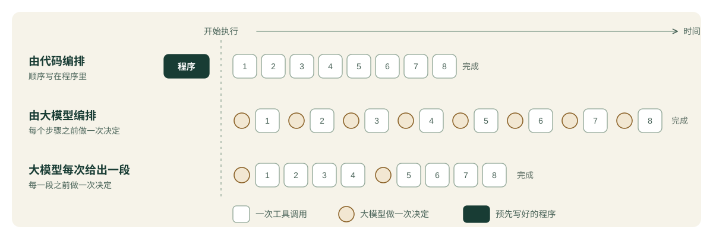
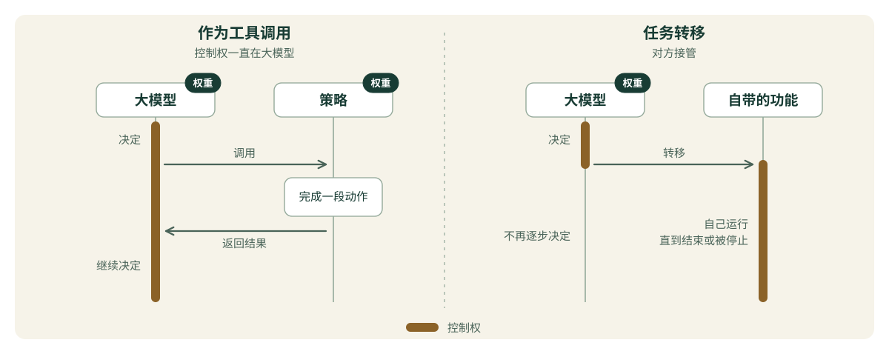

# 第 03 章 编排

机器人完成一个任务，往往要连续调用很多次工具。这些调用要按一定的顺序进行，还要确定任务在什么时候结束。安排这些调用的顺序，并确定任务什么时候结束，称为**编排**（orchestration）。在别的资料里，这个词也常专指把工作分派给几个智能体或者几个策略。本教程的用法要宽一些，一个大模型安排自己的各次调用也算编排。

编排有两种基本的方式。一种是把调用的顺序预先写成代码，执行时按这个顺序进行。另一种是把顺序交给大模型，由它在执行过程中根据情况逐步决定。前一种速度快，结果也稳定，但只能处理写代码时考虑到的情况。后一种能处理没有预料到的情况，可是大模型每做一次决定都要花几秒甚至更长的时间，还会产生费用。因此，比较稳妥的做法是把顺序确定的部分预先写好，在需要根据情况判断的地方才交给大模型。

本章先介绍怎样把任务分成阶段和步骤，再比较几种编排方式，然后说明进入下一个步骤之前需要什么依据，最后介绍控制权的交接和任务的结束。

## 3.1 任务与步骤

以叠积木为例。桌上有红、绿、蓝三块积木，指令是把它们叠成一摞，绿色在最下面，红色在中间，蓝色在最上面。这个任务可以分成三个**阶段**（stage）：把红色积木放到绿色积木上，把蓝色积木放到红色积木上，机械臂回到起始位置。

每个阶段都要有完成条件，用来判断这个阶段是否已经完成、能否进入下一个阶段。完成条件要写成能够观察到的状态。例如第一个阶段的完成条件是红色积木稳定地放在绿色积木上，而且夹爪已经松开。

一个阶段通常要调用多次工具。在第一个阶段里，要先读取图像，定位红色积木和绿色积木，再把夹爪移到红色积木上方，下降，闭合夹爪，抬起，移到绿色积木上方，下降，松开夹爪，最后再读取一次图像，确认红色积木的位置。这里的每一次调用是一个**步骤**（step）。也就是说，阶段是任务分成的段落，步骤则是阶段里的一次调用。

执行过程中还要记录进度，也就是各个阶段的完成情况，这样才知道接下来该做什么。不过，已经完成的阶段也可能失效。例如，叠蓝色积木时如果碰倒了下面的两块，第一个阶段就不能再算完成，需要重新做。进度可以由代码来记录，也可以交给大模型，让它在每一轮循环中更新。

其他机器人的任务也可以这样划分。例如让人形机器人教访客做一个打招呼的动作，阶段可以是讲解、示范、观察访客有没有跟着做。这里最后一个阶段的完成条件取决于访客，访客抬起了手臂，这个阶段才算完成。

## 3.2 编排方式

开篇介绍了两种编排方式，两者之间还有一种折中的做法。

第一种是**由代码编排**。要调用的工具和调用的顺序都预先写在一段程序里，执行时不需要大模型。程序里也可以有分支和循环，例如没有找到积木就再找一次。这样的程序常常写成状态机（state machine），也就是把任务分成几个状态，并规定在什么条件下从一个状态转到另一个状态。不少机器人自带的功能就是这样编排的：一段表演是依次播放语音和动作的脚本，自动寻找并踢球的功能则是一个状态机。

第二种是**由大模型编排**。在每一轮循环中，大模型根据当前的观测和进度，选择下一次要调用的工具。这时顺序没有预先写下来，是在执行过程中逐步确定的。目前研究中的机器人智能体大多采用这种做法。

第三种介于两者之间。大模型一次给出一串动作，或者写出一段程序，Harness 把它执行完，再把结果交给大模型，由大模型决定接下来的调用。和第二种相比，大模型决定的次数少了，每次决定所包含的动作却多了。

顺序越是留到执行中逐步确定，越能处理没有预料到的情况，花的时间也越多，见表 3.1。图 3.1 画出了三种方式在时间上的差别。

表 3.1 三种编排方式

| | 由代码编排 | 由大模型编排 | 大模型每次给出一段 |
|---|---|---|---|
| 顺序在什么时候确定 | 写程序时 | 执行中，每次确定一个步骤 | 执行中，每次确定一段 |
| 速度和开销 | 最快，不调用大模型 | 最慢，每个步骤都要等大模型 | 介于两者之间 |
| 遇到没有预料到的情况 | 程序里没有写的便无法处理 | 下一个步骤就可以调整 | 一段执行完以后才能调整 |

图 3.1 三种编排方式。三条时间线上是同样的八次工具调用，圆点表示大模型做一次决定。决定需要时间，所以决定的次数越多，任务完成得越晚。各段的长度仅作示意，不代表实际的时间。

用固定的程序比由大模型编排快得多，但无法处理每次情况都不一样的任务。有一项真机实验比较了第一种和第二种做法 [1]。在井字棋和叠放物品这两个任务上，由大模型逐步选择动作时，完成任务所用的时间大约是用固定的程序时的 10 倍。可是在把网线插进接口的任务上，固定的程序 4 次全部失败，把各个阶段之间的判断交给大模型以后，17 次里成功了 10 次。

实际的系统常常把几种做法混合使用。一种安排是阶段的顺序由代码固定，阶段之内的步骤由大模型决定。另一种安排正好相反，大模型先选定用哪一个技能，技能里面则是一段固定的脚本。不论怎样安排，原则仍然是把顺序确定、每次都一样的部分写成代码，把需要根据情况判断的地方留给大模型。

在介绍智能体的资料里，由代码编排的系统常称为工作流（workflow），由大模型编排的系统才称为智能体（agent）[2]。本教程里的机器人智能体常常两种方式并用，所以不用这两个词给系统分类，只用“由代码编排”和“由大模型编排”来区分这两种方式。

## 3.3 调用与反馈

不论用哪一种方式编排，进入下一个步骤之前都要有依据，用来判断上一个步骤做到了什么程度。

最直接的依据是调用的反馈，也就是工具返回的结果和新的观测。例如夹爪移动以后，返回的结果说明它是否到达了目标位置。又如闭合夹爪以后，再读取一次图像和夹爪的宽度，便知道积木有没有被夹住。至于新的观测怎样取得，有的系统在每次动作以后自动返回，有的系统则由大模型自己决定是否读取。

不过，有的机器人不提供这样的反馈。[2.2 节](./chapter-02.md#sec-2-2)提到，有的机器人播放动作和语音时，返回成功只表示请求已经受理，动作结束时也没有信号。这时就要用别的依据，例如按动作的时长等待，查询播放的状态，或者观察与机器人互动的人有什么反应。否则，不等上一个动作结束就发出下一个，新发出的动作可能被拒绝，也可能把上一个动作打断。

大模型每做一次决定，可以执行一个动作，也可以执行一串动作或者一段程序。执行得越多，中间观察的次数就越少。如果每次只执行一个动作，每个动作之后都能观察，出现偏差可以立即发现，但大模型要做很多次决定，完成任务所需的时间较长。如果每次执行一串动作或者一段程序，大模型决定的次数减少，但中途出现的偏差要到这一段执行完才能发现。至于哪一种更好，已有的实验结果并不一致。有的实验里，让大模型一次写一段程序，成功率比逐个调用工具更高，调用大模型的次数也少了一半 [3]。也有实验得到了相反的结果，而且在较小的模型上，逐个调用的优势更明显 [4]。因此，每次决定以后执行多少动作，要按大模型的能力和任务的情况来定。

此外还要考虑时间。大模型每做一次决定，要花几秒到几十秒，一个任务的大部分时间因此花在大模型的计算上。在一项仿真评测里，按评测规定的步数，一个任务里机械臂运动的时间相当于 8 到 76 秒，大模型计算的时间却平均有 55 分钟 [5]。仿真环境通常在大模型计算时暂停，等大模型给出决定再继续，目前多数实验结果是在这样的条件下得到的。而真机不能暂停，大模型计算的时候，环境可能已经发生变化，和机器人互动的人也在等待。

大模型还可能在一个无法完成的任务上反复尝试，时间和费用会不断增加。所以任务要设定**预算**（budget），规定最多执行多少轮循环，或者最多用多长时间。预算用完而任务还没有完成，就停下来，不再继续尝试。

## 3.4 控制权交接

前面讲编排时，一直默认指挥机器人的只有一方，也就是负责编排的大模型或者程序。实际上往往不止一方：大模型常常要把一段动作交给策略或者现成的程序去做，机器人上也可能有别的程序在发指令，操作者还可能随时介入。因此，任何时刻都要明确由谁指挥机器人，也就是**控制权**（control authority）归谁，还要预先规定怎样交出和收回控制权。

大模型把一段动作交出去，有两种方式。一种是把对方当作工具来调用。例如把训练得到的抓取策略包装成一个工具，大模型调用它，策略完成一次抓取便返回，接下来仍然由大模型决定。另一种是把任务交给对方接管，大模型不再逐步决定，这种方式称为任务转移（handoff）。例如启动机器人自带的寻找并踢球的功能，让它一直运行到结束或者被停止。图 3.2 画出了这两种方式的区别。

用第一种方式时，要规定策略什么时候返回。按完成的情况返回比按时间返回好，让大模型自己估计时间则最差。有一项仿真实验比较了三种规定 [6]。实验中，大模型每次给策略下达一条指令，策略执行一段时间以后返回。第一种规定是由大模型预先估计策略要执行多久，时间一到便返回，在步骤较多的任务上成功率是 44%。第二种是固定执行 8 秒就返回，成功率是 52%。第三种是检测到策略要做的动作已经完成才返回，成功率是 57%。

图 3.2 交出一段动作的两种方式。时间自上而下，粗线表示控制权归谁。作为工具调用时，控制权一直在大模型一方。任务转移以后，控制权转到对方，并一直保持到对方结束或者被停止。

除了大模型，机器人自带的程序也可能在发指令。指令的来源包括遥控器、自带的语音助手和自动运行的功能。因此，接入大模型之前，要弄清楚有哪些来源，并规定谁优先。否则，自动运行的功能和大模型同时指挥，机器人就会收到互相矛盾的指令。为此，有的机器人给各个指令来源设了优先级，并且规定一个来源在一段时间内没有发出指令，便失去控制权。

操作者的参与主要有确认、提问、取消和接管这几种。确认是指重要的动作先由操作者批准再执行，[2.3 节](./chapter-02.md#sec-2-3)的门控里已经提到。提问是指大模型没有把握时停下来向操作者询问。取消和接管是指操作者可以随时停止机器人，或者改由自己来操作。其中取消的途径必须始终可用，机器人正在执行一段动作时也要能够停止。

任务怎样结束也要预先规定。结束的情况不止成功一种：任务完成，大模型判断无法完成而放弃，预算用完，操作者取消，或者机器人的状态出现异常。因此，每次结束都要记录原因，这样事后才能分清是任务没有完成，是预算不够，还是中途被打断。

大模型报告任务已经完成，不能作为成功的依据。多项评测都发现，大模型会在任务没有完成时报告完成 [5, 7]。编写代码、处理文档的智能体通常在大模型不再调用工具时结束，相当于由大模型自己宣布完成 [8]。而机器人的任务是否成功，要由智能体之外的检查来判定，见[第 9 章](./chapter-09.md)。

## 小结

本章介绍了怎样安排一个任务里各次工具调用的顺序。任务先分成阶段，每个阶段有可以观察到的完成条件。顺序可以由代码来定，也可以由大模型来定，其中顺序确定的部分写成代码，需要判断的地方交给大模型。执行中，进入下一个步骤之前要有依据，大模型每次决定以后执行多少动作，则要在速度和观察的次数之间取舍。此外，还要明确控制权归谁，并在结束时记录原因。

即使顺序安排好了，每个步骤仍然可能失败，例如夹爪没有夹住积木，积木放歪了，或者动作没有执行。[下一章](./chapter-04.md)介绍怎样发现这些失败，以及发现以后怎样处理。

## 参考文献

1. Wang Q, Bi J, Jiang S, 等. [PyRUA-REAL: Robot Exploration and Adaptive Learning through RSI in the Real World](https://arxiv.org/abs/2611.06768). arXiv:2611.06768, 2026.
2. Anthropic. [Building effective AI agents](https://www.anthropic.com/engineering/building-effective-agents). 2024.
3. Si R, Bi J, Yang S, 等. [Fewer Tokens, Better Action: GPT-6 Astra Robot Agents with 14% Higher Success Rate but 65% Fewer Tokens](https://arxiv.org/abs/2610.01939). arXiv:2610.01939, 2026.
4. Liu H, Li X, Yao S, 等. [Guava: Distilling Frontier VLMs into a Compact Agent through a Robotic Manipulation Harness](https://arxiv.org/abs/2606.18363). arXiv:2606.18363, 2026.
5. SenseNova Joint Research Team, Cai Z, Cao Z, 等. [Has GPT-6-Astra Achieved Embodied Intelligence?](https://arxiv.org/abs/2610.22471). arXiv:2610.22471, 2026.
6. Hu J, Shridhar M, Lu C, 等. [What Matters in Orchestrating Robot Policies: A Systematic Study of Hierarchical VLA Agents](https://arxiv.org/abs/2606.10267). arXiv:2606.10267, 2026.
7. Galbot Team, Chen X, Cheng X, 等. [Systematically Exploring the Capabilities of GPT-6 Astra as Embodied Policies](https://arxiv.org/abs/2609.38537). arXiv:2609.38537, 2026.
8. Claude Agent SDK 文档. [How the agent loop works](https://code.claude.com/docs/en/agent-sdk/agent-loop).
