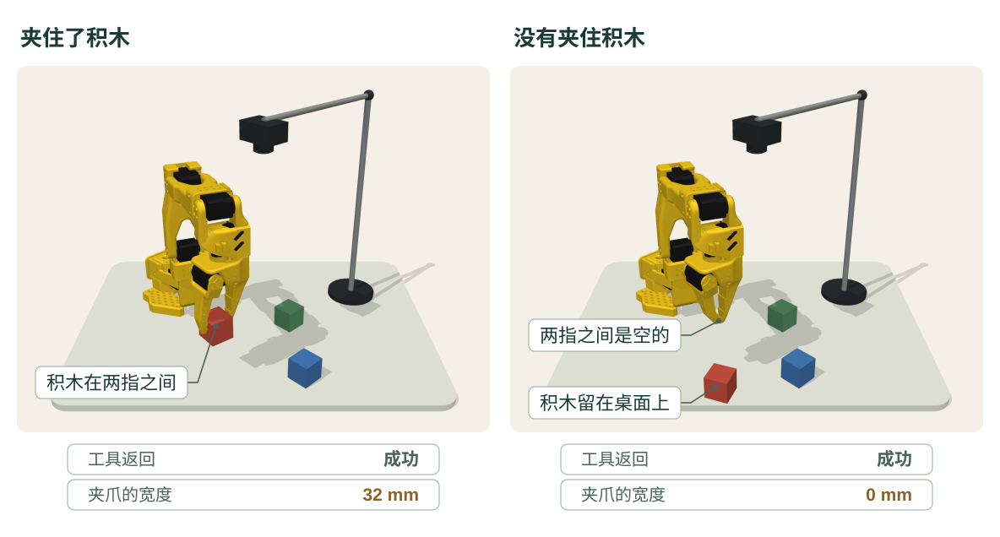
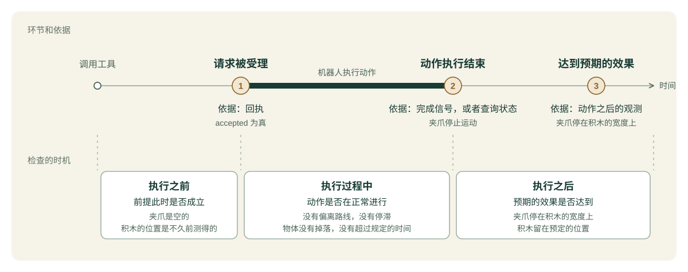
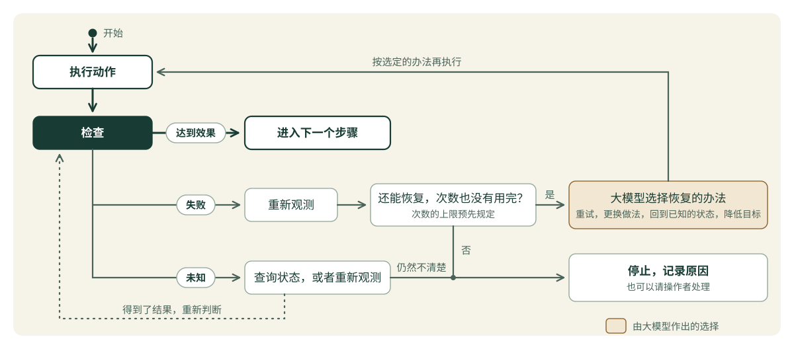

# 第 04 章 监控与恢复

大模型调用工具让机器人执行一个动作时，工具返回了成功，并不等于这个动作达到了目的。这是因为工具返回成功，常常只说明请求已经被受理，机器人随后才开始执行。即使动作做完了，效果也可能没有达到，例如夹爪按指令闭合了，物体却没有被夹住。有时工具甚至没有返回任何结果。

因此，要通过检查才能确认一个动作是否成功，而且检查的依据不能只是工具返回的内容，还要有另外的观测。检查动作执行的过程和结果，称为**监控**（monitoring）。结果无法确认时，要先把情况查清楚，再决定接下来怎么做。发现失败以后，在同一次任务里重新观测、重试或者更换做法，称为**恢复**（recovery）。恢复不能无限地进行下去，次数要有上限，到了上限就停下来。

本章先说明从调用工具到动作达到效果要经过哪几个环节，再介绍在什么时候检查、由谁来检查，然后讨论得不到结果时怎样处理，最后介绍失败以后怎样恢复，以及什么时候应当放弃。

## 4.1 受理、执行与效果

从调用工具到动作达到效果，中间有三个环节：请求被受理，动作执行结束，达到预期的效果。这三个环节先后发生，前一个完成并不保证后一个也能完成：请求被受理以后，机器人可能在中途停下；动作执行结束以后，也可能没有达到效果。因此，三个环节要分别确认。

以闭合夹爪去抓积木为例。大模型调用 `set_gripper`，门控检查通过，机械臂的控制程序接受了指令，这时请求被受理了。接着夹爪开始闭合，直到碰到积木或者完全合拢才停下，这时动作执行结束了。而闭合夹爪的目的是把积木夹住，积木确实被夹在两指之间，才算达到了效果。如果夹爪合拢时积木不在两指之间，动作同样会正常结束，但效果没有达到（图 4.1）。

图 4.1 夹爪闭合并抬起以后的两种情况。两幅画面里工具返回的内容相同，夹爪的宽度不同，要靠宽度的读数或者图像才能把它们区分开。画面由仿真软件 MuJoCo 生成，用作示意。

其他动作也是这样。把试管插进试管架时，夹爪已经到达孔的上方并且下降到位，试管仍可能卡在孔口，没有插到底。

对请求的答复称为**回执**（acknowledgement）。回执要说明请求有没有被受理，没有受理时还要给出原因。[2.2 节](./chapter-02.md#sec-2-2)的 `move_gripper` 就是这样规定的：`accepted` 一项说明调用是否被受理，没有被受理时，`reason` 一项给出原因。

这三个环节要靠不同的依据来确认（图 4.2 的上半部分）。请求是否被受理，要看回执；动作是否执行结束，要看接口给出的完成信号，或者查询动作的状态；效果是否达到，则要靠动作之后的观测，例如读取夹爪的宽度，或者再读取一次图像。

图 4.2 从调用工具到动作达到效果的时间线。上半部分是三个环节和确认它们的依据，粗线是机器人执行动作的时间。下半部分是三个时机的检查，在 [4.2 节](#sec-4-2)介绍。小字是闭合夹爪抓积木时的例子。

不同的接口报告这三个环节的方式并不一样，大致有三种情况。第一种，接口等动作结束才返回，回执和执行的结果一起给出，仿真环境里的机械臂多数是这样。第二种，接口立即返回回执和一个编号，机器人随后才开始执行，要用这个编号另外查询执行的状态。这是机器人软件里常见的做法。在广泛使用的开源机器人软件 ROS 2 里，动作（action）接口在请求被受理以后，执行过程中持续给出反馈，结束时再给出结果 [1]。第三种，接口立即返回回执，此后没有任何完成信号。例如有的机器人播放语音时，播放结束了也不发出通知，只能按语音的时长等待，或者查询播放的状态。

还要注意，请求没有被受理时，接口不一定明确地报告错误。有的接口把拒绝的原因放在返回内容的某一项里，其余各项看上去仍然正常。有的只在机器人的日志里留下记录，还有的不作任何表示，例如优先级较低的指令会被直接丢弃。因此，编写工具时要弄清楚接口可能返回的各种结果分别表示什么，并在调用契约里写明。如果回执不足以说明请求确实被受理了，就要再查询一次状态来确认。

上面三个环节针对的是一个步骤，也就是一次工具调用。即使各个步骤都达到了效果，任务也不一定成功。例如三块积木都叠了上去，每一次放置都达到了效果，但叠放的顺序和指令不一致。还有一种情况是指令本身没有说清楚，或者操作者中途改了主意，这时达到的效果未必合乎操作者的本意。大模型没有把握时，应当按 [3.4 节](./chapter-03.md#sec-3-4)的办法停下来提问，不能自行认定。任务是否成功，要按事先确定的标准，由智能体之外的检查来判定。这属于评估，[第 9 章](./chapter-09.md)专门介绍判定用的标准，以及判定的结果是否可靠。

## 4.2 检查的时机与办法

除了在动作结束以后确认效果，检查还可以放在执行之前和执行过程中。这三个时机检查的内容各不相同（图 4.2 的下半部分）。

执行之前，检查的是动作的前提此时是否成立。[2.3 节](./chapter-02.md#sec-2-3)的门控里，有的项目按固定的规则就能检查，例如目标位置是否在取值范围之内。有的要看了当前的状态才能判断，这里说的是后一类。例如去抓积木之前，夹爪应当是空的。又如把夹爪移向积木之前，积木的位置应当是不久前测得的。如果位置是一分钟以前测得的，中间积木又被碰过，按这个位置去抓就会落空。

执行过程中，检查的是动作是否在正常进行。需要发现的情况主要有：运动偏离了计划的路线，机械臂被挡住而停滞，夹着的物体掉落，执行的时间超过了规定。发现这些情况就让动作中途停下，不必等它做完。

及早发现可以节省时间。例如有一项仿真实验让人形机器人搬运箱子，箱子在途中有一定的概率掉落 [2]。一种做法是等搬运的动作结束以后再检查箱子是否还在，另一种做法是在搬运过程中每 0.2 秒检查一次。两种做法的成功率都是 96%，但前者平均用时 61.2 秒，后者只用 37.3 秒。这是因为箱子一掉落就被发现了，机器人不用走完余下的路程再回头去捡。

执行之后，检查的是预期的效果有没有达到。抓取时，闭合夹爪以后读取夹爪的宽度，便知道积木有没有被夹住。放置时，松开夹爪以后还要再读取一次图像，才能确认积木留在了预定的位置。

检查可以由代码来做，也可以交给大模型。由代码检查时，用的是传感器的读数，例如夹爪的宽度、关节的位置，以及夹爪与目标位置的偏差。这种检查很快，每次的结论也一致，但只能检查传感器能够测量的内容。交给大模型检查，则是让它根据图像来判断，可以由指挥机器人的大模型自己判断，也可以另外用一个模型。这种检查能够处理没有传感器可用的情况，例如判断积木是否放正，或者人形机器人教访客做动作时，访客是否跟着做了。可是它比较慢，判断也不一定可靠。

大模型根据图像作的判断并不总是可靠，可靠的程度可以测量 [3]。有一项测试让 13 个模型根据 2197 次机器人操作记录里的图像，判断每一次操作是否成功。成绩按成功和失败两类分别计算准确率再取平均，这样随意猜测也能得到 0.50。成绩最好的模型得到 0.77，在装配这类要看零件是否接触到位的任务上，没有一个模型超过 0.60。画面上的证据不明确时，模型还倾向于判断为成功。

因此，能用传感器读数检查的内容，应当先由代码检查。代码无法检查的内容再交给大模型判断，而且它的判断要当作有待核实的信息，重要的结论还要用别的观测来印证。

检查也不是越多越好，因为每检查一次都要花时间，交给大模型检查还要多调用一次。有一项仿真实验比较了两种安排 [4]：一种是每次夹爪动作以后都停下来让大模型检查，另一种是让大模型自己决定在哪些地方检查。在 50 次执行里，前者成功了 37 次，后者成功了 42 次。两者相差不大，但至少说明处处检查并没有带来好处。所以检查应当放在容易失败的地方，以及失败以后代价大的地方，例如抓取之后和松开夹爪之前。

此外，各种机器人能够提供的依据并不相同。桌面机械臂可以提供相机的图像和夹爪的读数。有的人形机器人只向应用开放了播放动作和语音的接口，应用读不到相机的图像和关节的读数。还有的任务，结果要靠机器人以外的观测才能确认，例如踢出去的球是否进入了目标区。所以设计检查时，先要弄清楚所用的机器人和任务提供了哪些观测。

## 4.3 超时与未知结果

调用工具以后，并不总是能够得到结果。如果接口一直没有返回，或者连接中途断开了，执行结果就只能算**未知**（unknown），既不能算成功，也不能算失败。相机没有给出图像时也是这样，因为没有新的观测，效果无从确认。

为了避免无限期地等待，要给每次调用设定时限。时限可以按动作预计的时长再加一些余量来定，例如计划 3 秒完成的移动，等到 5 秒还没有结束就算超时。超时并不等于失败。超时的时候，机器人可能已经执行完动作，只是结果没有传回来，也可能还在执行，或者根本没有开始。

结果未知时，要先查询动作的状态，或者重新观测，不能把同样的调用再发一次。在这一点上，机器人智能体和编写代码、处理文档的智能体不同。读取一个文件，读一次和读两次没有区别，所以没有得到结果时再读一次就可以了。而机器人的动作做两次，效果和做一次不一样：按钮多按了一次，机器人向前多走了一段，同一句话播放了两次。

有一个按按钮的任务可以说明这一点 [5]。这个仿真任务要求机器人按照卡片上的数字，把按钮按下相应的次数，多按一次任务便失败。起初，在 30 次执行里智能体成功了 23 次。失败的记录中，有几次是智能体先试按了一下，或者对某一次按压是否有效没有把握，又按了一次。后来加入一条技能，规定每一次下压都算作一次按压，不得重复，30 次执行便全部成功了。

如果查询和观测以后仍然不能确定，就不再继续这个步骤，让机器人回到一个已知的状态，或者交给操作者处理。尤其不能根据旧的观测继续行动。例如相机中断以后，画面仍然是中断之前的，按这幅画面去抓积木，和没有观察就行动是一样的。为此，要给每一次观测记下取得的时间，超过一定时间的观测不再作为决定的依据。

结果还可能迟到。Harness 等到超时，已经转去处理别的步骤，这时前一个动作的结果才传回来。如果把它当成当前步骤的结果，判断就错了。所以 Harness 要给每次调用编号，返回的结果带着同样的编号，才能知道它属于哪一次调用。

动作被打断以后，情况同样是未知的。[3.4 节](./chapter-03.md#sec-3-4)提到，操作者可以随时取消，别的指令来源也可能接管机器人。被打断的动作做到了什么程度，这时并不清楚，所以继续之前要先观测。

这一节的做法在机器人软件和一般的软件系统里已经用了很久 [1, 6]。在仿真环境里，大模型思考时仿真通常是暂停的，工具也总能返回结果，超时和结果未知的问题很少出现。到了真机上，这些问题都会遇到。

## 4.4 恢复与放弃

检查发现失败以后，要决定是恢复还是放弃。

恢复要从失败以后的状态开始。抓取落空时，积木可能已经被夹爪推到了别处。如果是叠放时出了问题，下面叠好的积木也可能被碰倒。所以恢复的第一步是重新观测，弄清楚物体现在的位置和夹爪里是否夹着物体，并确认已经完成的阶段的完成条件是否仍然满足。然后才能决定接下来怎么做。

恢复的办法有很多种，表 4.1 按代价从小到大列出了常用的几种。

表 4.1 失败以后的处理办法

| 办法 | 做什么 | 适用的情况 |
|---|---|---|
| 重新观测 | 再读取一次图像和状态 | 任何失败之后，以及结果未知时 |
| 重试 | 按新的观测再做一次同样的动作，参数可以调整 | 偶然的偏差，例如抓取的位置差了一点 |
| 更换做法 | 换一种抓取的姿态，或者换一个工具、一个策略 | 同样的动作连续失败 |
| 回到已知的状态 | 让机械臂回到起始位置，再重新执行这个阶段 | 当前的状态难以判断，或者动作被打断 |
| 降低目标 | 改为要求较低的目标，并如实报告 | 原来的目标无法达到，而完成一部分仍有价值 |
| 求助 | 停下来，请操作者处理或者给出指示 | 智能体无法判断，或者无法处理 |
| 放弃 | 停止任务，记录原因 | 失败无法恢复，或者恢复的次数已经用完 |

有的失败是无法恢复的，例如积木掉到了桌子下面，试管摔碎了，或者机器人摔倒了。遇到这样的情况，继续尝试没有意义，应当及时停下。

采用哪一种办法，通常交给大模型来选择，因为这要根据当时的情况判断。恢复的次数和范围则预先规定，由 Harness 来限制，例如同一个步骤最多重试两次。同样的动作连续失败以后，要更换做法或者停下来，不应当再照原样重试。检查之后的整个处理流程见图 4.3。

图 4.3 检查之后的处理流程。从左上角的“开始”读起，粗线是通常的路线。检查的结果有三种，各占一行。浅色的框是由大模型作出的选择，其余各框由 Harness 完成。虚线表示查询或者观测得到结果以后，回到检查重新判断。

检查加上重试，可以明显提高成功率。例如有一项真机实验让机械臂把三块积木叠完，其中两块事先已经叠好，动作里还有意加入了随机的偏差 [7]。大模型一开始就定好全部步骤、执行中得不到反馈时，10 次里只成功了 2 次。每次动作以后把识别到的物体和动作是否成功告诉大模型，再让它决定是否重做，10 次便全部成功。这里动作是否成功是由程序根据物体的位置来判断的。

另一方面，恢复如果没有单独的上限，代价很高。有一项仿真评测共执行了 6299 次 [4]，其中成功的 3405 次平均调用大模型 30.3 次，用时 11.5 分钟。其余的 2894 次一直在尝试恢复，直到预算用完，平均调用 67.6 次，用时 27.5 分钟。也就是说，没有成功的执行不到总数的一半，却占了大模型调用次数的 65.5%。所以除了 [3.3 节](./chapter-03.md#sec-3-3)说的任务预算，恢复本身也要有次数的上限。机器人软件里早有这样的做法，例如导航程序在恢复的次数用完以后便报告失败，这时还可以通知操作者来处理 [8]。

任务确实无法完成时，应当及时停下来并说明原因。能够正确地停下来，也是对机器人智能体的一项要求。不过，停止本身也是一个动作，各种机器人的情况并不相同。机械臂停止以后会保持当时的姿态，而双足机器人的电机一旦卸力，机身就失去了支撑，不能用同样的办法停止。因此，要为每一种机器人规定停止的做法，并且像其他动作一样确认它是否完成。停下以后，再按 [3.4 节](./chapter-03.md#sec-3-4)的要求记录结束的原因。

## 小结

本章介绍了怎样确认动作是否成功，以及失败以后怎样处理。从调用工具到动作达到效果，要区分请求被受理、动作执行结束和达到预期的效果这三个环节，它们分别要靠回执、完成信号和动作之后的观测来确认。检查可以放在执行之前、执行过程中和执行之后，能用传感器读数检查的内容先由代码检查。得不到结果时按未知处理，先查询或者观测，不重发调用。失败以后从当前的状态出发恢复，恢复的次数要有上限，无法完成的任务则及时停止。

恢复只在当前这次任务里起作用。执行中得到的信息，例如物体的位置和失败过的做法，如果不保存下来，后面的步骤和以后的任务都用不上。[下一章](./chapter-05.md)介绍怎样保存和使用这些信息。

## 参考文献

1. ROS 2 设计文档. [Actions](https://design.ros2.org/articles/actions.html).
2. Guo Y, Wang Y-J, Zha L, Chen J. [DoReMi: Grounding Language Model by Detecting and Recovering from Plan-Execution Misalignment](https://arxiv.org/abs/2307.00329). IROS 2024. arXiv:2307.00329.
3. Navasardyan Z, Danielyan T, Davtyan H. [FailBench: How Reliable are VLMs at Judging Robot Task Success?](https://arxiv.org/abs/2609.03611). arXiv:2609.03611, 2026.
4. Wang C, Shi Y, Xu S, 等. [Auriga Technical Report: A Task-Agnostic Agent Harness for Zero-Shot Embodied Manipulation](https://arxiv.org/abs/2611.01112). arXiv:2611.01112, 2026.
5. Gao H, Zeng J, Zhou A, 等. [HexaShell: A Universal Harness for Robot Coding Agents in Simulation and the Real World](https://arxiv.org/abs/2610.23479). arXiv:2610.23479, 2026.
6. Amazon Builders' Library. [超时、重试和抖动回退](https://aws.amazon.com/cn/builders-library/timeouts-retries-and-backoff-with-jitter/).
7. Huang W, Xia F, Xiao T, 等. [Inner Monologue: Embodied Reasoning through Planning with Language Models](https://arxiv.org/abs/2207.05608). CoRL 2022. arXiv:2207.05608.
8. Nav2 文档. [Navigation Servers](https://docs.nav2.org/rolling/getting_started/navigation_concepts/navigation_servers/)，[Detailed Behavior Tree Walkthrough](https://docs.nav2.org/rolling/getting_started/nav2_behavior_trees/detailed_behavior_tree_walkthrough/detailed_behavior_tree_walkthrough/).
