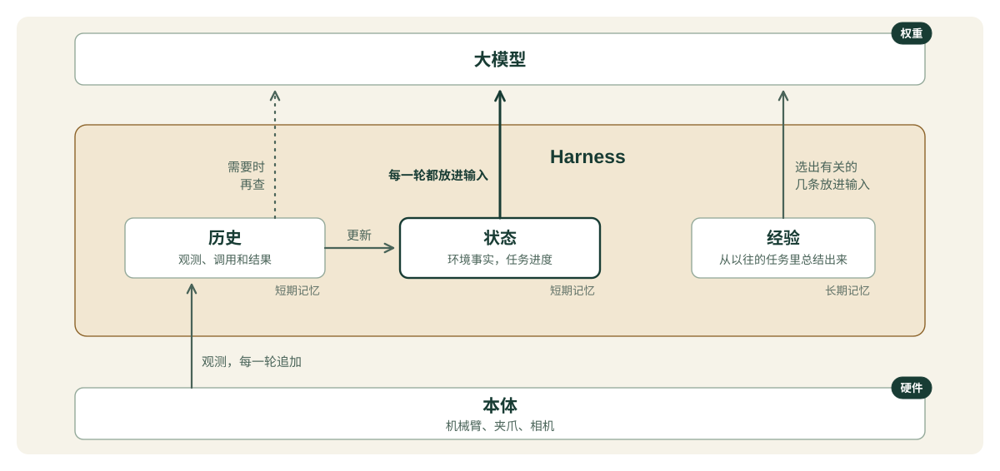
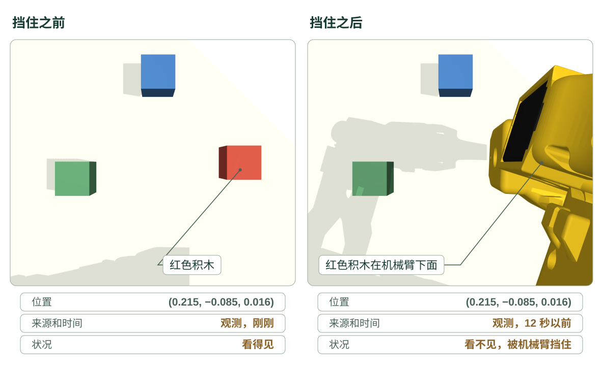
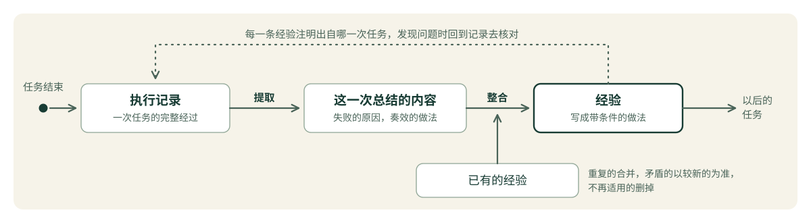

# 第 05 章 记忆

机器人智能体完成一个任务，要经过很多轮循环，每一轮都要调用一次大模型。大模型本身并不记得之前的输入和输出，它每次做决定，依据的只有当时输入给它的文字和图像。而做决定所需要的信息，又常常不在当前这一轮的观测里。例如物体被机械臂挡住以后，相机拍不到它，它的位置只能靠挡住之前的观测来确定。又如某个阶段有没有完成，要看前面检查的结论。要知道上一次任务为什么失败，也只能查当时的记录。因此，Harness 要把这些信息保存下来，在以后各轮放进大模型的输入。保存下来供以后使用的信息，称为**记忆**（memory）。

不过，记忆里的内容都是过去得到的，而环境会变。物体可能已经被挪动过，这时按记忆里的位置去找，就会落空。要判断一条内容现在是否还能使用，得知道它是什么时候、怎样得到的。所以保存时要把来源和时间一并记下，使用之前先判断它是否仍然成立。此外，输入的内容太多，大模型反而更容易出错，所以保存和输入的内容都要经过选择。

本章先介绍记忆包括哪些内容，再说明怎样判断记下的内容是否还能使用，然后讨论怎样更新记忆、每一轮把哪些内容放进输入，最后介绍怎样把一次任务的经过整理成以后可以使用的经验。

<a id="sec-5-1"></a>

## 5.1 记忆内容

本教程把记忆的内容分为历史、状态和经验三种。**历史**（history）是按时间顺序记下的经过，包括每一轮的观测、大模型调用的工具和返回的结果。**状态**（state）是对当前情况的概括，包括环境事实和任务进度两部分。环境事实指场景里的物体以及它们的位置和状况。任务进度在 [3.1 节](./chapter-03.md#sec-3-1)介绍过，记的是各个阶段的完成情况。**经验**（experience）是从以往的任务中总结出来、留给以后的任务使用的内容，例如“这种积木表面光滑，夹爪要闭合得紧一些”。

历史和状态只在一次任务之内使用，经验则要留到以后的任务里使用。在介绍智能体的资料里，前两种常称为短期记忆，后一种常称为长期记忆。这类资料里还有一种分法，把长期记忆再分成三种：语义记忆（semantic memory）记的是关于环境的事实，情景记忆（episodic memory）记的是以往的经历，程序性记忆（procedural memory）记的是做事的办法 [1]。按这种分法，以往任务的执行记录属于情景记忆，从中总结出来的经验大致属于语义记忆，[第 7 章](./chapter-07.md)的技能则属于程序性记忆。图 5.1 画出了历史、状态和经验这三种内容和它们的去向。

<p align="center"></p>

图 5.1 记忆的三种内容。历史、状态和经验都由 Harness 保存，方框下面的小字标出每一种属于短期记忆还是长期记忆。粗箭头表示状态每一轮都放进大模型的输入，虚线表示历史只在需要时查询。大模型、Harness 和本体的画法与图 1.3 相同。

最简单的做法是只保留历史，每一轮都把到目前为止的全部经过放进输入。可是历史越来越长，大模型每次都要从头读起，才能推算出现在的情况，花费的时间和费用也随之增加。而且内容多了以后，大模型反而容易出错。有一项仿真实验用一组要靠记忆才能完成的任务比较了两种输入 [2]：一种是文字形式的历史加上当前的图像，另一种在此之外把以前的图像也尽量加进去。结果，后一种的输入量是前一种的 4.9 倍，任务的成功率却从 36.6% 降到了 26.2%。

因此，除了历史，还要专门维护一份状态。以叠积木为例，环境事实包括三块积木各自的位置和夹爪是否夹着积木，任务进度则记录哪几块已经叠好。有了这份状态，大模型不用从头读一遍历史，就知道现在的情况。

有些情况从画面上看不出来，更需要记在状态里。有一项仿真实验设置了三类任务 [3]，每次执行都要依次完成一连串指令，后面的指令要用到前面各步的信息。其中两类涉及画面上看不出来的属性：一类是积木的轻重，由操作者在指令里告知；另一类是人为规定的干净和脏，干净的积木碰到脏的也会变脏。只把历史输入大模型时，三类任务各执行 20 次，没有一次正确完成全部指令。另外维护一份状态，并在每次动作以后更新，三类任务的成功率便分别达到 50%、40% 和 55%。

状态里的不少内容可以由 Harness 用代码来维护。例如 Harness 把 `locate` 返回的位置记进状态，在阶段的完成条件检查通过以后更新进度。这些内容不需要大模型来判断，用代码维护既快又稳定。需要理解和概括的工作，例如从一次失败里总结经验，才交给大模型。

需要记住的并不限于物体。例如人形机器人教访客做一个动作时，要记住这位访客是否同意参加，已经教到了哪个阶段，重新示范过几次。机器人自己的情况也在其中，例如它是否站立着，是否正在播放语音。另外，和人有关的信息，例如面貌、声音和姓名，要先向对方说明并取得同意才能保存，保存多久也要预先规定。

<a id="sec-5-2"></a>

## 5.2 来源与时效

状态里的每一条内容，都是在过去某个时刻用某种方式得到的。判断它现在是否还能使用，要看它是在什么时候、用什么方式得到的。所以记录一条环境事实时，除了内容本身，还要记下来源、时间和成立的条件。下面是一条完整的记录，记的是一块被机械臂挡住的红色积木，最后一项是它目前的状况。

```text
对象  红色积木
内容  位置 (0.215, -0.085, 0.016)，单位是米，坐标系与 move_gripper 相同
来源  观测。由 locate 根据相机图像计算得到
时间  14:02:31
条件  场景没有被重新摆放
状况  现在看不见，被机械臂挡住
```

**来源。** 一条内容的来源有三种：直接观测到的，根据动作推断的，以及别人告知的。三种里直接观测到的最可靠，推断和告知的都有待确认。例如把红色积木放到绿色积木上以后，如果没有再观测，红色积木的新位置就是根据动作推断出来的。[4.1 节](./chapter-04.md#sec-4-1)说明过，机器人的动作执行结束并不等于达到了预期的效果，所以这样的位置只能算推断，等重新观测确认以后，来源才能改为观测。操作者说“蓝色积木在盒子里”，属于告知，同样有待确认。

**时间和条件。** 时间记的是取得这条内容的时刻。使用时用当前的时刻减去它，便知道这条内容是多久以前取得的。这个差值不用保存，每次使用时由 Harness 计算。条件说明它在什么情况下成立，例如位置是在哪个坐标系里测得的，场景有没有被重新摆放过。条件变了，这条内容便不能直接使用。

**状况。** 这一项说明物体现在是否看得见。看不见并不等于不在。例如机械臂伸到红色积木上方以后，桌子上方的相机拍不到这块积木，可是它并没有离开，记下的位置仍然是被挡住之前测得的。如果因为图像里没有它，就认为桌上没有红色积木，后面的步骤便会出错。图 5.2 画出了积木被挡住前后相机拍到的画面，以及这条记录的变化。

<p align="center"></p>

图 5.2 红色积木被机械臂挡住之前和之后。两幅都是桌子上方的相机拍到的画面，下面是记忆里关于红色积木的记录，时间一项写的是距上一次观测过了多久。被挡住以后，位置和来源都没有变，状况变了，距上一次观测也已经过去 12 秒。画面由仿真软件 MuJoCo 生成，用作示意。

环境变了，记下的内容便不再和现实相符，这称为**过时**（stale）。一条内容可以使用多长时间，称为它的时效。不同的对象过时的快慢相差很大。桌上的积木只要没有人碰，位置可以一直使用，而传送带上的物体不到一秒就移到了别处。踢出去的球和走动的访客也是这样，位置只在很短的时间里有效。此外，机器人自己移动以后，原先相对于它测得的位置同样不能直接使用。因此，时效要按对象分别规定：静止物体的位置可以长时间沿用，运动的物体只用最新的观测，超过了时效就重新观测。

机器人软件里常见的做法是给信息带上时间，超过时效便不再使用。例如在 ROS 2 中，各个坐标系之间的换算关系都带着时间，默认只保留最近 10 秒的数据 [4]。如果查询的时刻超出了已有数据的时间范围，程序便报错，不会用旧的数据代替。不过，有的机器人接口返回的观测不带时间，这时 Harness 要在收到观测时自己记下时间。

在真机上，沿用过时内容的代价很明显。有一项实验让移动机器人在房间里按要求找到并拿取物品，其间有人会挪动这些物品 [5]。一种系统在开始时建好地图，以后不再更新，成功率是 30%，有 53.3% 的尝试因为找不到被挪动的物品而失败。另一种系统在运行中不断把新看到的内容加进地图，并删掉已经不在原处的内容，成功率是 70%，这类失败只占 6.7%。

<a id="sec-5-3"></a>

## 5.3 更新与检索

状态要随着观测不断更新，原则是以新的观测为准，记下的内容和它不一致时就需要修改。也就是说，记下的内容只能当作参考。按记下的位置去抓积木之前，如果能够重新观测，就先观测一次，确认积木还在那里。编写代码、处理文档的智能体也遵循同样的原则，有的开发文档写明：记忆可能会过时，只应当作参考，要以当前的环境为准 [6]。不这样做，过时的内容就会引出错误的动作。[5.1 节](#sec-5-1)中提到的仿真实验分析了智能体的 400 次失败 [2]，其中 61.3% 的起因是智能体所依据的记忆已经和它后来经历的情况相矛盾，例如物品已经换了地方，它仍然到原来的位置去找。

除了逐条更新，有些情况下还要把状态整个清除，或者重新确认一遍。常见的有：场景被复位或者重新摆放，开始了另一个任务，机器人移动到了别处，操作者中途介入过，以及任务停顿了较长的时间。为此，每一条内容都要有明确的适用范围，说明它属于哪一次任务、哪一个场景，超出了范围便不再使用。

任务进度同样需要更新。[3.1 节](./chapter-03.md#sec-3-1)提到，已经完成的阶段可能失效，所以重试一个步骤以后，要重新检查先前各阶段的完成条件是否仍然满足。例如整理桌面时，重新摆放一件物品，可能会碰乱已经摆好的另一件。

记忆保存下来以后，每一轮还要从中取出用得到的内容，放进大模型的输入，这称为**检索**（retrieval）。当前的状态和少量与任务有关的经验，每一轮都要用到，应当每次都放进去。这部分内容要尽量简短，经验也只挑和当前任务有关的几条，因为 [5.1 节](#sec-5-1)已经说明输入的内容不宜多。较早的历史、以前的图像和其余的经验多数时候用不到，可以提供一个查询的工具，大模型需要时再调用。编写代码、处理文档的智能体也是这样安排的：开始时只把一份简短的摘要放进输入，细节到任务需要时才去查 [6]。

按需查询要有查找的依据，常用的是相关程度，也就是看哪几条的意思和当前的情况最接近。有的系统把新近程度和重要程度也算进去，三项合成一个分数，分数高的先放进输入 [7]。机器人的记忆带着位置和时间，所以还可以按这两项来查，例如查某个位置附近记下过什么，或者某个时刻前后发生了什么。有的系统就为大模型提供了三个查询工具，分别按文字、位置和时间查找 [8]。

检索到的内容同样是过去记下的，使用之前仍然要按 [5.2 节](#sec-5-2)的办法判断它是否还成立。查不到的时候，要明确地报告没有查到。按相关程度查找总能返回最接近的一条，可是这一条未必就是要找的，所以相关程度不够时应当返回“没有找到”，不用最接近的一条代替 [5]。

<a id="sec-5-4"></a>

## 5.4 日志与记忆

任务执行的全部经过要完整地记录下来，包括每一次观测、每一次工具调用和它的回执、检查的结论，以及任务结束的原因。这份记录称为**执行记录**，也常称为日志（log）。它的内容和 [5.1 节](#sec-5-1)说的历史相近，不过历史只用在任务进行当中，执行记录则要在任务结束以后长期保留。执行记录供人查看和事后分析，要求完整，不直接放进大模型的输入。记忆则供大模型以后做决定时使用，要求简短而且有用。因此，执行记录里有用的内容要整理成经验，以后的任务才用得上。

整理经验分为两步。第一步是提取，从这一次的执行记录里总结出值得记下的内容，例如失败的原因和后来奏效的做法。第二步是整合，把新总结的内容和已有的经验放在一起，重复的合并，互相矛盾的以较新的为准，已经不适用的删掉。这两步可以交给大模型在任务结束以后完成，也可以由人来做（图 5.3）。

<p align="center"></p>

图 5.3 从执行记录到经验。任务结束以后先提取，再整合。虚线表示每一条经验都注明出处，发现问题时可以回到执行记录去核对。

大模型总结的经验可以明显提高任务的成功率。例如有一项仿真实验让大模型在每次任务以后，根据执行的经过和结果改写一份用文字写成的经验 [9]。经验改写了若干次以后固定下来，再换到没有用过的场景上测试。在 510 次测试中，不带这份经验时成功率是 46.7%，带上以后是 81.7%。

不过，大模型总结的经验也会出问题，常见的有两种。一种是把某个场景里的具体数值当成了经验。这项实验有 93 次失败，其中 41 次有相当一部分动作落在了经验里记下的坐标附近 [9]。另一种是把偶然的情况当成了规律。例如在把笔插进笔筒的任务里，有几次成功恰好是在最后微调笔的位置时判定的，大模型便在经验里建议做这样的微调。带着这份经验测试，20 次里成功了 5 次，只比不带经验时的 15% 略高。

所以，经验要写成带条件的做法，说明在什么情况下怎样做，不要记某个场景里的坐标。使用时，经验和状态一样只能当作参考，要对照当前的观测来确认。每一条经验还要注明它出自哪一次任务，这样发现它有问题时，可以回到当时的执行记录去核对。

经验里如果有一套多步的做法，可以进一步整理成技能，供以后直接调用，[第 7 章](./chapter-07.md)介绍怎样整理。[第 8 章](./chapter-08.md)介绍怎样通过评估判断一条经验是否确实有用、是否值得保留。

## 小结

本章介绍了 Harness 怎样为大模型保存和提供信息。记忆的内容分为历史、状态和经验三种。只保留历史是不够的，还要维护一份状态，概括当前的情况。每一条环境事实都要带上来源、时间和成立的条件，不同的对象时效不同，过时的内容要重新观测。更新时以新的观测为准。每一轮放进输入的内容要简短，而且和当前的任务有关，其余的内容按需查询，查不到时如实报告。执行记录要完整地保留，其中有用的内容经过提取和整合成为经验，写成带条件的做法。

有了记忆，大模型每次做决定时便知道当前的情况。可是它做一次决定要花几秒，机器人和环境在这几秒里并不会停下来等它。[下一章](./chapter-06.md)介绍运行得快的程序和策略怎样与运行得慢的大模型配合。

## 参考文献

1. Sumers T R, Yao S, Narasimhan K, 等. [Cognitive Architectures for Language Agents](https://arxiv.org/abs/2309.02427). Transactions on Machine Learning Research, 2024. arXiv:2309.02427.
2. Liang L, Zhong X, Pan M, 等. [EmbodiedMemory-Bench: Benchmarking Embodied Memory for Long-Horizon Embodied Tasks](https://arxiv.org/abs/2609.28236). arXiv:2609.28236, 2026.
3. Yoneda T, Fang J, Li P, 等. [Statler: State-Maintaining Language Models for Embodied Reasoning](https://arxiv.org/abs/2306.17840). ICRA 2024. arXiv:2306.17840.
4. ROS 2 文档. [Using time (C++)](https://docs.ros.org/en/jazzy/Tutorials/Intermediate/Tf2/Learning-About-Tf2-And-Time-Cpp.html)，tf2 教程.
5. Liu P, Guo Z, Warke M, 等. [DynaMem: Online Dynamic Spatio-Semantic Memory for Open World Mobile Manipulation](https://arxiv.org/abs/2411.04999). arXiv:2411.04999, 2024.
6. OpenAI Agents SDK 文档. [智能体记忆](https://openai.github.io/openai-agents-python/zh/sandbox/memory/).
7. Park J S, O'Brien J C, Cai C J, 等. [Generative Agents: Interactive Simulacra of Human Behavior](https://arxiv.org/abs/2304.03442). UIST 2023. arXiv:2304.03442.
8. Anwar A, Welsh J, Biswas J, 等. [ReMEmbR: Building and Reasoning Over Long-Horizon Spatio-Temporal Memory for Robot Navigation](https://arxiv.org/abs/2409.13682). arXiv:2409.13682, 2024.
9. Yao Y, Zou Y, Gao X, 等. [Review the Episodes, Refine the Lessons: Simple Memory Evolution for Embodied Agents](https://arxiv.org/abs/2611.11509). arXiv:2611.11509, 2026.
