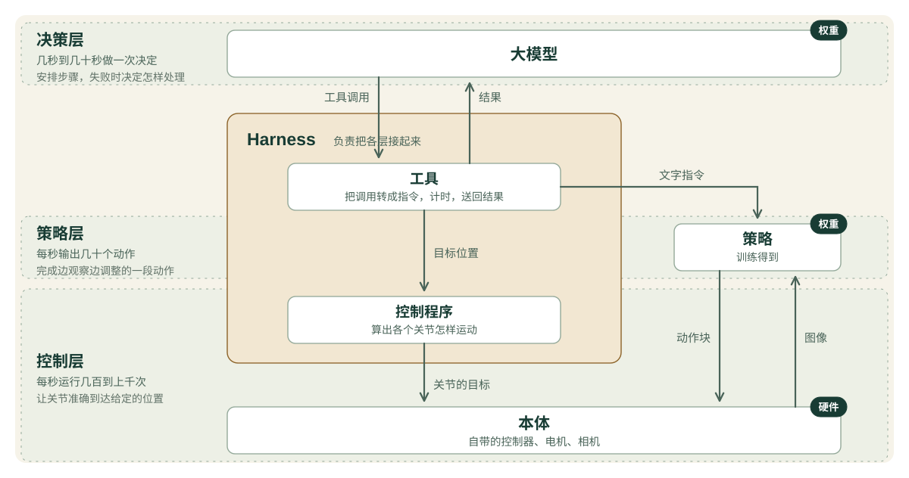
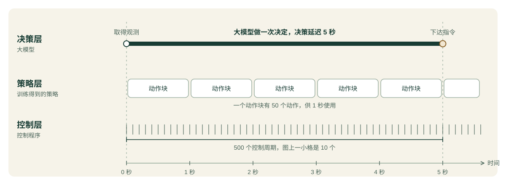
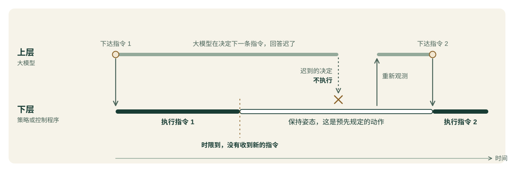

# 第 06 章 分层系统

大模型每做一次决定，要花几秒到几十秒。机器人的电机却要不断地接收指令，每秒少则几十次，多则上千次。两者相差成百上千倍，所以大模型没有办法直接控制电机。

直接控制电机的是运行得更快的部分，也就是前面几章提到的控制程序和训练得到的策略。大模型向它们下达指令，由它们去驱动电机。大模型思考的时候它们仍然在运行，机器人才不至于失去控制。这样的系统分成快慢不同的几层，称为**分层系统**（layered system）。下达指令的一层称为上层，接受指令的一层称为下层，所以慢的在上，快的在下。

分了层，就要预先规定各层之间怎样衔接，例如上层下达的一条指令可以执行多久，上层没有按时给出新的指令时下层怎样处理。

本章先介绍系统分为哪几层、各层负责什么，再说明各层在时间上怎样配合，然后讨论大模型调用训练得到的策略时要规定哪些内容，最后介绍层与层之间出现异常时怎样处理。

<a id="sec-6-1"></a>

## 6.1 层次与职责

机器人智能体通常按运行的频率分为三层。

本教程把最上面的一层称为**决策层**，也就是大模型；中间一层称为**策略层**，也就是训练得到的策略；最下面一层称为**控制层**，包括 Harness 里的控制程序和机器人自带的控制器。图 6.1 画出了这三层，左侧标着各层运行的频率和负责的工作。

<p align="center"></p>

图 6.1 机器人智能体的三层。三条浅色的横带表示三层。工具向下有两条路，一条通向 Harness 里的控制程序，另一条通向框外的策略。大模型、Harness 和本体的画法与图 1.3 相同。

以叠积木为例。大模型决定先抓哪一块积木、放到什么地方，这是决策层的工作。[2.1 节](./chapter-02.md#sec-2-1)的 `move_gripper` 收到目标位置以后，控制程序算出各个关节怎样运动，再驱动电机完成这段运动，这是控制层的工作。如果要抓的是形状不规则的物体，就要一边观察一边调整夹爪，这样的动作很难写成程序，可以交给一个训练得到的抓取策略。这个抓取策略便属于策略层。

这三层不一定都有。有一类机器人智能体只有决策层和控制层，大模型直接调用控制程序，中间没有训练得到的策略 [1]，前面几章用 `move_gripper` 的例子也是这种结构。只有当一段动作很难写成程序时，才需要策略层，例如 [1.3 节](./chapter-01.md#sec-1-3)提到的把插头对准插孔的动作。

层数也不是越多越好。每多一层，就多一处衔接，也多一处可能出错的地方。介绍智能体的资料大多建议先用最简单的结构，确有需要时再增加 [2]。机器人智能体也是这样，任务需要安排多个步骤时，决策层才有用处。有一项仿真实验用同一个策略比较了两种做法 [3]。一种让策略独自完成任务，另一种在它上面加一个大模型，大模型把任务拆成若干条指令，逐条交给策略。在步骤少的任务上，两种做法的成功率几乎相同，都在 70% 左右。在步骤较多的任务上，前一种是 25%，后一种是 41%。

介绍机器人的资料里还有别的叫法。有的把上层称为“大脑”，把下层称为“小脑”。例如在工业和信息化部 2023 年的一份指导意见里，“大脑”指基于大模型的环境感知、行为控制和人机交互，“小脑”指对机器人运动的控制 [4]。也有的把慢的一层称为慢系统（System 2），把快的一层称为快系统（System 1）。这两种原来都是两层的分法。前一种没有说明训练得到的策略归哪一层，后一种的快系统通常指的就是策略，没有包括控制程序。近来也有资料在快系统下面加上 System 0，指本体的实时控制，这样就分成了三层 [5]。这种分法和本教程的三层大体对应，只是各层包括的内容不完全相同：在这种分法里，System 2 包括大模型和 Harness，感知和运动规划的模块归 System 1；在本教程里，感知的工具属于 Harness，运动规划和逆运动学一起算在控制层。本教程用决策层、策略层和控制层这三个名称，不采用这些叫法。

相邻的两层之间，上层向下层下达指令，下层向上层返回结果。决策层通过工具调用下达指令，指令里要写明目标、允许的活动范围和最长的执行时间。下层返回的是执行的结果，例如是否到达、停在了什么位置，并不返回执行的全部经过。Harness 负责把大模型的调用转成下层的指令，为指令计时，再把结果送回大模型。图 6.1 中的箭头标出了各层之间传递的内容。

按快慢来分层，是机器人智能体和其他智能体的不同之处。编写代码、处理文档的智能体也有分层的做法，常见的一种是由一个主智能体把任务拆开，分给几个子智能体去做，再汇总它们的结果。这样分层，是为了让每个智能体只处理和自己的任务有关的内容。在这种系统里，各层都是大模型，快慢相同，主智能体通常等子智能体做完了再继续 [6]。机器人智能体分层，则是因为各层快慢不同，下层要一直运行，不能停下来等上层。

<a id="sec-6-2"></a>

## 6.2 时间尺度

各层快慢不同，也就是时间尺度不同，相差多少可以用两个量来说明。大模型从取得观测到给出决定所用的时间，称为**决策延迟**（decision latency）。下层每秒发出指令的次数称为**控制频率**（control frequency），相邻两次指令之间的间隔称为控制周期（control period）。决策延迟比控制周期长得多。假设大模型的决策延迟是 5 秒，控制程序的控制频率是每秒 100 次，也就是控制周期为 0.01 秒，那么大模型做一次决定的时间里，控制程序已经运行了 500 个周期。在这 5 秒里，环境也可能发生变化。叠积木时，桌上的积木不会自己移动，5 秒以前测得的位置仍然可以使用。如果物体在传送带上，传送带每秒前进 5 厘米，那么大模型看到物体以后用 5 秒作出决定时，物体已经前进了 25 厘米，按原来的位置去抓就会抓空。

这个例子说明，大模型做决定时依据的观测，到动作开始时已经不是最新的，其间经过的时间至少等于决策延迟。[5.2 节](./chapter-05.md#sec-5-2)已经说明，不同的对象时效不同。如果决策延迟超过了对象的时效，这样的决定便不能直接执行。这时要把大模型来不及处理的部分交给下层：大模型只决定抓哪一个物体，下层用最新的观测跟踪这个物体的位置，并完成抓取。

物体移动时，这样分工的好处最明显。有一项真机实验比较了两种做法 [7]。一种是让一个有 70 亿参数的模型直接输出动作，每秒大约 4 次。另一种是让这个模型隔几步才运行一次，另外用一个小的策略根据最新的图像输出动作，每秒大约 10 次。物体静止不动时，两种做法的成功率相近，分别是 71.3% 和 70.0%。物体以每秒 1 厘米的速度移动时，前一种的成功率是 48%，后一种是 75%。

还要注意，目前发表的实验结果多数没有计入决策延迟。[3.3 节](./chapter-03.md#sec-3-3)已经说明，仿真里通常在大模型思考时让仿真暂停，这时决策延迟再长也不影响成功率，而真实的场景不会这样等待。仿真暂停和不暂停，结果可能相差很大。在一组城市街道的导航仿真里，大模型指挥仿真里的角色按路线行走，路上有行人和车辆 [8]。在同样的路线上，仿真暂停和不暂停时到达终点的比例相近，分别是 91% 和 94%，平均每次任务的碰撞次数却从 3 次增加到 41 次，其中多数发生在大模型思考的时候。所以，同一套系统用到真机上，或者用到不暂停的仿真里，成功率要重新测量。

让大模型多推理，也并不总是有益。不少大模型可以调节每次决定的推理量。推理得多，决定通常好一些，花的时间也长，而环境不暂停的时候，多花的时间会增加风险。在同一组仿真里，把推理量从默认的一档调高以后，到达终点的比例几乎没有变化，每次任务里的碰撞却从 41 次增加到 62 次 [8]。所以推理量要按任务允许的时间来定。

大模型两次决定之间，下层执行的是上一条指令。本教程把一条指令从下达时起可以执行的时间称为它的**有效期**。有效期定得长，大模型决定的次数就少，可是环境变了以后，要等很久才能换一条指令。有效期定得短，系统反应快，但大模型做决定的次数增多，耗费的时间和费用也随之增加。已有的系统大多取 1 秒到 8 秒，短的每过 1 秒就让上层重新做一次决定 [9]，长的取 4 到 8 秒 [3]。有效期应当由规则来定，因为 [3.4 节](./chapter-03.md#sec-3-4)已经说明，让大模型自己估计一条指令该执行多久，效果最差。

有效期规定的是一条指令预定执行多久。另有一种规定是限定一次调用最多执行多久：不论动作是否完成，到了规定的步数或者时间就停下。本教程把它称为**执行上限**。例如规定每次运动最多执行 20 个控制周期，大约 0.8 秒，没有走完的部分丢弃，重新观测以后再让大模型决定 [1]。在一组仿真任务上，加上这条规定以后，评测的得分从 34.7 提高到了 38.0。

在机器人软件里，给指令规定有效期是通常的做法。有的把有效期写进指令，例如一种四足机器人的接口规定，每条运动指令都必须带上结束的时间，以防指令不受控制地一直执行下去 [10]。有的由接收指令的一方设定时限，超过时限没有收到新的指令，就不再执行旧的指令。表 6.1 列出了几种开源的机器人软件和一种机械臂接口里的时限。可以看到，越靠近电机的一层，时限越短。

表 6.1 接收指令的一方设定的时限（2026 年 11 月各文档中的默认值）

| 接收指令的一方 | 时限 |
|---|---|
| 一种机械臂的实时接口，每秒通信 1000 次 [11] | 连续 20 次没有按时收到指令，约 20 毫秒 |
| 机械臂的伺服控制软件 MoveIt Servo [12] | 0.1 秒 |
| ros2_control 里轮式底盘的速度控制器 [13] | 0.5 秒 |
| LeRobot 里运行策略的程序，动作用完以后 [14] | 1 秒 |

策略层和控制层之间也有快慢不同的问题，因为策略计算一次同样需要时间。例如一个策略计算一次要 76 毫秒，加上传输是一百多毫秒，而控制周期只有 20 毫秒 [15]。也就是说，策略计算一次的时间里，控制层已经运行了五到七个周期。因此，这类策略一次输出一连串动作，称为**动作块**（action chunk）。例如一次输出 50 个动作，供接下来的 1 秒使用。下一个动作块要在这一个用完之前算好。如果等新的动作块算完才继续执行，机器人每执行完一个动作块就要停下来等待，延迟越大，表现越差。解决的办法是让机器人在计算期间继续执行当前的动作块，并处理好新旧两个动作块的衔接，这样额外增加 0.2 秒的延迟也不影响表现 [15]。第三部分“改权重”介绍怎样训练和使用这样的策略。

按前面例子里的数字，大模型做一次决定要 5 秒，在这 5 秒里，策略层要输出 5 个动作块，控制层要运行 500 个周期（图 6.2）。

<p align="center"></p>

图 6.2 大模型做一次决定的时间里各层的运行情况。图中的数字取自正文的例子：决策延迟是 5 秒，控制频率是每秒 100 次，一个动作块供 1 秒使用。在这 5 秒里，策略层和控制层执行的是上一条指令。

<a id="sec-6-3"></a>

## 6.3 策略作为工具

决策层调用策略层，同样是通过工具：把训练得到的策略包装成一个工具，由大模型来调用。这样的工具，调用契约要比 [2.2 节](./chapter-02.md#sec-2-2)的 `move_gripper` 多写三方面的内容：策略自己读取的输入，适用范围，以及结束条件。[3.4 节](./chapter-03.md#sec-3-4)已经介绍过怎样把一段动作交给策略、策略什么时候返回，这里只讨论契约。

**输入。** 调用 `move_gripper` 时，目标位置写在参数里。调用策略时，参数通常只是一句文字指令，例如“抓起红色积木”。相机图像和关节的状态并不经过大模型，策略在每个控制周期自己读取。所以契约里要写明策略使用哪几个相机，以及指令要怎样表述策略才能理解。

**适用范围。** 策略只在和训练数据相近的情况下可靠。只要有一项条件超出了训练时见过的范围，策略就可能失败。这些条件包括物体的种类、光照、相机的位置，以及开始时机械臂和物体的相对位置。例如有一个让双足机器人踢球的策略，训练时球都放在脚前，球不在脚前时调用它，能否踢到就没有保证。策略的适用范围要通过测试得到，再写进契约，从策略本身是看不出来的。[2.3 节](./chapter-02.md#sec-2-3)介绍的门控可以在调用之前检查其中能用代码判断的条件。

加上策略，结果并不总是更好。有一项仿真实验比较了两种做法 [16]：一种是大模型直接给出动作，另一种是先让一个策略给出动作，大模型审查以后采用或者修改。在一组任务上，带策略的做法 50 次里成功了 24 次，不带的成功了 13 次。在另一组任务上却是不带策略的略好，50 次里成功了 49 次，带策略的是 46 次。这组结果表明，策略能否起作用，取决于它学到的动作和任务是否相符。

**结束条件。** 多数策略没有表示完成的输出，只要不停止它，它就会一直输出动作。所以调用它的一方要规定结束条件，通常包括执行上限和停止条件。执行上限规定最多执行多少个动作块，或者多长时间。停止条件是指令要求的动作已经完成，由代码或者另一个模型来判断。[3.4 节](./chapter-03.md#sec-3-4)的实验已经说明，检测到完成以后再返回，比按固定的时间返回效果好。执行上限则保证检查失灵时策略也会停下。

这两项可以做成参数，这样调用策略的工具就有三个参数：一句文字指令，动作块数目的上限，以及一个停止条件。策略不断输出动作块，直到满足停止条件，或者达到上限。在一组仿真任务上，同一个策略独自执行时成功率是 50.0%，由大模型这样调用时是 72.1% 到 82.4%，随所用的大模型而不同 [17]。

策略停下以后，工具返回的是停下的原因和当时的状态。原因可以是满足了停止条件、达到了上限，或者中途被取消。工具并不返回“成功”，动作是否达到了预期的效果，仍然要用 [4.2 节](./chapter-04.md#sec-4-2)介绍的检查来确认。下面是一个抓取策略的契约，写法仿照 [2.2 节](./chapter-02.md#sec-2-2)。上限和结束条件在这里写成了固定的规定，没有做成参数，其中的数值只是示意。

```text
名称  grasp_with_policy
用途  用训练得到的策略抓起一个物体，并抬离桌面。
参数  instruction：一句文字指令，说明要抓的物体，例如“抓起红色积木”。
输入  策略自己读取桌子上方和夹爪上两个相机的图像，以及各个关节的角度，每秒 30 次。
适用  桌面上的积木和大小相近的物体，物体在两个相机的画面里都看得见。
      开始时夹爪是空的，位于物体上方 0.10 到 0.20 米。
上限  最多执行 10 秒。
结束  夹爪停在物体的宽度上，并且抬起了 0.05 米；或者达到上限；或者被取消。
返回  stopped_by：停下的原因，取值为 condition、limit 或 cancelled。
      gripper_width：停下时夹爪的宽度，单位是米。
```

大模型调用策略以后，可以等策略停下再继续，这种方式称为阻塞的调用。另一种方式是工具立即返回一个编号，策略在后台执行，大模型可以凭这个编号查询进展，或者取消。编写代码、处理文档的智能体常用后一种方式处理耗时长的工作。已有的机器人智能体多用前一种 [16, 17]。有的大模型接口还明确规定，物理动作必须用阻塞的方式调用，这样大模型会等机器人做完再选择下一步 [18]。[6.1 节](#sec-6-1)提到的由主智能体和子智能体组成的系统也让主智能体等待，开发者给出的原因之一是，其他智能体还在运行时，大模型目前不善于协调它们 [6]。大模型既然在等待，策略执行期间的检查就要靠 Harness 的代码按下层的频率来做，也就是 [4.2 节](./chapter-04.md#sec-4-2)介绍的执行过程中的检查。

<a id="sec-6-4"></a>

## 6.4 层间异常

层与层之间的异常主要有三种：上层停顿，状态过时，执行中断。

[4.3 节](./chapter-04.md#sec-4-3)讨论过上层等待下层的情况：上层调用了下层，一直没有收到结果，这时由上层设定时限。这一节讨论相反的情况：下层正在执行，但没有收到上层的新指令。处理的原则是一样的，哪一方在等待，就由哪一方设定时限，因为对方出了故障时，往往没有办法发出通知。大模型和下层之间的时限该定多长，目前还没有公认的标准。下面的规则参照的是机器人软件里已有的做法。

第一种异常是上层停顿。大模型的回答可能来得很慢，网络可能中断，Harness 的程序也可能出错。下层的时限到了，就应当转为预先规定的动作，不再继续执行旧的指令。规定的动作随本体而不同。机械臂通常保持当前的姿态，轮式底盘把速度降为零。双足机器人则不能简单地停住，它的控制器要继续工作，才能保持平衡。

保持姿态也不等于安全：这时力矩没有切断，电机仍然在出力，夹爪里的物体仍然被夹着，机器人也不一定静止不动 [14]。因此，接入大模型之前，要弄清楚每一种本体在收不到新指令时会做什么，并把它写进工具的说明。

更进一步，可以让下层在制订计划时考虑决策延迟：给大模型回答所用的时间定一个上限，让下层的控制器在这段时间里始终能够执行每一种恢复办法 [19]。上限可以测量出来，例如查询大模型 500 次，取其中 95% 的回答都不超过的时间，在一组真机实验里是 4.3 秒。在四旋翼飞行器的仿真实验里，按这种做法，500 个场景每一次都恢复成功，而不考虑决策延迟的做法只有 23% 成功。回答的时间超过上限以后怎样处理，目前还没有解决。

第二种异常是状态过时。大模型的决定到达时，它依据的观测可能已经过时，下层也可能早已因为超时而停下，这样的决定不能直接执行。编写代码、处理文档的智能体遇到迟到的结果时，要核对它属于哪一次请求，已经取消的请求过后返回的结果要忽略 [20]。机器人除了核对请求，还要核对时间，也就是这个决定依据的观测是否还在时效之内。超过了时效，就重新观测，再让大模型决定。下层停下以后要恢复运动，同样必须先重新观测，不能以迟到的结果为依据 [14]。图 6.3 以机械臂为例，画出了从上层停顿到重新开始执行的经过。

<p align="center"></p>

图 6.3 上层停顿时下层的处理。时间从左到右。实心的粗线表示下层在执行指令，空心的线表示下层在保持姿态。带叉号的虚线表示迟到的决定没有被执行。

第三种异常是执行中断。下层可能在执行中途自己停下，例如关节受力过大触发了保护，操作者按下了停止按钮，或者 [3.4 节](./chapter-03.md#sec-3-4)提到的优先级更高的指令来源接过了控制权。这时下层要向上层报告停下的原因、执行到的位置和当前的状态。判断已经执行了多少时，要以下层的记录为准，因为大模型下达过的指令并不等于机器人已经执行的动作。有的机器人在控制权被接管时不通知原来的一方，这时 Harness 要在下达指令之前和之后查询当前由谁控制。

上层有时要主动让下层停下。这时发出的停止指令只是一个请求，请求被受理并不表示动作已经停下 [21]，是否停下要另外确认。有的动作一旦开始就不能中途打断。

除了各层自己的检查，还可以另设一个监视的程序，和三层同时运行，不经过大模型 [5]。它可以是几条规则，也可以是一个小的模型，以较高的频率检查周围的人、本体和场景，发现来不及等大模型决定的情况，例如操作者要求停止，机械臂受到碰撞，有人走进了机械臂的活动范围。遇到可能改变任务的情况，它打断大模型，让大模型重新决定。遇到必须立即反应的情况，它按预先写好的规则让下层减速或者停下。

出现这些异常时，可以按快慢来划分各层的责任（表 6.2）。上层来不及处理的检查由下层负责，包括关节的转动范围、指令的时限和受力过大时的保护性停止。这些检查写在代码里，每个控制周期都执行，大模型下达什么指令都不能改变它们。这和 [2.3 节](./chapter-02.md#sec-2-3)的门控是同一个道理。编写代码的智能体也是这样做的，权限的规则由运行它的程序执行，不由大模型执行 [22]。停下以后怎样恢复，则由上层决定，办法见 [4.4 节](./chapter-04.md#sec-4-4)。硬件的急停开关在各层之下，由操作者掌握，软件发出的停止指令不能代替它。

表 6.2 三种层间异常的处理

| 异常 | 由谁发现 | 下层的处理 | 上层的处理 |
|---|---|---|---|
| 上层停顿 | 下层，依据时限 | 转为预先规定的动作 | 恢复以后重新观测，再决定 |
| 状态过时 | Harness，依据观测的时间 | 不执行迟到的指令 | 重新观测，再决定 |
| 执行中断 | 下层 | 停下，报告原因、执行到的位置和当前的状态 | 按 [4.4 节](./chapter-04.md#sec-4-4)的办法选择怎样恢复 |

## 小结

本章介绍了快慢不同的各层怎样配合。机器人智能体按运行的频率分为决策层、策略层和控制层，其中策略层可以没有，层数应当按需要增加。上层给下层的指令要规定有效期和执行上限，越靠近电机的一层，时限越短。决策层通过工具调用策略层，契约里要写明策略自己读取的输入、适用范围和结束条件。上层没有按时下达指令时，下层转为预先规定的动作。停下以后恢复运动，要先重新观测。上层来不及处理的检查由下层的代码负责。

到这里，第一部分介绍完了 Harness 在执行任务时的五个方面。[5.4 节](./chapter-05.md#sec-5-4)已经说明，以往任务里有效的做法可以整理成技能，供以后的任务直接调用。从[第 7 章](./chapter-07.md)起进入第二部分，介绍怎样保存和修订技能。

## 参考文献

1. Wang Z, Dang Y, Shi X, 等. [JustRUA: A Controlled Study of GPT-6 Robot-Use Agents](https://arxiv.org/abs/2611.16009). arXiv:2611.16009, 2026.
2. Anthropic. [Building effective AI agents](https://www.anthropic.com/engineering/building-effective-agents). 2024.
3. Hu J, Shridhar M, Lu C, 等. [What Matters in Orchestrating Robot Policies: A Systematic Study of Hierarchical VLA Agents](https://arxiv.org/abs/2606.10267). arXiv:2606.10267, 2026.
4. 科技日报. [工业和信息化部印发《人形机器人创新发展指导意见》](https://www.news.cn/tech/20231103/f76096318e964b13a8c31011de8cda2a/c.html). 新华网, 2023-11-03.
5. Grid Robotics, Lan Q, Li D, 等. [Envisioning Agentic Robotics: A New Era of Robotic Systems](https://arxiv.org/abs/2611.18359). arXiv:2611.18359, 2026.
6. Anthropic. [How we built our multi-agent research system](https://www.anthropic.com/engineering/multi-agent-research-system). 2025.
7. Zhang J, Guo Y, Chen X, 等. [HiRT: Enhancing Robotic Control with Hierarchical Robot Transformers](https://arxiv.org/abs/2410.05273). CoRL 2024. arXiv:2410.05273.
8. Xu T R, Ren J, Yang Y, 等. [RT-Safe: Benchmarking Agent Safety in Real-Time Embodied Environment](https://arxiv.org/abs/2610.09294). arXiv:2610.09294, 2026.
9. Shi L X, Ichter B, Equi M, 等. [Hi Robot: Open-Ended Instruction Following with Hierarchical Vision-Language-Action Models](https://arxiv.org/abs/2502.19417). ICML 2025. arXiv:2502.19417.
10. Boston Dynamics. [Spot API Protocol Buffer Reference](https://dev.bostondynamics.com/protos/bosdyn/api/proto_reference)，`end_time` 字段的说明.
11. Franka Robotics 文档. [Minimum system and network requirements](https://frankarobotics.github.io/docs/doc/libfranka/docs/system_requirements.html).
12. MoveIt 2. [servo_parameters.yaml](https://github.com/moveit/moveit2/blob/main/moveit_ros/moveit_servo/config/servo_parameters.yaml)，MoveIt Servo 的参数定义.
13. ros2_control 文档. [diff_drive_controller](https://control.ros.org/rolling/doc/ros2_controllers/diff_drive_controller/doc/userdoc.html).
14. LeRobot 文档. [Remote inference](https://huggingface.co/docs/lerobot/main/en/remote_inference).
15. Black K, Galliker M Y, Levine S. [Real-Time Execution of Action Chunking Flow Policies](https://arxiv.org/abs/2506.07339). NeurIPS 2025. arXiv:2506.07339.
16. Galbot Team, Chen X, Cheng X, 等. [Systematically Exploring the Capabilities of GPT-6 Astra as Embodied Policies](https://arxiv.org/abs/2609.38537). arXiv:2609.38537, 2026.
17. Zhang Y, Zhang H, Gao F, 等. [Harness VLA: Steering Frozen VLAs into Reliable Manipulation Primitives via Memory-Guided Agents](https://arxiv.org/abs/2607.08448). arXiv:2607.08448, 2026.
18. Gemini API 文档. [Robotics with streaming](https://ai.google.dev/gemini-api/docs/robotics-streaming).
19. Sinha R, Elhafsi A, Agia C, 等. [Real-Time Anomaly Detection and Reactive Planning with Large Language Models](https://arxiv.org/abs/2407.08735). RSS 2024. arXiv:2407.08735.
20. Model Context Protocol 规范. [Cancellation](https://modelcontextprotocol.io/specification/2025-11-25/basic/utilities/cancellation).
21. Temporal 文档. [Request Cancel for an Activity](https://docs.temporal.io/activity-operations/request-cancel).
22. Claude Code 文档. [Configure permissions](https://code.claude.com/docs/en/permissions).
