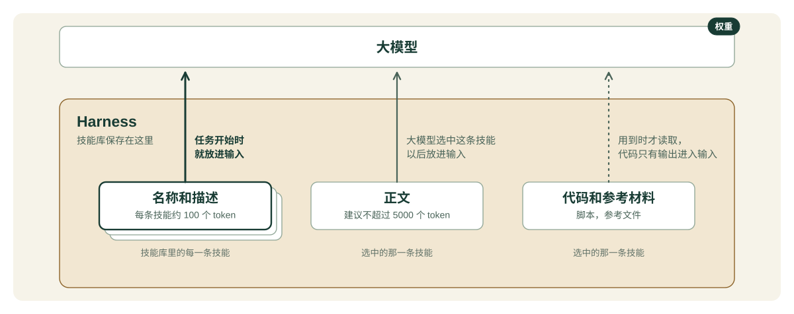
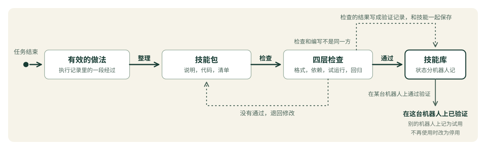

# 第 07 章 技能与技能库

机器人完成一个任务以后，其中有效的做法可以写成说明或者代码，留给以后的任务使用。本教程把这样保存下来、可以反复使用的做法称为**技能**（skill）。在别的资料里，训练得到的策略和录制好的动作也常叫技能，本教程的用法要窄一些。技能和这两种对象的区别见 [7.1 节](#sec-7-1)。技能逐渐积累，汇集成**技能库**（skill library），执行新的任务时便可以从中查找合适的技能。

不过，一种做法只在一定的条件下有效，例如用的是某一种物体、某一台机器人，周围没有别的物体妨碍。如果保存的只有做法本身，这些条件就没有留下来。以后的任务里，往往要由大模型判断是否使用某一条技能，可是它看到的只是一段文字或者一个可以调用的名称，无从知道这条技能换了物体、换了机器人以后是否还适用。所以，一条技能要能复用，除了做法本身，还要写明供大模型选择用的名称和描述、适用范围，以及它在哪里验证过。技能进入技能库之前，也要经过检查。

本章先介绍技能的两种形式，以及它和工具、策略、经验的区别，再说明一条技能怎样保存，然后讨论怎样写明适用范围，最后介绍技能进入技能库之前的检查，以及以后怎样查找和复用。

<a id="sec-7-1"></a>

## 7.1 技能的形式与边界

技能有两种形式，一种只有给大模型读的说明，另一种还带有代码。以叠积木为例，假设机器人在前几次任务里常常把积木放偏，松开夹爪以后积木就滑落了。后来发现，放下之前先让夹爪对准下方积木的中心，积木大多能放稳。松开以后再观察一次，还可以确认它没有滑落。这种做法可以写成下面的一段说明。

```text
放置积木
1. 用 locate 取得下方积木的位置。
2. 把夹爪移到下方积木中心的正上方，高出 0.05 米。
3. 下降到两块积木刚好接触的高度，松开夹爪。
4. 把夹爪抬高 0.10 米，读取一次图像，确认积木留在下方的积木上。
```

把这段说明放进大模型的输入，大模型就可以按照其中的步骤依次调用工具。本教程把只有说明的技能称为**文本技能**。同样的做法也可以写成一段代码，代码按同样的顺序调用 `locate`、`move_gripper` 和 `set_gripper`，最后再调用一次 `locate`，检查积木的位置，并返回检查的结果。带有这种代码的技能称为**可执行技能**。代码并不单独存在，它总要配一段给大模型读的文字，说明这条技能做什么、什么时候用。这段文字可以只是一个名称和一句说明用途的话，也可以是一份完整的说明。

两种形式的差别在于执行时大模型参与多少。使用文本技能时，每一步仍然由大模型决定。遇到说明里没有写到的情况，例如下方的积木被碰歪了，大模型可以临时调整做法。但是每一步都要等大模型做一次决定，大模型也可能漏掉其中的某一步。使用可执行技能时，大模型调用一次，代码就按预定的顺序执行完其中的几步，中间不经过大模型，所以速度快，每次的做法也相同。可是代码只能处理编写时考虑到的情况，别的情况仍然要由大模型根据返回的结果来处理。

这和 [3.2 节](./chapter-03.md#sec-3-2)介绍的由大模型编排还是由代码编排的取舍是一样的。所以决定一条技能里哪些内容写成代码时，可以沿用同样的原则：顺序固定、稍有偏差就会失败的步骤，以及按明确的规则就能完成的检查，写成代码；需要根据现场的情况决定怎样做的内容，写在说明里，告诉大模型看什么、怎样选。说明里再写明调用这段代码的时机和注意事项。代码只写确有必要的那几步。有一个系统为机器人仿真任务整理了 205 条技能，几乎都是一页左右的说明，带有代码的只有 3 条 [1]。其中一条用于 [4.3 节](./chapter-04.md#sec-4-3)提到的按按钮的任务：这个任务多按一次就算失败，所以技能里按压的循环是用五行代码写的。

技能离不开工具，但两者的分工不同：工具给大模型的是能力，技能给大模型的是知识 [2]。前者说的是机器人能做什么，后者说的是某一类任务怎样做。文本技能只是建议，大模型读了以后仍然要自己去调用工具，也可能不照着做。工具则有调用契约，参数、前提和返回都由代码把关。

可执行技能里的代码要直接驱动机器人，所以不能只是建议，要和工具一样有契约、经过门控。在本教程里，这段代码就以工具的形式提供给大模型，有名称、用途、参数和返回。也就是说，从调用的一方看，这段代码就是一个工具，和 [2.1 节](./chapter-02.md#sec-2-1)提到的把定位、移动、下降和闭合夹爪合在一起的工具没有区别。工具和技能说的是两个方面：大模型调用的是这段代码，它是一个工具；技能库保存和管理的是放置积木的整套做法，这是一条技能，其中的代码、说明、适用范围和验证记录一起更新版本，一起修订。表 7.1 以本章的例子比较了机器人自带的原子能力和这样的可执行技能。文献里对这类代码的叫法也不统一，有的称为技能，有的称为工具 [3, 4]。

表 7.1 原子能力和可执行技能的比较

| | 原子能力，例如 `move_gripper` | 可执行技能，例如放置积木 |
|---|---|---|
| 调用时 | 工具 | 其中的代码是工具 |
| 来历 | 随机器人的接口一起提供 | 从完成的任务里整理出来 |
| 数量 | 由机器人的接口决定 | 随着任务不断增加 |
| 管理 | 由开发者随接口维护 | 入库之前要检查，要写明适用范围和验证记录，以后还会修订 |

技能里的代码也不一定都做成单独的工具。编写代码、处理文档的智能体里，技能可以附带脚本，大模型通过命令行运行这些脚本，不必为每个脚本单独定义工具 [5]。有的机器人智能体让大模型自己编写程序，这时技能里的代码是程序里可以调用的函数 [1]。用在机器人上时，不论哪一种做法，这些代码最终都要驱动本体，所以参数、返回和适用范围都要写明。

在别的资料里，“技能”还指另外两种对象。一种是训练得到的策略，例如有的系统准备了 551 个这样的技能，让大模型每一步从中选出一个来执行 [6]。另一种是录制好的动作，[2.1 节](./chapter-02.md#sec-2-1)提到，机器人厂商的应用商店里就有这样的技能。

在本教程里，这两种对象都通过工具来调用，[6.3 节](./chapter-06.md#sec-6-3)介绍过怎样为策略写调用契约。它们和技能的区别在于修改的方式。技能是文字和代码，修改以后马上生效，效果不好还可以退回上一个版本。策略要重新训练，动作要重新录制。不过，策略和录制的动作也可以登记到技能库里，条目上注明它的类型，需要写明的内容和技能相同，也就是后面几节介绍的描述、适用范围和验证记录。

技能和 [5.1 节](./chapter-05.md#sec-5-1)的经验也有区别。经验是从以往任务里总结出来的内容，可以是一条事实，例如“这种积木表面光滑，容易滑落”，也可以是一种做法。经验放进输入，供大模型决定时参考。技能则是一套整理好、可以照着做的步骤，有自己的名称，大模型可以选用它，也可以调用它。经验可以整理成技能：[5.4 节](./chapter-05.md#sec-5-4)提到，经验里如果有一套多步的做法，就可以写成一条技能。这一节开头放置积木的技能，便是由“放下之前先让夹爪对准下方积木的中心”这条经验整理成的。

<a id="sec-7-2"></a>

## 7.2 技能包结构

一条技能除了说明，还有后面要讲的适用范围和验证记录，有的还带代码和参考材料。这些内容放在同一个文件夹里，才便于一起保存、一起更新版本，也便于交给别的机器人使用。这样的文件夹称为**技能包**（skill package）。

编写代码、处理文档的智能体有一种公开的技能格式，已有多种智能体采用 [7]。按照这种格式，说明文件的开头是名称和描述，后面是正文，也就是具体的做法。其中必须填写的只有名称和描述两项，名称不超过 64 个字符，描述不超过 1024 个字符 [7]。机器人的技能包可以沿用这种格式。已经有厂商这样做：一家人形机器人厂商在 2026 年 10 月公开的技能仓库里，有三条技能的说明文件就是按这种格式写的，用来告诉智能体任务的执行办法、要检查的项目和停止的条件 [8]。

名称和描述是供大模型选择技能用的。大模型根据描述判断是否使用一条技能，所以描述里既要写这条技能做什么，也要写什么时候该用它 [5]。例如，只写“放置积木”是不够的，可以写成“把夹爪里的积木放到另一块积木上。夹爪已经夹着一块积木、下方积木的顶面空着时使用”。不该使用的情况也可以写进去。

技能库里的技能并不全部放进大模型的输入。输入里的内容越多，大模型每次决定所花的时间和费用也越多，[5.1 节](./chapter-05.md#sec-5-1)已经提到这一点。因此技能包里的内容是分阶段放进输入的 [5]。任务开始时，输入里只有当前可用的各条技能的名称和描述。大模型选中一条技能以后，这条技能的正文才放进输入。代码和参考材料用到时才读取。代码执行时，进入输入的只有它的输出，代码本身不占用输入。

大模型输入的长度用 token 来计量。据估计，一条技能的名称和描述大约占 100 个 token，正文建议不超过 5000 个 token [5]。这种先给出少量内容、需要时再给出其余内容的做法，称为**渐进式披露**（progressive disclosure）。图 7.1 画出了技能包的内容放进输入的三个阶段。

<p align="center"></p>

图 7.1 技能包的内容分阶段放进输入。粗箭头表示任务开始时就放进输入，细箭头表示选中技能以后才放进输入，虚线表示用到时才读取。大模型和 Harness 的画法与图 1.3 相同。

前面介绍的公开格式是为编写代码、处理文档的智能体设计的。机器人的技能包还需要几项这种格式没有规定的内容，这些内容写在一份**清单**（manifest）里：

- 标识和版本。标识在技能库里不能重复，每次修改以后要更新版本。
- 适用的机器人，以及依赖的工具和策略。
- 可执行技能的入口，也就是要调用的函数，以及它的参数和返回。
- 适用范围，在 [7.3 节](#sec-7-3)介绍。
- 验证记录存放的位置。验证记录在 [7.4 节](#sec-7-4)介绍。

这样的清单在机器人软件里已有先例。在 ROS 2 中，每个软件包都带有一份清单文件，其中必须写明名称、版本、描述、维护者和许可证，依赖的其他软件包也在这里声明 [9]。技能的依赖也要在清单里声明。Harness 读取技能包时检查这些依赖，如果当前的机器人没有某条技能所依赖的工具，这条技能就不提供给大模型。

下面是放置积木这条技能的技能包，其中的文件名只是示意。

```text
place-block/
├── SKILL.md         说明文件：名称、描述和正文
├── manifest.yaml    清单
├── place_on.py      代码
└── records/         验证记录
```

说明文件的内容如下。

```text
---
name: place-block
description: 把夹爪里的积木放到另一块积木上。夹爪已经夹着一块积木、下方积木的顶面空着时使用。下方的物体表面不平时不要使用。
---
1. 调用 place_on，参数是下方积木的名称。它依次完成定位、对准、下降、松开夹爪和抬起，然后重新定位两块积木，按两者中心的水平距离判断并返回积木是否放稳。中途停下时，返回停下的原因和停在哪一步。
2. 没有放稳或者中途停下时，先看停下的原因。任务已经被取消，就到此结束。可以继续的，用 locate 确认要放的积木在哪里：还夹在夹爪里，再调用一次 place_on；已经落在桌上，重新抓取以后再放。
3. 连续两次没有放稳，就停下来报告，不再重试。
```

这个技能包里是一条可执行技能。固定的几步写在 `place_on.py` 里，以工具的形式提供。说明文件告诉大模型什么时候调用它，以及没有放稳时怎样处理。

<a id="sec-7-3"></a>

## 7.3 适用范围

技能的适用范围，指它在什么条件下可以使用。本章所说的适用范围，还包括技能执行完以后应当达到的状态、它占用的资源，以及失败和停止时的行为。

适用范围没有写明，技能就可能被用在不合适的场合。例如在一项仿真实验里，技能是在没有障碍物的桌面上总结出来的 [10]。后来桌面上放了障碍物，任务的指令也要求避开，可是只要这条技能和当前的步骤相符，智能体就照原样执行，机械臂便在目标附近碰到了障碍物。技能里的做法本身没有错，只是总结它的时候桌面上没有障碍物。所以技能适用的条件要写明，表 7.2 以放置积木的技能为例，列出了要写的各项内容。

表 7.2 技能的适用范围要写明的内容

| 项目 | 含义 | 什么时候用到 | 放置积木的例子 |
|---|---|---|---|
| 适用的机器人和工具 | 技能需要什么样的本体，依赖哪些工具 | 读取技能包时 | 桌面机械臂，平行夹爪，桌子上方有相机；`locate`、`move_gripper`、`set_gripper`、`get_image`、`get_robot_state` |
| 前置条件 | 开始之前必须成立的条件 | 调用之前 | 夹爪里有一块积木；下方的积木在相机的画面里，顶面平整，上面没有别的物体；夹爪从当前位置移到下方积木的上方、再下降和抬起，一路上没有障碍物 |
| 执行期间的条件 | 执行期间一直要成立的条件 | 执行期间 | 松开夹爪之前，积木一直夹在夹爪里。用 `get_robot_state` 读夹爪的宽度来检查，宽度比夹住积木时小了，说明积木掉了 |
| 后置条件 | 做完以后应当成立的条件 | 结束以后 | 积木留在下方的积木上，两者中心的水平距离小于 0.01 米；夹爪已经松开并抬起 |
| 占用的资源 | 执行时独占的部件、物体和空间 | 调用之前 | 机械臂和夹爪；两块积木和它们上方的空间 |
| 执行上限 | 一次调用最多执行多久 | 执行期间 | 20 秒 |
| 失败时的返回 | 没有做完时报告的内容 | 停下以后 | 停下的原因，停在哪一步，夹爪当时的位置和宽度 |
| 停止时的行为 | 收到停止的请求以后做什么 | 收到请求时 | 停止运动；还没有松开时夹爪保持闭合，已经松开时保持张开 |

表中有三种条件，是按检查的时间来分的。开始之前必须成立的条件称为**前置条件**（precondition），[2.2 节](./chapter-02.md#sec-2-2)调用契约里的“前提”就属于这一种。做完以后应当成立的条件称为**后置条件**（postcondition）。还有一种条件要在执行期间一直成立（hold-condition），例如搬运物体时，物体始终在夹爪里。这种分法并不新，机器人软件和工业设备的技能模型里早已采用 [11, 12]。

后置条件同时是判断一次执行是否达到效果的依据。和 [3.1 节](./chapter-03.md#sec-3-1)里阶段的完成条件一样，后置条件也要写成能够观察到的状态。传统的机器人软件对照一份用符号表示的世界模型来判断条件是否成立 [11]。机器人智能体通常没有这样的模型，条件是否成立要根据观测和工具的返回来判断。所以写条件时，还要考虑用什么办法检查它。另外，后置条件不能用接口的回执代替。[4.1 节](./chapter-04.md#sec-4-1)已经说明，调用被受理、执行结束和达到效果是三个环节，后置条件检查的是最后一个。

占用的资源关系到两条技能能否同时执行。两条技能都要用同一只手臂，就只能先后执行。稳妥的做法是让每条技能声明执行时占用的物体和空间，没有声明的一律按独占全部资源处理，不能和别的技能同时执行 [13]。

写明了条件，还要确定由谁来检查。写在说明里的条件只能提醒大模型，大模型未必照办。前面障碍物的例子里，避开障碍物的要求就是用文字给出的。所以，凡是能用代码判断的条件，都应当由代码来检查：读取技能包时核对机器人和工具，调用之前检查前置条件，执行期间检查应当一直成立的条件和执行上限，结束以后检查后置条件。其中执行之前的核对，机器人的动作库里已有先例：动作库给每个动作标明开始和结束时机器人各应处于什么状态，几个动作串成一段脚本时，如果前一个动作结束时的状态和后一个动作开始时的状态不一致，就拒绝这段脚本 [14]。条件由代码来检查，和 [2.3 节](./chapter-02.md#sec-2-3)的门控、[6.4 节](./chapter-06.md#sec-6-4)下层的检查是同一个道理。

不同的机器人，适用范围的内容差别很大。桌面机械臂的前置条件常常和物体有关，例如抓取时物体在可达的范围内，在相机的画面里，夹爪是空的。双足机器人和人形机器人的前置条件还要包括机身的状态，例如机器人已经站稳，电量充足，周围留有足够的空间。占用的资源也不限于手臂，带语音的技能还要占用扬声器。停止时的行为差别更大。机械臂通常停在原地就可以了，双足机器人停止动作以后还要保持平衡，有的动作开始以后不能中途停下。这些都要在清单里写明。

[7.2 节](#sec-7-2)介绍的公开格式还没有为这些内容留出位置：和适用范围有关的只有描述，以及一项用文字填写的环境要求 [7]，前置条件、后置条件和占用的资源都没有专门的项目。而机器人的动作往往无法撤销，技能用错了就难以补救。所以编写技能的人需要把表 7.2 的各项内容补充到清单里，其中能用代码判断的，再写成检查。

<a id="sec-7-4"></a>

## 7.4 入库与复用

技能包写好以后，要经过检查才能加入技能库，也就是**入库**。技能可以由人编写，也可以由智能体在任务结束以后根据执行记录整理出来。不论由谁编写，没有经过检查的技能都不宜直接使用。有一项网页操作任务的实验比较了两种入库的办法：一种是新技能先实际执行一次，通过以后才加入；另一种是不经验证就加入。用前一种办法时，后续任务的成功率更高 [3]。

人审核过的技能也不是处处有益。有一项实验在机器人的仿真环境里为 34 个任务各准备了一条文本技能，由智能体起草，再由人逐条审核 [1]。在同样的 1020 次执行里，加入这些技能以后成功的次数从 667 增加到 864，可是原来成功的执行里有 37 次反而失败了。可见技能即使总的来看有帮助，也可能让一部分原来能完成的任务失败，所以检查时还要确认原来能完成的任务没有变差。

入库的检查可以分成由轻到重的四层：

1. 技能包是否完整，清单能不能读取。
2. 依赖的工具是否存在，参数的类型是否正确。
3. 试运行。在仿真环境或者真机上执行这条技能，核对后置条件是否成立。
4. 回归。比较加入这条技能前后的结果，确认原来能够完成的任务没有变差。

前两层不需要机器人。另外，检查的一方和编写技能的一方应当分开，技能的作者不能审核自己的技能 [15]。检查时还要看技能的内容：技能里不能出现智能体在执行时观测不到的信息，例如仿真环境内部的坐标，这一项可以用程序来查 [1]。

对照一家人形机器人厂商的应用商店，可以看出这四层检查在实际的审核里各做到了什么程度。这家商店公布了上架的要求和流程 [16]。开发者提交的应用要写明适用的机型和自由度，声明用到的权限，附上使用手册，程序还要提供启动和停止两个接口。商店审核时检查应用和描述是否一致、权限是否必要、文档是否完整、程序能否正常运行、代码有没有恶意行为。

这几项查的是文档、权限和程序能否运行，大致相当于四层里的前两层，没有提到在机器人上核对动作的效果。试运行这一层由开发者自己负责：上传的前提是已经在本地充分测试，但公布的流程里没有规定要通过哪些测试。商店的用户协议也写明，平台无法保证这些应用的安全和可靠。在一个前空翻动作的页面上，有用户留言说试过以后安全落地，也有用户留言说机器人动了几秒就向后退，倒在地上。只看公开的流程和留言，看不出这个动作在哪种机型、哪些条件下通过了测试。技能的验证记录就是用来向使用者提供这些信息的。

检查的结果要写成**验证记录**（validation record）。下面是一个例子，内容只是示意。

```text
技能    place-block，版本 1.2.0
环境    仿真环境，桌面机械臂，边长 3.2 厘米的积木
次数    执行 30 次，成功 28 次
失败    2 次放偏，下方的积木都靠近桌子的边缘
日期    2026-11-10
检查    由另一个智能体执行，操作者复核
```

这是一份试运行的记录，写明了检查的版本、检查的环境、执行和成功的次数，以及由谁检查。回归的结果也这样记录，另外写明比较的双方，按任务列出各自成功的次数，并标出原来成功、这次失败的情况。

环境一项不能省略，因为技能在一种环境里通过了检查，不等于在另一种环境里也能通过。有一项实验把仿真里总结的技能交给智能体，供它为另一种真实的机械臂编写程序时参考 [17]。有了这些技能，程序还是要根据真机上的执行结果重新调整。不过技能里的做法仍然有帮助：两个任务各执行 20 次，提供技能以后，一个任务成功的次数从 13 次增加到 19 次，另一个从 0 次增加到 11 次。做法可以沿用，效果却要在新的环境里重新确认。所以技能换到另一台机器人上，或者从仿真换到真机，都要重新验证，验证记录按机器人分别保存。

同一台机器人也会变化。电机发热、部件磨损或者更换了夹爪以后，同样的指令得到的动作可能不同，原来验证过的技能就可能失效。要了解硬件的改动影响有多大，可以参考训练得到的策略：有一项仿真实验保持任务不变，只改动机器人硬件和安装方面的设置，例如相机的位置、相机和机械臂之间的标定、控制频率和夹爪的垫片。改动的幅度最大时，八个策略合计的成功率从 93% 降到了 51% [18]。所以机器人维修或者更换部件以后，用到这些部件的技能和策略都要重新验证。

技能修改以后要更新版本。新版本要重新验证，旧版本的验证记录不能沿用。执行记录里还要记下每次任务用的是哪条技能的哪个版本，这样出了问题才查得到原因，也才能退回上一个版本。技能库里的每条技能还应当标明状态，状态按版本和机器人分别记录。一个版本通过了入库的检查，在还没有验证过它的机器人上，状态记为试用，例如只在仿真里通过检查的版本，到了真机上仍记为试用。它在哪一台机器人上通过了试运行和回归，在这台机器人上才记为已验证。执行日常的任务时，只把已验证的版本提供给大模型，试用的版本只在试验时使用。不再使用的版本记为停用，停用的版本同样不提供，它的记录仍然保留。

从一种有效的做法到技能库里的一条技能，要经过整理和四层检查。入库以后，这个版本在哪台机器人上通过了试运行和回归，就在哪台机器人上记为已验证，在其余的机器人上先记为试用，见图 7.2。

<p align="center"></p>

图 7.2 从一种有效的做法到技能库里的技能。粗箭头是主要的路线。两条虚线分别表示检查没有通过时退回修改，以及检查的结果写成验证记录保存下来。

技能入库以后，执行任务时要从技能库里找出合适的技能。技能不多的时候，先按清单去掉当前的机器人不能使用的技能，再把其余技能的名称和描述放进输入，由大模型来选。技能多了以后，名称和描述加起来也要占用不少输入。一次提供的技能太多，大模型还可能选错，或者漏掉该用的技能 [15]。这时可以先按任务检索出最相关的几条，只把这几条放进输入，办法和 [5.3 节](./chapter-05.md#sec-5-3)检索经验时相同。

即使每次只提供几条，技能库也需要维护，因为技能的数量多不等于效果好。有一项实验让大模型在解数学题时把写过的函数存起来，留给后面的题目使用：一种做法积累了 875 个函数，另一种只保留反复用到的 16 个，后一种的准确率更高 [4]。因此入库要有条件，用处重复的技能要合并，长期用不到的技能可以停用。

技能的复用有三种情况。第一种是同一个任务再做一次，条件和总结技能时相同。第二种是用到另一个任务里，例如把放置积木的技能用在整理桌面的任务里，这时要看新任务是否满足前置条件。第三种是用到另一台机器人上。[2.4 节](./chapter-02.md#sec-2-4)提到，两台机器人提供的工具相同时，已经写好的技能可以沿用，工具不同就要调整代码和参数。不论工具是否相同，都要在新的机器人上重新验证。

## 小结

本章介绍了怎样把一种有效的做法整理成可以复用的技能。技能有文本技能和可执行技能两种形式，后者在说明之外还带有代码。固定的步骤和按明确规则就能完成的检查写成代码，要看现场情况决定的内容写成说明，代码提供给大模型时就是一个工具。一条技能保存成一个技能包，名称和描述供大模型选择，正文在选中以后才放进输入。技能包里还要写明适用范围，包括前置条件、执行期间的条件、后置条件、占用的资源，以及失败和停止时的行为，其中能用代码判断的条件由代码检查。技能入库之前要经过检查，检查的结果写成验证记录，修改以后、换了机器人以后都要重新验证。执行任务时，先按清单筛选，再按名称和描述选用。用处重复的技能要合并，长期用不到的可以停用。

入库以后，技能还会在使用中暴露出问题。[下一章](./chapter-08.md)介绍怎样根据失败的记录修订技能和 Harness 的其他部分，以及怎样判断一次修订是否值得保留。

## 参考文献

1. Gao H, Zeng J, Zhou A, 等. [HexaShell: A Universal Harness for Robot Coding Agents in Simulation and the Real World](https://arxiv.org/abs/2610.23479). arXiv:2610.23479, 2026.
2. Wang Q, Wang T, Li C, 等. [Towards the Harness of Embodied Agents](https://arxiv.org/abs/2608.11246). arXiv:2608.11246, 2026.
3. Wang Z Z, Gandhi A, Neubig G, 等. [Inducing Programmatic Skills for Agentic Tasks](https://arxiv.org/abs/2504.06821). COLM 2025. arXiv:2504.06821.
4. Wang Z, Neubig G, Fried D. [TroVE: Inducing Verifiable and Efficient Toolboxes for Solving Programmatic Tasks](https://arxiv.org/abs/2401.12869). ICML 2024. arXiv:2401.12869.
5. Claude 文档. [Agent Skills](https://platform.claude.com/docs/en/agents-and-tools/agent-skills/overview).
6. Ahn M, Brohan A, Brown N, 等. [Do As I Can, Not As I Say: Grounding Language in Robotic Affordances](https://arxiv.org/abs/2204.01691). CoRL 2022. arXiv:2204.01691.
7. Agent Skills. [Specification](https://agentskills.io/specification).
8. Unitree. [unitree_robotskills](https://github.com/unitreerobotics/unitree_robotskills). 2026.
9. Thomas D. [REP 149: Package Manifest Format Three Specification](https://ros.org/reps/rep-0149.html). ROS Enhancement Proposal.
10. Xu B, Shang Y, Dong Z, 等. [SafeHarness: Coding Agents with Harness for Safe Robot Control](https://arxiv.org/abs/2609.20822). arXiv:2609.20822, 2026.
11. SkiROS2 文档. [Skill model](https://github.com/RVMI/skiros2/wiki/Overview-3:-Skill-model).
12. Plattform Industrie 4.0. [Information Model for Capabilities, Skills & Services](https://www.plattform-i40.de/IP/Redaktion/EN/Downloads/Publikation/CapabilitiesSkillsServices.pdf?__blob=publicationFile&v=1). 讨论稿, 2022.
13. Intrinsic SDK. [skill_interface.py](https://github.com/intrinsic-ai/sdk/blob/main/intrinsic/skills/python/skill_interface.py)，`get_footprint` 的说明.
14. Boston Dynamics. [Choreography Service](https://github.com/boston-dynamics/spot-sdk/blob/master/docs/concepts/choreography/choreography_service.md). Spot SDK 文档.
15. Claude 文档. [Skills for enterprise](https://platform.claude.com/docs/en/agents-and-tools/agent-skills/enterprise).
16. Unitree UniStore 使用手册. [开发动作包](https://unistore.unitree.com/manuals?slug=dev)；[创建应用流程](https://unistore.unitree.com/manuals?slug=create-application)；[版本上传指南](https://unistore.unitree.com/manuals?slug=upload-action-version). [应用平台用户协议](https://oss-global-cdn.unitree.com/static/%E5%AE%87%E6%A0%91%E7%A7%91%E6%8A%80-Unitree%20%E5%BA%94%E7%94%A8%E5%B9%B3%E5%8F%B0%E7%94%A8%E6%88%B7%E5%8D%8F%E8%AE%AE.pdf). 动作 [G1-韦伯斯特前空翻](https://unistore.unitree.com/action?id=185) 页面上的用户评论. 2026 年 11 月 17 日读取.
17. Lu R, Wu Y, Kou E, 等. [ASPIRE: Agentic /Skills Discovery for Robotics](https://arxiv.org/abs/2607.00272). arXiv:2607.00272, 2026.
18. Cui A Y, Wang H, Wang X, 等. [LIBERO-RIG: A Hardware-Setup Robustness Benchmark for Vision-Language-Action Models](https://arxiv.org/abs/2610.18843). arXiv:2610.18843, 2026.
