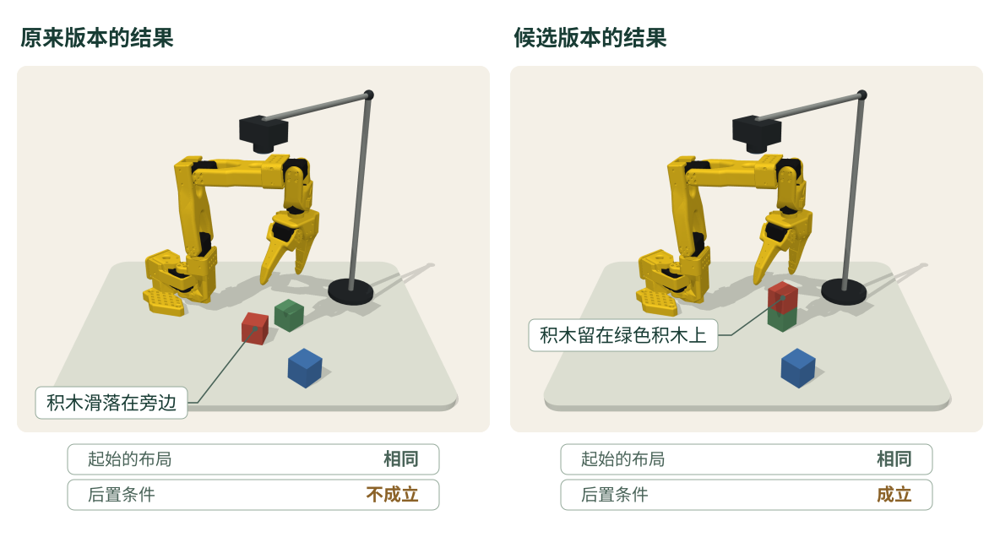
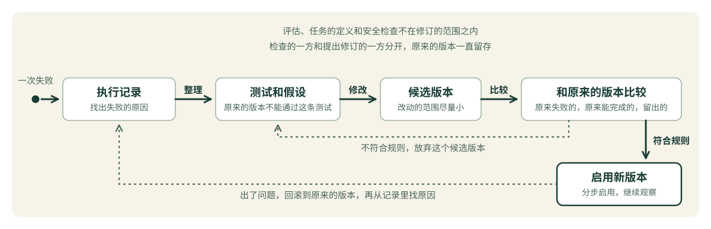

# 第 08 章 技能与 Harness 的演化

技能进入技能库以后，在使用中仍然会失败。这时要修改的可能是技能本身，也可能是 Harness 里和它有关的其他内容，例如工具的说明、提示词和编排的规则。这些内容都是文字和代码，修改以后不需要训练。失败的原因如果在训练得到的策略里，要修改的就是权重，这属于第三部分的内容。[13.1 节](./chapter-13.md#sec-13-1)讨论怎样在修改 Harness 和修改权重之间选择。

可是，为一次失败所作的修改未必有效。它可能没有解决原来的问题，可能让原来能完成的任务变差，也可能只在修改时用过的那几个回合上有效，换一种布局便不起作用。这里的**回合**（episode），指从一种起始布局开始，把任务执行一次。

以往，这样的修改由工程师来做。现在这项工作也可以交给智能体，由它阅读执行记录、提出修改。提出的修改多了，就需要一套办法，来判断其中哪些应当保留。

本章把对技能和 Harness 的一次修改称为一次**修订**（revision），修订积累起来的过程称为演化（evolution）。下面先介绍怎样根据执行记录提出修订，再说明怎样生成待检验的版本，然后讨论怎样比较新旧版本，最后介绍怎样决定是否启用新版本，以及启用以后出了问题怎样退回原来的版本。

## 8.1 从记录提出修订

修订从一次失败开始：先从执行记录里找出失败的原因，再确定要改什么，并把要做的修订写成可以检查的形式。本章用 [7.2 节](./chapter-07.md#sec-7-2)的放置积木作例子：一次任务里，`place_on` 松开夹爪以后，红色积木从绿色积木上滑落了。这个例子的细节只是示意。

着手修订之前，先要确认这次任务确实失败了。如果任务没有完成却被判为成功，或者完成了却被判为失败，就要先检查评估，不能根据这次的结果修订技能。[9.3 节](./chapter-09.md#sec-9-3)讨论这类问题。本例中，从图像上可以看到红色积木落在桌上，这一次放置确实失败了。

找原因要依靠执行记录。如果记录里只有工具的返回，就只知道积木没有放稳，不知道原因。有了每一步前后的图像，才有可能看出原因。记录是否详细，对改进的结果影响很大：有一项仿真实验让智能体根据失败反复改进，诊断时使用执行过程的录像，五轮以后任务的成功率是 78.2%，不用录像时只有 51.8% [1]。

即使有了详细的记录，要确定哪一步出了错也不容易。有一项研究在多个大模型智能体协作的软件系统上比较了三种自动方法，让它们从失败任务的记录里找到出错的一步，其中最好的一种也只找对了 14.2% [2]。这里可以利用 [7.3 节](./chapter-07.md#sec-7-3)的后置条件。如果每条技能都写明了后置条件，就可以沿着调用的顺序逐个核对，哪一步的后置条件最先不成立，就从哪一步查起。本例中，抓取的后置条件成立，放置的后置条件不成立，所以先查放置这一步。从松开夹爪前后的图像上看得出，红色积木在夹爪里夹偏了。`place_on` 对准时用的是夹爪的位置，夹爪对准了绿色积木的中心，夹偏的红色积木并没有对准，放下去时有一边悬空。

夹偏是抓取时发生的，抓取的后置条件却成立：它只要求积木夹在夹爪里，没有要求夹正。可见后置条件最先不成立的一步只是查找的起点，起因可能在更早的一步，而更早一步的检查没有发现问题。这样就有两处可以改：抓取时把积木夹得更准，或者放置时在积木夹偏的情况下也能对准。抓取时总会有些偏差，所以本例修改放置这一步。

接着，根据这次失败编写一条测试。测试里写明任务、起始布局和判断成功的条件，原来的版本应当不能通过这条测试。本例的测试是：起始时红色积木夹在夹爪里，中心偏离夹爪的中心 1 厘米，放置结束以后要求后置条件成立。开源的机械臂软件 MoveIt 就要求提交修改时附带测试，并且去掉这项修改以后这些测试应当不能通过 [3]，这种做法也称为“先失败”（fail first）[4]。这样的测试要逐渐积累起来，因为只根据最近的一次失败来修订，容易顾此失彼。可以先从真实的失败里整理出二十到五十个任务，作为以后检验的依据 [5]。

最后，把要做的修订写成一个假设，写明改动的内容、预期由失败变为成功的任务，以及不应当受到影响的任务。有了这样的假设，后面的检验才有明确的对象。本例的假设是：如果对准之前先用 `locate` 取得夹爪里积木的位置，按积木的位置对准，不按夹爪的位置，夹偏的积木就能放稳；积木没有夹偏的任务不受影响。

## 8.2 候选版本

按假设修改以后、还没有经过检验的版本，称为**候选版本**（candidate version）。检验期间，原来的版本保持不变。

候选版本的改动范围应当尽量小，只涉及和这次失败有关的部分。本例只改 `place_on.py` 里对准的那一步，其余的步骤和说明文件都不动。新的做法要求夹爪里的积木也在相机的画面里，清单里的前置条件要相应加上这一项。改动小，出了问题容易查明，也不容易影响别的任务。如果让大模型把一份说明全部重写，风险要大得多。例如在一项实验里，大模型一步就把一份积累到 18,282 个 token 的经验记录改写得只剩 122 个 token，大部分内容丢失了，准确率比不使用这份记录时还低 [6]。

有些内容不在修订的范围之内。提出修订的一方不能改动评估的办法和任务的定义，否则即使成功率提高了，也可能只是因为标准变了 [1]。安全方面的检查同样不能改动，包括速度、力和活动范围的限制，这和 [2.3 节](./chapter-02.md#sec-2-3)的门控、[6.4 节](./chapter-06.md#sec-6-4)下层的检查是一致的。

评估用的答案和执行时观测不到的信息也不能写进技能，例如仿真环境内部的物体坐标和评分用的阈值。本例中，候选版本不能把测试布局里绿色积木的坐标直接写进代码。技能的后置条件里可以写容差，例如表 7.2 的 0.01 米，技能执行以后用它检查积木是否放稳。评分程序使用的阈值则不提供给技能。如果修订时只求通过当前的几个回合，得到的修订往往不可靠，还可能发展到直接照搬答案。有一项实验为每个任务配备了专用的工具，每失败一个回合，就让优化程序编写或者修补这个任务的工具，再在同一个布局上重试，这样反复了 769 轮，写出大约 78,000 行代码。把这些工具固定下来重新测试，在开发时用过的回合上也只通过了 36%。事后检查还发现，有七个任务的工具直接照搬了场景里物体的尺寸 [7]。

每个候选版本都要留下记录，写明改了什么、针对哪一次失败、由谁提出。按 [7.2 节](./chapter-07.md#sec-7-2)的要求，技能修改以后要更新版本，这份记录就附在新的版本上。如果修改的是提示词或者编排的规则，也要同样记录。有了这些记录，日后发现问题时才能查到是哪一次修订引起的。

## 8.3 回归与留出评估

候选版本要和原来的版本比较，才知道它是否更好。比较时，除了修订的内容，其余的都要保持相同：同样的任务和起始布局，同样的大模型和其他技能，同样的预算和评分规则。和 [7.4 节](./chapter-07.md#sec-7-4)入库时一样，检查的一方和提出修订的一方也应当分开。图 8.1 是本例的一次比较：起始布局相同，原来的版本没有把积木放稳，候选版本放稳了。

图 8.1 同一个起始布局下原来的版本和候选版本的结果。左边是原来的版本，红色积木滑落在绿色积木旁边，后置条件不成立。右边是候选版本，红色积木留在绿色积木上，后置条件成立。画面由仿真软件 MuJoCo 生成，用作示意。

比较时要用到三组任务（见表 8.1），分别用来检查原来的失败是否还会出现、原来能完成的任务是否变差，以及修订对没有见过的情况是否同样有效。

表 8.1 比较新旧版本用到的三组任务

| 任务 | 来源 | 要看的结果 |
|---|---|---|
| 原来失败的任务 | [8.1 节](#sec-8-1)编写的测试 | 原来的版本不能通过，候选版本应当通过 |
| 原来能完成的任务 | 以往验证时用过的任务 | 候选版本不能变差 |
| 留出的任务 | 事先放在一边、提出修订时没有用过的任务 | 候选版本也应当有提高 |

本例中，第一组是夹偏 1 厘米的那条测试；第二组是技能入库时验证用过的回合；第三组仍然是叠放积木的任务，只是换了积木的大小和起始位置，积木同样是夹偏的。

第二组的检查就是 [7.4 节](./chapter-07.md#sec-7-4)所说的回归。第三组称为**留出**（held-out）的任务，用来防止修订只对见过的情况有效。在提出修订时用过的任务上，结果往往偏高。例如优化提示词时，用过的题目的准确率常常比没有用过的题目高 5 到 20 个百分点 [8]。有一项机器人的实验做了 15 轮改进，其中有两轮的修订通过了开发时的检查，留出任务上成功的次数反而各少了一次 [1]。留出的任务一旦被用来指导修订，就不能再算留出，要另外准备一组。如果接连比较几个候选版本，每次都参考这一组任务的成绩，最后留下成绩最好的一个，这一组任务同样不能再算留出。

比较的回合不能太少。大模型每次的输出不尽相同，机器人的动作也有偏差，所以同一个版本运行两次，结果也会不一样。有一项仿真实验只改动了一处对成功率没有明显影响的设置，把同样的回合再运行一次，有 15% 到 19% 的回合得到了和前一次相反的结果 [7]。由成功变为失败的回合和由失败变为成功的回合数目相近，总的成功率因此没有明显变化。可见单个回合的结果很容易改变。只比较少数几个回合时，看到的差别可能只是偶然出现的，所以每条测试都要重复运行几次 [9]。机器人的任务该重复多少次，要看结果波动的大小。[9.4 节](./chapter-09.md#sec-9-4)介绍怎样估计这种波动，以及怎样判断差别是否可信。

仿真环境里可以做大量的比较，可是在仿真里通过，不能代替在真机上检验。别的领域的法规里有同样的要求，例如欧盟关于自动驾驶车辆的法规写明，规定的实物测试不得用仿真代替 [10]。在真机上比较还有另外的困难：每试一次都要花时间，机器人会磨损，各个回合开始时物体的位置也不可能完全相同。同一台机器人上两个版本只能先后运行，轮到后一个版本时，电量和温度可能已经变了。因此在真机上比较时，应当让两个版本交替运行，并如实写明各运行了多少次。

## 8.4 保留与回滚

根据比较的结果，决定是保留候选版本、用它替换原来的版本，还是放弃它。保留的规则要事先定好，写明总的结果要提高多少、原来能完成的任务最多允许变差多少。已有的系统规定各不相同。有的要求在任务、预算和随机种子都相同的条件下，候选版本成功的次数严格多于原来的版本才替换，持平和变差的都只归档 [11]。仿真里的随机种子相同，抽到的起始布局等随机的内容也就相同。有的要求平均成功率提高，并且没有哪一个任务的成功率下降超过 20 个百分点 [1]。

这里说的提高和变差，都是指超出了 [8.3 节](#sec-8-3)所说的波动的变化。本章的例子采用三项条件：候选版本通过那条复现失败的测试，在原来能完成的任务上没有变差，在留出的任务上成功率有提高。这三项条件还没有给出具体的数值，因为要确定提高多少才算提高、最多允许变差多少，先要知道结果的波动有多大。[9.4 节](./chapter-09.md#sec-9-4)介绍怎样估计波动，[13.3 节](./chapter-13.md#sec-13-3)的改动计划是一个给出了数值的例子。表 8.2 按这三项条件，列出了比较以后的几种结果和相应的处理。

表 8.2 比较的结果和处理

| 原来失败的任务 | 原来能完成的任务 | 留出的任务 | 处理 |
|---|---|---|---|
| 通过 | 没有变差 | 有提高 | 保留 |
| 通过 | 没有变差 | 没有提高 | 不保留，这次修订可能只对见过的情况有效 |
| 通过 | 变差 | 不必再看 | 不保留，缩小改动的范围以后再试 |
| 没有通过 | 不必再看 | 不必再看 | 不保留，回到 [8.1 节](#sec-8-1)重新找原因 |

本例中，候选版本通过了夹偏的那条测试，在换了积木的任务上，它的成功率也比原来的版本高，差别超出了重复运行时的波动。假设入库时成功的回合里有一个这次失败了，这时还不能断定候选版本变差了。要先记下这个回合，再让两个版本各重复运行几次，看原来的版本在这个回合上是否也有时成功、有时失败。如果原来的版本也是这样，这个回合就不算变差，候选版本属于表中的第一行，可以保留；如果候选版本确实失败得更多，就属于第三行。重复的次数太少、还看不出来时，先继续使用原来的版本，补足回合再比较。

没有带来提高的修订，即使没有造成损害也不应当保留，因为这样的修订积累起来，说明和代码会越来越长，以后更难查找问题。按这样的规则，能够保留下来的修订并不多。例如在一次开发过程里，提出的 32 项修订测试了 23 项，最后只保留了 9 项 [11]。有时设的检查很多，没有一个候选版本能够全部通过 [12]。一项修订也没有保留，同样是正常的结果，这时继续使用原来的版本。

符合保留规则的修订，启用以后仍然可能出问题，因为三组任务覆盖的情况有限，一次改动又可能在一些情况下解决了问题，在另一些情况下使结果变差。[7.4 节](./chapter-07.md#sec-7-4)举过这样的例子。所以新版本要分步启用：仿真里的比较通过以后，先在真机上试验，试验时选用即使损坏也不造成损失的物体。新版本在真机上通过了试运行和回归，才按 [7.4 节](./chapter-07.md#sec-7-4)的规定记为已验证，用于实际的任务。开始的一段时间要有人看护，启用以后也要继续观察。原来的版本要留存，新版本出了问题就退回原来的版本，这称为**回滚**（rollback）。给设备升级软件的工具里就有这样的做法：装上新版本以后先检查运行是否正常，正常才确认这次升级，不正常就自动回到原来的版本 [13]。

回滚能恢复的只有技能和 Harness 的文件，机器人周围的环境不会随之恢复。本例中，退回原来的 `place_on.py` 以后，滑落在桌上的积木还要另外收拾。因此，后果难以挽回的修订，在启用之前要检验得更充分。

技能也要有淘汰的办法。持续失败的版本应当改为 [7.4 节](./chapter-07.md#sec-7-4)所说的停用状态，长期用不到的技能也可以停用。编写代码、处理文档的智能体管理技能时，也有同样的几条规定：新版本通过完整的评估才启用，使用时固定版本，出了问题立即退回最近一个正常的版本，评估持续失败的技能不再使用 [14]。

最后，演化本身也要受到限制。按 [8.2 节](#sec-8-2)的规定，安全方面的检查不在修订的范围之内，法规也开始对会演化的系统提出要求。欧盟的机械法规将从 2027 年 1 月 20 日起适用，其中专门提到了行为会自我演化的控制系统 [15]：机器的动作不得超出规定的任务和活动空间，实现安全功能的软件要记录和安全有关的决策过程，记录保存一年，而且任何时候都要能够纠正机器。

图 8.2 把本章介绍的步骤连在一起：一次修订依次经过找出失败的原因、整理出测试和假设、修改、比较这几个步骤，最后启用新版本或者放弃。

图 8.2 一次修订从失败到保留或者放弃的经过。粗箭头是主要的路线。两条虚线分别表示不符合规则时放弃候选版本，以及启用以后出了问题时回滚。

## 小结

本章介绍了怎样判断一次修订是否值得保留。修订时先从执行记录里找出失败的原因，根据这次失败编写一条原来的版本不能通过的测试，再把要做的修订写成可以检查的假设。候选版本的改动要小，评估、任务的定义和安全检查不在修订的范围之内。候选版本要在同样的条件下和原来的版本比较，比较时用到三组任务：原来失败的任务、原来能完成的任务和留出的任务。候选版本符合事先定好的规则才保留，没有提高的不保留。新版本要分步启用，原来的版本要留存以备回滚，不再有用的技能要停用。

第二部分到这里结束。第 7、8 两章里关于成功、通过和变差的结论，都要靠评估才能得出。第三部分首先要解决评估本身是否可靠的问题，[第 9 章](./chapter-09.md)介绍评估与验证。

## 参考文献

1. Wang Y-J, Jiang H, Deng S, 等. [Reconstruct, Practice, Go Real: Guided Self-Improvement for Embodied Agents](https://arxiv.org/abs/2610.02204). arXiv:2610.02204, 2026.
2. Zhang S, Yin M, Zhang J, 等. [Which Agent Causes Task Failures and When? On Automated Failure Attribution of LLM Multi-Agent Systems](https://arxiv.org/abs/2505.00212). ICML 2025. arXiv:2505.00212.
3. MoveIt 2. [Pull request template](https://github.com/moveit/moveit2/blob/main/.github/PULL_REQUEST_TEMPLATE.md).
4. Gemini CLI. [Behavioral evals](https://github.com/google-gemini/gemini-cli/blob/main/evals/README.md).
5. Anthropic. [Demystifying evals for AI agents](https://www.anthropic.com/engineering/demystifying-evals-for-ai-agents).
6. Zhang Q, Hu C, Upasani S, 等. [Agentic Context Engineering: Evolving Contexts for Self-Improving Language Models](https://arxiv.org/abs/2510.04618). ICLR 2026. arXiv:2510.04618.
7. Gao H, Zeng J, Zhou A, 等. [HexaShell: A Universal Harness for Robot Coding Agents in Simulation and the Real World](https://arxiv.org/abs/2610.23479). arXiv:2610.23479, 2026.
8. Yang C, Wang X, Lu Y, 等. [Large Language Models as Optimizers](https://arxiv.org/abs/2309.03409). ICLR 2024. arXiv:2309.03409.
9. Claude Code 文档. [Test plugins with evals](https://code.claude.com/docs/en/plugin-evals).
10. 欧盟委员会. [Commission Implementing Regulation (EU) 2022/1426](https://eur-lex.europa.eu/eli/reg_impl/2022/1426/oj)，附件三. 2022.
11. Li Z, Zhang Y, Huang H, 等. [RACaP: Agentic Reasoning, Acting, and Coding as Policies for Evolvable Robot Learning](https://arxiv.org/abs/2609.29394). arXiv:2609.29394, 2026.
12. Chen Y, Huai Z, Li S, 等. [ETA: A New Agentic Paradigm for Embodied Tasks](https://arxiv.org/abs/2608.03924). arXiv:2608.03924, 2026.
13. Mender 文档. [Introduction](https://docs.mender.io/overview/introduction)；[State scripts](https://docs.mender.io/artifact-creation/state-scripts).
14. Claude 文档. [Skills for enterprise](https://platform.claude.com/docs/en/agents-and-tools/agent-skills/enterprise).
15. 欧洲议会和欧盟理事会. [Regulation (EU) 2023/1230 on machinery](https://eur-lex.europa.eu/eli/reg/2023/1230/oj)，附件三第 1.2.1 条. 2023. 条文和适用日期按 2026 年 7 月 27 日的[合并文本](http://publications.europa.eu/resource/celex/02023R1230-20260727)核对.
