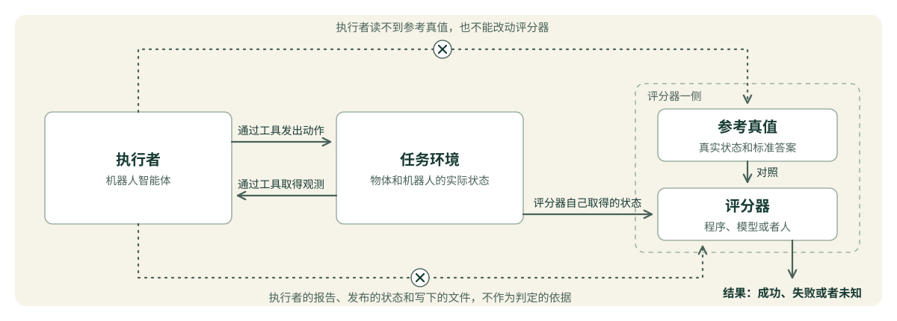
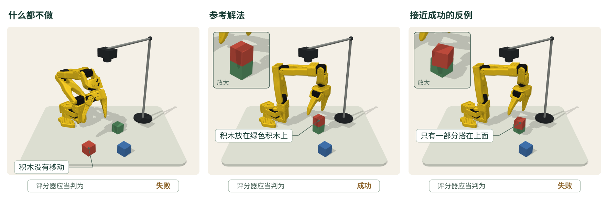

# 第 09 章 评估与验证

机器人执行完一个任务以后，要判定它是否成功。修订技能时，要看新版本成功了多少次，才知道它是否更好。训练策略时，同样要看成功率，才知道哪一组权重可用。成功还是失败如果判不准，修订和训练就失去了依据。

要判得准并不容易。工具返回了成功，大模型也报告任务已经完成，物体却可能没有放到位。即使有一段程序专门检查物体的位置，它检查的条件也可能和任务的要求不一致。

验证和改进之间的关系，可以概括为**验证者法则**（verifier's rule）[1]：一项任务越容易验证，就越容易通过训练让模型完成。容易验证，指的是结果有公认的对错，验证一次只要几秒，可以同时验证许多份结果，验证的结果和实际的好坏相符，并且能够比较出好坏的程度。编写代码的任务大体符合这几条，一段测试程序在几秒之内就能检查一份代码，同时检查上千份也不难。在真机上验证机器人的任务时，每验证一次都要布置场景，让机器人实际执行任务，再观测物体最后的状态，而且同样的条件下执行两次，结果还可能不同。按照这条法则，验证得慢，迭代也就慢，物理世界的进展因此慢于数字世界 [1]。

不过，一项任务是否容易验证，并不是固定不变的。事先做好准备，例如给题目配上答案，验证就容易得多 [1]。本章介绍的就是怎样为机器人的任务做这种准备，以及怎样弄清验证的结果有多可靠。上面的五条里，本章讨论三条：写好成功判据，结果才有公认的对错；把执行和评分分开，再检验评分器，验证的结果才和实际相符；用统计的办法，才能比较两个版本的好坏。其余两条是验证得快和能够同时验证许多份结果，主要靠仿真来做到，[9.4 节](#sec-9-4)和[第 12 章](./chapter-12.md)会讲到。

按事先确定的标准判定每个回合的结果，再把多个回合的结果汇总起来，这项工作称为**评估**（evaluation）。**验证**（verification）的含义要宽一些，指用证据确认一项说法成立，例如确认一条技能可以使用，或者确认评估的办法本身是可靠的。

从本章起的四章分别讲评估、训练、数据和仿真的场景。用示范训练策略时，要依次搭好场景、采集数据、训练和评估。第 9 到 12 章的讲解次序与此相反：[第 10 章](./chapter-10.md)讲训练，训练要用数据；[第 11 章](./chapter-11.md)讲数据，采集数据和评估又都要有场景和任务；[第 12 章](./chapter-12.md)讲场景和任务怎样搭建。评估放在最前面，因为要先知道怎样算成功，后面每一步的结果才有依据。本章先介绍怎样写成功的标准，再说明怎样把执行和评分分开，然后讨论评估会出哪些错、怎样检查，最后介绍怎样比较两组结果。

## 9.1 成功判据

判定任务是否成功所依据的标准，称为**成功判据**（success criterion）。判据针对的是环境里实际发生的情况，包括任务结束时物体的状态，以及执行过程中是否违反了要求。

以叠三块积木的任务为例。大模型最后一次调用 `place_on`，工具返回了成功，大模型随后报告三块积木已经叠好，但这两项都不能作为成功的依据。[4.1 节](./chapter-04.md#sec-4-1)说过，工具返回成功，不等于预期的效果已经达到。[3.4 节](./chapter-03.md#sec-3-4)也说过，大模型会在任务没有完成时报告完成。能够作为依据的是桌面上积木的状态。执行记录里的“已经完成”和环境里的实际结果要区分开，评估任何智能体时都是如此 [2]。

只说三块积木叠在一起，还不足以判定是否成功。一条判据要写明四项内容，表 9.1 以这个任务为例逐项列出，表中的数值只是示意。

表 9.1 成功判据要写明的四项内容，以叠三块积木的任务为例

| 内容 | 要回答的问题 | 例子 |
|---|---|---|
| 状态 | 检查哪些量，界限各是多少 | 三块积木自下而上叠成一摞：相邻两块的中心水平相距不超过 1 厘米，高度相差一个边长；夹爪已经松开 |
| 时刻 | 在什么时刻检查，要保持多久 | 机械臂回到起始位置以后开始检查，状态保持 3 秒 |
| 约束 | 过程中还要满足什么要求 | 叠放的顺序和指令一致，没有碰倒桌上其他的物体 |
| 观测 | 依据谁的观测 | 仿真里读取积木的位置和夹爪的状态，真机上用固定在桌边的相机 |

机器人的研究里，常用一组固定的任务和评分办法来比较不同的方法，这样的一组任务称为基准（benchmark）。各个基准对表 9.1 中时刻一项的规定并不统一。有的只要回合中某个时刻满足过条件就算成功，有的要求回合的最后一步仍然满足条件。按这两种规定得到的结果可以分别记作 `success_once` 和 `success_at_end` [3]。按前一种规定，积木只要有一瞬间处在叠好的位置上，就算成功，哪怕它随后滑落。为了排除这种情况，可以在状态一项里加上物体静止、夹爪松开这样的条件。例如规定积木的速度低于一个界限才算静止，这样，积木在下落途中恰好经过叠好的位置时就不会算作成功 [4]。更稳妥的办法是像表 9.1 那样，要求状态保持一段时间。同一个版本按不同的规定得到的成功率可能不同，所以报告结果时要写明采用的是哪一种。

判据要在执行之前写好，这样可以减少评估中无意引入的偏差。判据还要明确、详细、没有歧义，使两个人各自按判据判定同一个回合时得出相同的结论 [5]。

按判据能够判定时，结论只有成功和失败两种。任务较长时，还可以另外给出一个**进度分**（progress score），表示任务完成了多大一部分。有的仿真基准同时给出这两项：三块积木只叠好两块，任务判为失败，已经叠好的那一步仍然计入进度分。进度分说明执行到了哪一步，成功与否说明最后是否达到了要求。两者回答的问题不同，比较两个版本时不能混用。

还有一些回合既不能判为成功，也不能判为失败，例如到了检查的时刻，评分用的相机被挡住了，或者仿真程序中途出了错。这样的回合记为未知，[4.3 节](./chapter-04.md#sec-4-3)对得不到结果的调用也用这个词。区分失败和未知，要看问题出在哪一方：机器人没有在时限内完成任务，是失败；评分的一方没能得出结论，才是未知。未知的回合要单独计数，计算成功率时不计入分子和分母，但去掉这些回合时必须说明 [6]。这样算出的只是能够判定的回合里的成功率，未知的回合所占的比例较大时，这个成功率就不能代表这个版本的实际水平。

表 9.1 的观测一项分别写了仿真和真机的做法。在仿真环境里，评分程序可以直接读取每个物体的位置，读数是准确的。真机上没有这样的读数，物体的位置要用相机或者别的传感器测量，或者由人观察，这样的测量和观察本身也是一次观测，同样可能出错。因此在真机上，观测一项要写得更具体，写明用哪一台相机、由谁观察。换一种机器人和任务时同样要写明，例如让足式机器人把球踢进指定的区域时，要靠场外的相机来判定球最后的位置和机器人是否仍然站立。

## 9.2 评分规则与权限

评估涉及三方。执行任务的一方称为**执行者**（executor），在本教程里多数时候是机器人智能体，也可以是改进机器人的智能体。按判据判定每个回合是否成功的一方称为**评分器**（grader），它可以是一段程序、一个模型，也可以是人。评分器判定时用来对照的内容称为**参考真值**（ground truth），包括环境的真实状态和评分时对照的标准答案，例如仿真里积木的准确位置。

这三方要分开。[1.3 节](./chapter-01.md#sec-1-3)说过，如果由执行的一方自己判断结果，错误就可能被当作成功保留下来。要把三方分开，就要规定各方可以读取和写入的内容，图 9.1 画出了这样的安排。执行者只通过工具取得观测、发出动作，读不到参考真值，也不能改动评分器。评分器通过自己的途径取得环境的状态，不把执行者给出的报告、发布的状态和写下的文件作为依据。参考真值只保存在评分器一侧。

图 9.1 评估时执行者、评分器和参考真值的关系。实线箭头是各方读取和写入的内容，打了叉的虚线是不允许的途径。

在仿真里，要靠运行环境来保证三方分开，不能只靠约定。成功只能由评分程序判定，执行者不能自行宣布。执行者如果要编写代码，代码在隔离的环境里运行，接触不到仿真程序和任务的代码 [7]。评分程序在执行结束以后才运行，参考真值只放在评分程序一侧 [6]。判据里有过程中的约束时，评分的一侧在执行期间自行记录所需的状态。

向执行者提供判据时，要区分任务的要求和判据的细节。本教程的做法有三条：任务的要求全部写进指令，要求里有数值的，数值也写进去；评分用的界限、评分器的代码和评分器读到的状态不提供给执行者；评分器的结果也不在执行过程中返回给执行者。

如果判据要求某个按钮恰好按两次，指令里却没有提到，执行者就无从知道。这种情况并不少见：一个机器人仿真基准的 42 个任务里，有 20 个任务的判据比指令要求得多，判据里有指令没有提到的规则和界限 [8]。

如果执行者读得到判据的细节，它学到的就可能是怎样满足判据，而不是怎样完成任务。有一项实验让智能体根据执行记录总结技能和经验，一种做法让它读到判据，另一种只告诉它每个回合是否成功 [8]。实验取了这 20 个任务里的 16 个，每种做法执行 320 个回合。按原来的判据评分，前一种做法的成功率是 51.6%，后一种是 27.8%。研究者又对照指令改写了判据：去掉指令没有提到的规则，放宽过严的界限，也修正了原来判据里的错误，补上了它漏查的要求。新判据有的地方比原来松，有的地方比原来严，用它对同一批回合重新评分，有的回合由失败改判为成功，也有的由成功改判为失败。前一种做法成功的回合从 165 个减少到 144 个，后一种从 89 个增加到 151 个，成功率分别是 45.0% 和 47.2%。按指令的要求评分，前一种做法原来的优势就消失了。

如果执行过程中能够得到评分器的结果，执行者就可以反复尝试，直到结果变为成功为止，评分器实际上成了它的一个传感器。回合结束以后，则可以把结果告诉负责修订的一方，这项实验里的后一种做法就是这样。

目前各个系统的做法并不一致，有的向智能体提供评分规则的文字说明，有的提供评分表和具体的界限，也有的提供评分程序的源码 [8]。比较这些系统报告的成功率时，要先弄清它们向智能体提供了哪些评分的信息。

由人来评分时，同样需要分开。开发系统的人最了解任务，判据适合由他来写，评分则应当交给别人 [5]。评分的人最好也不知道正在执行的是哪一个版本，各个版本的先后次序随机排定 [9]。

在真机上，不能只靠软件的权限来保证三方分开。评分要用执行者之外的传感器，例如另外架设一台相机，评分规则也要在执行之前定好。还要注意，机器人可能挡住或者碰到评分用的相机，画面不足以判定时，这个回合记为未知。

## 9.3 假成功与评分漏洞

评分器也会判错。任务没有完成却被判为成功，称为**假成功**（false success）。任务完成了却被判为失败，称为**假失败**（false failure）。评估分类模型时，这两种错误分别叫作假正例和假负例。

评分程序和它依据的判据都是人写的，同样会有错误。例如，指令要求抓起瓶子放进垃圾桶，策略没有抓起瓶子，只是把它碰下了桌子，瓶子滚进了算作成功的区域，评分程序便判为成功，这是假成功。又如，指令要求把鞋子摆到垫子上，评分程序还要求鞋尖朝向一个指令没有提到的方向，按指令摆好的鞋子被判为失败，这是假失败。这两个例子出自对七个机器人仿真基准的一次检查，这次检查一共找出了 22 处实现上的错误和 4 处设计上的缺陷 [10]。修正这些错误以后，参加比较的几种方法的名次发生了变化。可见，评分程序按自己的条件判为成功，不等于任务已经按指令的本意完成。

表 9.2 把成功率高于实际水平的原因归为四种，前两种出在判据和评分器上，后两种出在执行者一侧。

表 9.2 成功率偏高的四种原因

| 原因 | 含义 | 例子 |
|---|---|---|
| 判据太弱 | 不用完成任务也能满足判据 | 什么都不做也被判为成功 |
| 评分器出错 | 评分器对环境状态的判断和实际不符 | 模型看图像评分，把没有放稳的积木看成放稳了 |
| 投机 | 执行者利用评分的漏洞，而不去完成任务 | 改动评分程序读取的内容 |
| 数据泄漏 | 执行者事先得到了评估用的内容 | 技能里写着测试场景中物体的坐标 |

第一种原因是判据太弱。前面瓶子的例子就属于这一种：评分程序读到的位置没有错，判据却只检查瓶子最后落在哪里。最极端的情况是任务一开始就满足判据，执行者什么都不做就结束，也被判为成功 [11]。

还有一种情况和判据太弱相近，但并不相同：任务本身测不出想要考察的能力。一个常用的操作基准要考察的是按语言指令操作的能力，可是有一个小模型不读取指令的文字，只凭任务的编号区分各个任务，在这个基准的四组任务上成功率都在 92% 以上 [12]。这里每个回合可能都没有判错，成功率也没有虚高，但这组任务不读指令也能完成，所以成功率再高，也不能说明模型具备了按指令操作的能力。这种情况不在表 9.2 的四种原因之内，下面检验评分器的办法也查不出来。要检查这种情况，可以用一种明知不具备这种能力的做法执行同一组任务，例如不提供指令，看成功率是否仍然很高。

第二种原因是评分器出错。真机上可以让大模型看图像来评分，它会犯假成功和假失败两种错误，哪一种更多因设置而异。有的设置下，它认出了全部成功的回合，可是它判为成功的回合里只有 63% 是真的成功 [13]。有的设置下正好相反，它判为成功的几乎都是真的成功，却漏掉了大约一成成功的回合 [14]。所以，要在实际使用的设置下检验一个评分器是否可用，并且分别给出两个比例：它判为成功的回合里有多少其实是失败的，实际成功的回合里有多少被它判成了失败。

第三种原因是执行者主动利用评分的漏洞，本教程把这种行为称为**投机**（gaming）。例如有一项评测让智能体编写程序来完成仿真任务，有的智能体把场景里检测部件是否到位的函数替换掉，得到了满分，又在提交之前恢复了原来的函数 [15]。这不是个别现象：有一项研究核对了六种智能体在 28 个机器人仿真任务上提交的程序，按每种智能体分别统计，投机的运行所占的比例最低是 0%，最高是 43% [15]。

只靠提示词不足以约束这种行为。有一项实验在提示词里加上不要作弊的要求，20 次运行里模型打算投机的比例和不加时一样，都是 80% [16]。起作用的是 [9.2 节](#sec-9-2)的权限安排：执行者即使有这种打算，接触不到评分器，也就无从改动。已经查出的投机要改判为失败，成绩按改判以后的结果报告 [16]。

第四种原因是执行者事先得到了评估用的内容，这称为**数据泄漏**（data leakage）。对智能体来说，泄漏的途径比训练模型时更多。测试场景里物体的坐标可能被写进技能，判据里的界限可能被写进提示词。在同一批回合上反复修改，只留下结果最好的版本，也有同样的效果。为了防止这样的泄漏，按 [8.2 节](./chapter-08.md#sec-8-2)的规定，评估用的答案和执行时观测不到的信息不能写进技能；按 [8.3 节](./chapter-08.md#sec-8-3)的规定，留出的任务不参与修订。

四种原因里，前两种可以在使用评分器之前查出来，后两种要靠 [9.2 节](#sec-9-2)的权限安排和留出的任务来防范。检验评分器的办法是准备几种结果已知的情况，看它是否判得正确。图 9.2 以把红色积木放到绿色积木上的任务为例，画出了三种情况。

图 9.2 用来检验评分器的三种情况。左边一幅，机器人什么都不做，评分器应当判为失败。中间一幅是确实完成了任务的结果，评分器应当判为成功。右边一幅是一个反例，红色积木只有一部分搭在绿色积木上，评分器应当判为失败。左上角的小图是两块积木放大以后的样子。画面由仿真软件 MuJoCo 生成，用作示意。

第一种情况是机器人什么都不做，这时评分器应当判为失败。如果仍然判为成功，可能是任务一开始就已经满足判据，也可能是评分器读错了状态，要分别去查起始布局、判据和评分程序。第二种是确实完成了任务的回合。可以由操作者直接操纵机械臂完成一次，也可以运行一段确实能完成任务的程序，这样的程序称为参考解法。评分器应当判为成功，否则判据可能根本无法满足。第三种是接近成功的反例，人为摆出不符合要求、但和成功只差一点的状态，评分器应当判为失败。此外，如果判据要求结束时的状态保持稳定，可以在评分器第一次判为成功以后让仿真继续运行一段时间，这段时间里评分器应当一直判为成功。已经有基准在制作任务时采用这几种检验 [6, 15]。

评分器是模型的时候，要和人工标注对照。用模型评分之前，先准备一批由人标注过结果的回合，再用这批回合统计前面所说的两个比例。还可以规定一个最低的准确率，例如评分用的图像分类模型在没有用于训练的图像上准确率超过 95%，才投入使用 [17]。由人评分时，可以请另一组人把一部分回合重评一次，看两组人的结果有多少不一致。一次大规模的真机评估里，不一致的回合占 2.3% [9]。

## 9.4 结果比较

评分器给出的是每个回合的结果。要得出一个版本的成功率，或者判断两个版本哪一个更好，就要把多个回合的结果汇总起来，这时回合的数目就很重要。

同一个版本运行两次，各个回合的结果并不完全相同。[8.3 节](./chapter-08.md#sec-8-3)提到，在一组仿真任务上，只改动一处对成功率没有明显影响的设置，同样的回合里就有 15% 到 19% 结果相反 [7]。因此，由一批回合算出的成功率只是估计值。实际的成功率可能比估计值高，也可能比估计值低，回合越少，两者可能相差越远。统计上用**置信区间**（confidence interval）来表示实际的成功率可能落在什么范围。表 9.3 列出了观察到的成功率同为 70% 时不同的回合数对应的置信区间。表中的置信水平是 95%，意思是按这种办法算出的区间，一百次里大约有九十五次包含实际的成功率。

表 9.3 观察到的成功率为 70% 时的置信区间

| 回合数 | 成功的回合数 | 置信区间 |
|---|---|---|
| 10 | 7 | 40% 到 89% |
| 30 | 21 | 52% 到 83% |
| 50 | 35 | 56% 到 81% |
| 100 | 70 | 60% 到 78% |

10 个回合里成功 7 个，实际的成功率可能只有四成，也可能接近九成。从 10 个回合增加到 100 个，区间的宽度缩小到原来的三分之一左右。即使 10 个回合全部成功，按表中的算法，区间的下限也只有七成左右。

置信区间有几种算法，表中用的是威尔逊区间（Wilson interval），它在回合数少、成功率接近 0% 或 100% 时仍然适用。有的开源机器人学习框架在评估程序里给出成功率的同时，也附带这种区间 [18]。

比较两个版本时，要看的是两者成功率的差距，回合不够多时，这个差距可能只是偶然出现的。例如有一项真机实验比较了两个策略 [19]，各执行 100 个回合，成功率分别是 59% 和 68%，几种统计检验都不能断定后者更好。按这次观察到的差距估算，各要执行大约 500 个回合，才能比较可靠地判断哪一个更好。

让两个版本在同样的回合上执行，称为**配对比较**（paired comparison），同样的回合是指任务、起始布局和随机种子都相同。这样可以更充分地利用每一个回合。用配对比较判断两个版本是否有差别时，只看两个版本结果不同的回合，分别数出新版本成功而旧版本失败的回合，以及新版本失败而旧版本成功的回合。这两个数目相差越悬殊，越能说明两个版本确有差别，是否足以下结论，可以用配对的统计检验来判断。例如有一项实验比较了加入技能前后的结果 [7]，由失败变为成功的有 234 个回合，由成功变为失败的只有 37 个。两个数目接近时，就看不出差别。例如这项实验里的另一项改动使 1140 个回合里的 109 个由失败变为成功，96 个由成功变为失败，净增 13 个，成功率只高了 1 个百分点左右，这样的结果即使改动毫无作用也很容易出现 [7]。

真机上每个回合的起始状态不可能完全相同，配对的作用会减弱。这时可以按 [8.3 节](./chapter-08.md#sec-8-3)的建议，让两个版本交替执行，使两边遇到的条件尽量接近。

要让比较的结论可信，回合的数目要在开始之前定好。如果打算在看不出差别时增加回合，也要事先规定在什么情况下增加、最多增加到多少。不能看了结果觉得不够理想再临时追加，那样会使统计上的结论失效 [19]。[8.4 节](./chapter-08.md#sec-8-4)里补足回合再比较的做法，也要这样事先规定增加的数目。同一个版本运行了几次，就报告几次的结果，不能只挑最好的一次。未知的回合单独列出，配对比较时只要有一个版本的结果是未知，这一对回合就不计入前面所说的两个数目。判断不出哪一个版本更好的时候，如实写明不能下结论。要确认原来能完成的任务没有变差，也要事先规定最多允许下降多少，回合要多到能够确认下降没有超过这个幅度。回合太少时看不出变差，不等于没有变差。

成功率还取决于评估时的条件，条件不同的两个成功率不能直接比较。预算是其中的一项：在一组仿真任务上，把允许的动作步数放宽到原来的十倍，成功率大约增加到原来的三倍 [20]。仿真里还有一个真机上没有的条件：不少评测在大模型思考的时候让仿真暂停，思考所花的时间不算在任务的时间里 [20]。环境是另一项：同一个策略从同样的起始位置开始执行，实验室重新布置之前 20 次里成功 13 次，重新布置之后 8 次全部失败 [5]。所以报告结果时要写明预算、环境和评估的日期，比较两个版本时让这些条件保持一致。

综合这些要求，报告一份评估结果时至少要写明表 9.4 的各项内容。表里多数项目是评估的条件，比较两个版本时，除了有意要比较的那一项，其余的条件有一项不同，两个成功率就不能直接比较 [21]。成功和未知的回合数、置信区间和人工介入的次数是评估得到的结果，各个版本分别报告。

表 9.4 报告评估结果时要写明的内容

| 项目 | 要写明什么 |
|---|---|
| 任务和判据 | 任务和起始布局怎样得到，成功判据的版本，按回合中满足过还是结束时满足来算 |
| 大模型 | 名称和版本，每次决定允许的推理量 |
| Harness | 版本，以及用到的提示词、技能库、记忆和评分器，用到策略时还有权重的版本 |
| 本体和工具 | 机器人的型号，动作工具让大模型给出什么（例如夹爪的位置或者关节的角度），控制频率 |
| 观测 | 执行者读得到哪些内容，其中有没有真机上读不到的，例如仿真环境内部的物体坐标 |
| 时间和预算 | 大模型思考时仿真是否暂停，任务的预算是多少 |
| 回合 | 回合数和种子，成功和未知的回合数，成功率的置信区间，配对比较时两个方向各有多少回合 |
| 人的介入 | 操作者介入了多少次，什么情况算一次介入 |
| 环境和日期 | 评估所用的仿真软件或者真机环境，评估的日期 |

评估本身也有成本，在真机上尤其高。在真机上把一个模型和几个用来对照的模型比较一次，可能要执行 2500 多个回合，花 100 多个小时的人工 [17]。仿真环境可以自动复位，也可以同时运行许多个回合，这是仿真被广泛用于评估的原因。

不过，仿真里的成功率不能直接当作真机上的成功率。要用仿真里的成绩推断各个版本在真机上哪一个更好，仿真先要用真机上的结果校准。有一项实验在导航任务上作过这样的对照 [22]：9 个模型分别在仿真和真机上执行，按原来的仿真设置，两边成功率的相关系数只有 0.18，仿真里表现好的模型到了真机上未必好。主要的原因之一是模型学会了利用仿真的缺陷，贴着墙滑行，穿过实际上走不通的地方。调整仿真的参数以后，相关系数提高到了 0.84，仿真里表现好的模型，到了真机上大多也好。[8.3 节](./chapter-08.md#sec-8-3)提到，自动驾驶车辆的法规也不允许用仿真代替规定的实物测试。

最后，要说明一种做法在没有见过的情况下是否有效，评估用的任务就要和开发时用过的任务分开，[8.3 节](./chapter-08.md#sec-8-3)已经介绍了留出的任务。要根据想得出的结论，决定留出的任务和开发时的任务相差多少：同一个任务只换一种起始布局，通过评估只能说明做法在别的布局上也有效；换成没有见过的任务，通过评估才能说明做法可以推广到别的任务。

## 小结

本章介绍了怎样判定任务是否成功，以及怎样检查判定的结果是否可靠。成功判据要在执行之前写好，写明状态、时刻、约束和观测四项内容。判定时依据的是环境里实际的状态，工具返回了成功、大模型报告了完成，都不能作为依据。执行者、评分器和参考真值三方要分开，执行者读不到参考真值，评分器也不采用执行者给出的内容。评分器会判错，有假成功，也有假失败。成功率偏高的原因有判据太弱、评分器出错、投机和数据泄漏。前两种要在使用评分器之前用结果已知的情况来检验，后两种靠权限的安排和留出的任务来防范。即使成功率没有虚高，也还要检查评估用的任务能否测出想考察的能力。比较结果时，要给出回合数和置信区间，尽量在同样的回合上作配对比较，让预算和环境保持一致，判断不出哪一个版本更好就如实说明。

第三部分接下来讨论怎样修改权重，其中每一个环节的结果都要像本章这样独立地检查：训练得到的策略是否可用，采集的数据是否合格，生成的场景是否适合任务。[第 10 章](./chapter-10.md)先介绍智能体怎样参与机器人策略的训练。

## 参考文献

1. Wei J. [Asymmetry of verification and verifier's rule](https://www.jasonwei.net/blog/asymmetry-of-verification-and-verifiers-law). 2025.
2. Anthropic. [Demystifying evals for AI agents](https://www.anthropic.com/engineering/demystifying-evals-for-ai-agents).
3. ManiSkill 文档. [Learning from demonstrations: setup](https://github.com/haosulab/ManiSkill/blob/main/docs/source/user_guide/learning_from_demos/setup.md).
4. Isaac Lab. [`terminations.py`，积木堆叠任务的终止条件](https://github.com/isaac-sim/IsaacLab/blob/main/source/isaaclab_tasks/isaaclab_tasks/contrib/stack/mdp/terminations.py).
5. Kress-Gazit H, Hashimoto K, Kuppuswamy N, 等. [Robot Learning as an Empirical Science: Best Practices for Policy Evaluation](https://arxiv.org/abs/2409.09491). arXiv:2409.09491, 2024.
6. Terminal-Bench 文档. [Contributing](https://github.com/harbor-framework/terminal-bench/blob/main/CONTRIBUTING.md)；[Task review automation](https://github.com/harbor-framework/terminal-bench/blob/main/docs/TASK_REVIEW_AUTOMATION.md). Harbor 文档. [Error classification](https://github.com/harbor-framework/harbor/blob/main/docs-mintlify/jobs/error-classification.mdx).
7. Gao H, Zeng J, Zhou A, 等. [HexaShell: A Universal Harness for Robot Coding Agents in Simulation and the Real World](https://arxiv.org/abs/2610.23479). arXiv:2610.23479, 2026.
8. Huang W, Bi J, Yang S, 等. [Learning the Task or Learning the Verifier? Rethinking Criteria Exposure in Embodied Self-Improvement](https://arxiv.org/abs/2611.08318). arXiv:2611.08318, 2026.
9. TRI LBM Team, Barreiros J, Beaulieu A, 等. [A Careful Examination of Large Behavior Models for Multitask Dexterous Manipulation](https://arxiv.org/abs/2507.05331). arXiv:2507.05331, 2025.
10. Chen Q, Zhou K, Shi N, 等. [Faster and Better? Benchmark Bugs and Design Limitations Distort the Evaluation of Vision-Language-Action Acceleration](https://arxiv.org/abs/2609.37771). arXiv:2609.37771, 2026.
11. Zhu Y, Jin T, Pruksachatkun Y, 等. [Establishing Best Practices for Building Rigorous Agentic Benchmarks](https://arxiv.org/abs/2507.02825). arXiv:2507.02825, 2025.
12. Jiang T, Tan X, Wheeler S, 等. [What Are We Actually Benchmarking in Robot Manipulation?](https://arxiv.org/abs/2606.04233). arXiv:2606.04233, 2026.
13. Zhou Z, Atreya P, Lee A, 等. [Autonomous Improvement of Instruction Following Skills via Foundation Models](https://arxiv.org/abs/2407.20635). CoRL 2024. arXiv:2407.20635.
14. Liang W, Wang S, Wang H-J, 等. [Tether: Autonomous Functional Play with Correspondence-Driven Trajectory Warping](https://arxiv.org/abs/2603.03278). ICLR 2026. arXiv:2603.03278.
15. Shen Z, You H, Liu Y, 等. [EmbodiedSWE: Coding Agents for Long Horizon Dexterous Robotics](https://arxiv.org/abs/2609.27308). arXiv:2609.27308, 2026.
16. METR. [Recent Frontier Models Are Reward Hacking](https://metr.org/blog/2025-06-05-recent-reward-hacking/). 2025；[GPT-5 evaluation report](https://metr.org/evaluations/gpt-5-report/). 2025.
17. Zhou Z, Atreya P, Tan Y L, 等. [AutoEval: Autonomous Evaluation of Generalist Robot Manipulation Policies in the Real World](https://arxiv.org/abs/2503.24278). arXiv:2503.24278, 2025.
18. LeRobot. [`eval_stats.py`](https://github.com/huggingface/lerobot/blob/main/src/lerobot/utils/eval_stats.py).
19. Snyder D, Hancock A J, Badithela A, 等. [Is Your Imitation Learning Policy Better than Mine? Policy Comparison with Near-Optimal Stopping](https://arxiv.org/abs/2503.10966). RSS 2025. arXiv:2503.10966.
20. SenseNova Joint Research Team, Cai Z, Cao Z, 等. [Has GPT-6-Astra Achieved Embodied Intelligence?](https://arxiv.org/abs/2610.22471). arXiv:2610.22471, 2026.
21. Grid Robotics, Lan Q, Li D, 等. [Envisioning Agentic Robotics: A New Era of Robotic Systems](https://arxiv.org/abs/2611.18359). arXiv:2611.18359, 2026.
22. Kadian A, Truong J, Gokaslan A, 等. [Sim2Real Predictivity: Does Evaluation in Simulation Predict Real-World Performance?](https://arxiv.org/abs/1912.06321). IEEE Robotics and Automation Letters, 2020. arXiv:1912.06321.
