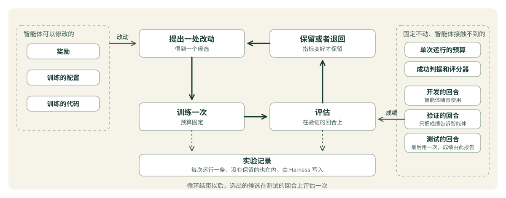
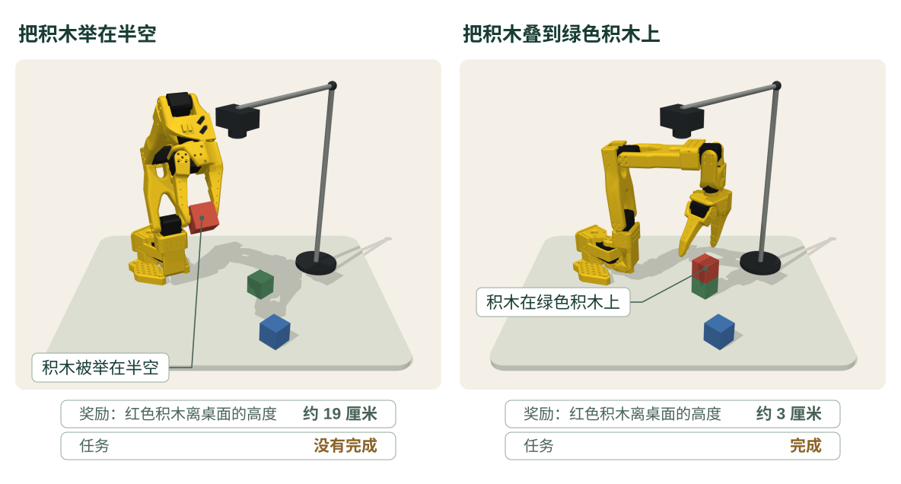

# 第 10 章 智能体驱动的机器人策略训练

有些能力很难写成说明或代码。例如把试管插进试管架时，夹爪要根据接触时受到的阻力逐步调整试管的位置和角度，这样的动作很难用文字说明，也难以写成几条规则。这类能力要靠训练得到，训练的结果是策略的权重。

启动训练程序只是训练的一部分。训练之前要准备示范，或者写出衡量动作好坏的奖励，还要选定训练用的各项参数。训练当中要查看各项数值的变化，判断进展是否正常。训练之后要让策略用保存下来的各份权重分别执行任务，按表现挑出一份。这些工作原来由工程师承担，现在可以交给智能体。这里的智能体是 [1.3 节](./chapter-01.md#sec-1-3)所说的改进机器人的一方，它操作的是代码、数据和实验，不直接指挥机器人。

把训练交给智能体以后，智能体每提出一种做法，都要训练一次才知道效果，花费的是算力和时间，所以要事先规定每次可以花费多少、一共可以尝试多少次。另外，训练过程中用来衡量进展的数值变好了，不等于机器人能够完成任务，所以还要用训练之外的评估来检查训练的结果。

本章先说明什么时候值得训练，介绍训练的基本过程，再说明智能体可以承担其中的哪些工作，然后讨论怎样在固定的预算里安排实验、选出结果，接着介绍训练好的策略怎样接回任务系统，最后讨论怎样调整大模型自己的权重。

<a id="sec-10-1"></a>

## 10.1 训练基础

动手训练之前，先要判断是否值得训练。训练适合的情况是，大模型给出的指令正确，机器人却不能把动作做好，而且这个动作难以用代码写出来。例如插试管时要随着阻力调整，抓形状不规则的物体时要边看边调整。如果问题出在大模型看不到需要的信息，或者任务分解有误，训练策略就没有帮助，这时应当修订 Harness 和技能。所以要先修改程序，确认失败是因为机器人缺少某种动作能力，再去训练 [1]。

训练出来的权重也不一定比代码好。用一段程序产生的数据去训练策略，得到的策略未必比这段程序本身强。在已有的报告里，策略在多数任务上不如这段程序，或者只是持平 [2]。[13.1 节](./chapter-13.md#sec-13-1)讨论怎样在修订技能和训练策略之间选择。

本章以训练叠放积木的策略为例：策略读取相机的图像和关节的状态，输出夹爪的动作，把夹爪里的积木放到另一块积木上。叠放形状规则的积木，用代码就能完成，真正需要训练的是插试管这类靠接触来调整的动作。这里以叠放积木为例，是因为读者已经熟悉这个任务。

策略是输入观测、输出动作的模型。训练就是调整它的权重，使它在各种观测下给出合适的动作。按依据的不同，训练有两种基本的方式。

第一种是让策略学习现成的做法，称为**模仿学习**（imitation learning）。操作者先操纵机器人完成若干次任务，例如叠放几十次积木，每次都记下各个时刻的观测和动作，这样的记录称为示范。训练时把示范里的观测输入策略，比较策略给出的动作和示范里的动作，两者的差距用一个数值表示，称为损失（loss）。训练的过程就是不断调整权重，让损失变小。

第二种是让策略自己尝试，按尝试的效果来调整，称为**强化学习**（reinforcement learning）。这时要事先写出一个计算规则，根据机器人和环境的状态给每一步算出一个分数，这个分数称为**奖励**（reward）。例如训练叠放积木的策略时，夹爪里的积木离下方积木的顶面越近，奖励越高，积木掉到桌上则扣分。策略在环境里反复尝试，训练的过程就是调整权重，让一个回合里得到的奖励总和更大。

强化学习需要的尝试数量很大，在真机上进行既慢又容易损坏设备，所以通常在仿真里进行。仿真软件可以同时运行许多个相互独立的环境。在一块图形处理器（GPU）上同时仿真几千台四足机器人，平地上行走的策略不到四分钟就能训练完成，崎岖地形上也只要二十分钟，而以前的做法要几十个小时 [3]。训练一次的时间缩短到这种程度，才有可能在一天里比较许多种做法。

仿真里训练出来的策略，最后要用在真机上。仿真和真实的环境总有差别，例如物体表面的摩擦和电机的响应不同，所以策略在仿真里学到的动作到了真机上可能不再有效。为此，训练时通常让摩擦这类参数在一定的范围内随机变化，使策略不依赖某一组特定的数值，这种做法称为**域随机化**（domain randomization）。

两种方式事先要准备的内容不同：模仿学习要先采集示范，强化学习要先有可以反复尝试的环境，通常是仿真环境，还要写出奖励，见表 10.1。

表 10.1 两种训练方式

| | 模仿学习 | 强化学习 |
|---|---|---|
| 依据 | 操作者的示范 | 事先写好的奖励 |
| 衡量进展的数值 | 损失，越小越好 | 奖励，越大越好 |
| 训练的场所 | 在计算机上，用采集好的示范 | 多在仿真里，由策略自己尝试 |
| 事先的准备 | 采集示范 | 搭建仿真环境，写出奖励 |
| 例子 | 机械臂的抓取和插装 | 足式机器人的行走 |

训练是分步进行的，每一步调整一次权重。训练程序每隔一定的步数把当时的权重保存成一份文件，称为**检查点**（checkpoint）。训练结束以后得到的是一系列检查点，实际使用的是其中的一份。

损失和奖励是训练用的信号。它们变好，说明训练在按设定的方向进行，并不说明任务能够完成 [4]。例如在模仿学习里，留作检查的示范上损失最小的检查点，不一定是执行任务时表现最好的检查点 [5]。所以，每一份检查点都要按[第 9 章](./chapter-09.md)的办法另行评估：用事先写好的成功判据，由训练之外的评分器，在一定数量的回合上判定它是否可用。以叠放积木为例，成功判据按 [9.1 节](./chapter-09.md#sec-9-1)表 9.1 的格式写出，这里只举状态和时刻两项：积木叠在指定的位置上，夹爪已经松开，这个状态保持了规定的时间。奖励再高，达不到这项判据也不算成功。

机器人智能体里可以训练的权重有两种。一种是策略的权重，[6.3 节](./chapter-06.md#sec-6-3)已经介绍过大模型怎样通过工具调用策略。另一种是大模型自己的权重。[10.2 节](#sec-10-2)到 [10.4 节](#sec-10-4)讨论前一种，[10.5 节](#sec-10-5)讨论后一种。

<a id="sec-10-2"></a>

## 10.2 智能体的参与方式

由工程师在仿真里训练足式机器人的行走时，过程可以分成四步 [6]：训练，回放，换一种仿真软件测试，上真机。训练这一步得到检查点。回放是让策略在仿真里执行，查看效果是否符合预期。换一种仿真软件测试，是为了确认策略没有依赖某一种仿真软件的特性。最后才把策略装到真机上运行。

在这个过程里，智能体可以承担四类工作，多数在训练和回放这两步，见表 10.2。表中的配置指训练用的各项参数，训练内容由易到难的安排通常称为课程（curriculum）。

表 10.2 智能体在训练里可以承担的工作

| 工作 | 内容 | 例子 |
|---|---|---|
| 设计奖励 | 写出计算奖励的代码，并根据训练的结果修改 | 积木放下时晃动，就加上限制松开时速度的一项 |
| 修改代码和配置 | 调整训练的参数、训练内容由易到难的安排和域随机化的范围 | 把积木表面摩擦的随机范围放宽 |
| 安排实验 | 启动、监视和停止训练，决定下一次实验的内容 | 奖励不再上升时，提前停止这次训练 |
| 分析结果 | 阅读训练的日志和执行的录像，找出问题，挑选检查点 | 从录像里看出策略一直把积木举在半空 |

以设计奖励为例，奖励由若干项组成，叠放积木的奖励除了积木离目标位置的远近，还可以有松开时的速度、夹爪用力的大小等几项。以往，工程师靠反复试验来确定每一项怎样计算、各占多大的比重。现在可以让大模型来写：它一次写出若干份奖励的代码，每一份各训练一个策略，训练的统计结果再反馈给它，由它写出下一批，这样重复几轮。有一项实验在 29 个仿真任务上比较了这样得到的奖励和工程师写的奖励，都按任务自己的指标衡量：在 83% 的任务上，用前一种奖励训练出的策略，成绩不低于用后一种奖励训练出的策略 [7]。

大模型写出的奖励不能直接采用，它有三种常见的问题。第一种是代码无法运行，在一项实验里大约占一成 [8]。第二种是奖励的方向错了，例如任务是把椅子折叠起来，奖励鼓励的却是展开 [9]。第三种最难发现：奖励能够运行，训练也很顺利，但策略学到的不是想要的动作。例如指令要求人形机器人把包裹平稳地推到目的地，训练出的策略却把它踢过去或者扔过去 [10]。前两种靠试运行和人工检查可以查出来，第三种要靠独立的评估，[10.3 节](#sec-10-3)再讨论。

早期的做法是把大模型嵌在固定的流程里，按预先写好的提示词调用，它只负责写奖励。现在也可以使用通用的编写代码的智能体，它可以读写文件、运行命令，能够承担上面的四类工作。训练框架为这种智能体写的说明里，有这样几条要求 [4, 11]：开始之前，先向用户问清目标、硬件和可用的时间；加大规模之前，先做一次小规模的试运行；每次实验只改动一个变量；奖励上升不能当作任务表现改善的证明。有的训练框架已经把这些要求写成技能，放在代码仓库里供智能体读取 [4]。

成功的定义和上真机这两项，仍然由人负责。成功判据由人事先写好，智能体改的是奖励，不是成功判据。上真机这一步由操作者负责。以足式机器人为例，操作者先把机器人吊起来启动，确认状态稳定以后再慢慢放到地面，并且可以随时用遥控器让它停下 [6]。

<a id="sec-10-3"></a>

## 10.3 固定预算循环

智能体每提出一种做法，例如一份新的奖励，都要训练一次才知道效果。一次训练称为一次运行（run），为回答一个问题而做的一组运行称为一次实验（experiment）。待比较的做法称为候选，和 [8.2 节](./chapter-08.md#sec-8-2)的候选版本是同一个意思。运行的数量增加得很快。按 [10.2 节](#sec-10-2)的办法为一个任务设计奖励，一次写 16 份，进行 5 轮，就要训练 80 个策略，在 8 块 GPU 上用时不到一天 [7]。

一次运行所允许的花费称为它的预算，可以用时间规定，也可以用训练的步数规定。各个候选的预算应当相同，否则训练时间长的候选更有利，比较就失去了意义。按事先定好的条件提前停止的运行，也算一次。

预算固定以后，训练按固定预算循环进行：智能体每次只提出一处改动，按同样的预算训练一次，评估以后决定保留还是退回 [12]。循环开始之前要先定好：智能体可以修改的内容，例如奖励和训练的配置；不能修改的内容，例如成功判据和评估用的回合；一次运行的预算和整个循环的运行次数；决定保留的规则。

第一次运行不作任何改动，它的结果用作后面比较的对照。此后每一轮有四步。第一步，智能体提出一处改动，得到一个候选，例如在叠放积木的奖励里增加关于松开时速度的一项。第二步，按预算训练一次。第三步，让训练出的策略在评估用的回合上执行，由评分器逐个回合判定，算出成功率。衡量候选好坏的数值称为指标，这里的指标就是成功率。第四步，和改动之前比较，符合事先定好的保留规则就保留这处改动，否则退回到改动之前的状态。图 10.1 画出了这个循环，图中三组回合的安排在后面说明。

<p align="center"></p>

图 10.1 固定预算的训练循环。左边是智能体可以修改的内容，右边是固定不动、智能体接触不到的内容，中间用粗箭头画出循环的四步，虚线表示每次运行都写入实验记录。

循环开始之前定好的这些界限，不能只写在给智能体的说明里。预算要由启动训练的一方从外部强制执行，指标要由 Harness 计算并写入记录，评分的代码和用来决定保留与否的回合要放在智能体接触不到的位置。否则智能体可以改动检查预算的代码，记录也成了它自己写的。曾有智能体在实验超出规定的时间以后去修改代码里的时间限制，而不是缩短实验 [13]。这些要求和 [9.2 节](./chapter-09.md#sec-9-2)执行者与评分器分开的要求是一致的。

挑选检查点时，要让策略用各个检查点的权重实际执行任务，再按成功率挑选，不能按训练的信号挑选。模仿学习里有两种简便的做法，一种是取留作检查的示范上损失最小的检查点，另一种是取最后一个检查点。这样挑出的检查点，和实际执行以后成绩最好的检查点相比，成功率相对下降了 10% 到 100% [5]。另外，按成功率挑出的最好的候选，成绩也往往偏高，因为各个候选的评估结果都有波动，成绩最好的一个多少带有偶然的成分。例如在一项让智能体做机器学习实验的评测里，得分最高的一个解法重新运行以后，得分从 0.88 降到了 0.69 [14]。

为了不高估选出的候选，评估用的回合要分成三组 [2]。回合之间的差别来自随机种子，叠放积木时每个种子对应一种起始布局和积木表面的摩擦，所以分组就是把种子分成三组。开发的一组供智能体随意使用。验证的一组由评分的一方掌握，开发期间只把成绩告诉智能体，循环里依据这一组决定保留还是退回。测试的一组只在最后使用一次，报告的成绩全部出自这一组。还可以更进一步，让不同的智能体分别负责开发和最后的检验 [1]。

每次运行都要留下记录，没有带来改进的运行也不例外。下面是一条记录的例子，内容只是示意。

```text
运行      r-0412，在 r-0398 的基础上改动
改动      奖励里加入松开时积木速度的一项，比重 0.2
配置      环境 4096 个，随机种子 3
代码      版本 3f2a9c1
预算      训练 1500 步，用时 28 分钟
结果      验证的回合成功 46/50，改动之前是 38/50
          由失败变为成功 9 个，由成功变为失败 1 个
检查点    runs/r-0412/model_1500.pt
状态      保留
```

记录里的改动只有一处，这样才能判断效果来自哪里。结果一项除了两个总数，还记下了多少回合由失败变为成功、多少由成功变为失败，[9.4 节](./chapter-09.md#sec-9-4)的配对比较要用这两个数。本例事先定下的保留规则是：配对的检验表明两份权重的差别不大可能出于偶然时，才保留改动。有 9 个回合由失败变为成功，只有 1 个由成功变为失败。如果两份权重实际上一样好，这样悬殊的结果出现的可能性只有 2% 左右，所以这一轮保留。这个结论只适用于这两份训练好的权重。要换几个随机种子重新训练，才能知道奖励里加的这一项是否总有好处；选出的候选最后的成绩，也要在测试的一组上另测。训练框架自己会保存一部分内容，例如配置、随机种子和检查点，有的还保存代码的版本。Harness 要补上预算、改动的说明和评估的结果。

评估和奖励分开，评估又固定不变，才能发现策略利用奖励漏洞的情况。奖励是按事先写好的规则算出的数值，策略只是让这个数值变大，奖励本身反映不出策略用的办法是否合乎要求。图 10.2 是叠放积木的例子，这里故意换了一种有漏洞的奖励，只按红色积木离桌面的高度计算：策略把积木举在半空，奖励很高，任务却没有完成。只看仿真里的成绩，同样会漏掉问题 [15]。让大模型为四足机器人的奔跑设计奖励时，提示词里如果没有关于安全的要求，训练出的策略在仿真里的速度是每秒 1.8 米，比有这项要求时的每秒 1.7 米还快。可是它跑的时候有三只脚和髋部拖在地上，到了真机上，一起步就摔倒，速度是 0，而有安全要求时训练出的策略在真机上是每秒 1.2 米。

<p align="center"></p>

图 10.2 奖励高不等于任务完成。任务是把红色积木叠到绿色积木上，奖励是红色积木离桌面的高度。左边一幅里积木举在半空，奖励高，任务没有完成。右边一幅里积木叠好了，奖励反而较低。画面由仿真软件 MuJoCo 生成，用作示意。

所以，智能体改动了奖励以后，奖励的数值就不能再用来比较改动前后的结果，比较要依据固定不变的评估。评估里还应当包括奖励没有顾及的方面，例如动作是否平稳，是否损害设备。

这个循环用在机器人策略的训练上，还要注意评估结果的波动和预算的规定方式。评估要靠在仿真里或者真机上执行回合，结果有波动，要按 [9.4 节](./chapter-09.md#sec-9-4)的办法给出回合数和置信区间。两个候选的成功率分不出哪一个更高时，不能算作变好。预算用训练的步数来规定比用时间更合适：如果按时间规定，速度快的机器在同样的时间里训练的步数更多，各个候选就不再可比。按步数规定时，并行环境的数目也要固定，否则每一步用到的数据量不同。重新训练和重新评估都要花费算力，这部分花费要事先算进预算。

<a id="sec-10-4"></a>

## 10.4 策略接入

训练得到的策略接回任务系统以后，由大模型通过工具来调用，[6.3 节](./chapter-06.md#sec-6-3)已经介绍了这种办法：策略以工具的形式提供，调用契约里写明它的输入、适用的范围和结束的条件。叠放积木的策略接入以后也是这样一个工具，契约的写法和 [6.3 节](./chapter-06.md#sec-6-3)的 `grasp_with_policy` 相同，只是起始的条件不同：`grasp_with_policy` 开始时夹爪是空的，叠放的工具则要求调用之前夹爪里已经夹着积木。大模型给出一句指令，例如“把红色积木放到绿色积木上”，夹爪怎样移动由策略负责。新训练的策略还要补上训练和评估时的条件，例如用的是哪一种机器人、哪一种仿真软件、什么样的物体和地面，并补上评估的结果。叠放积木的策略要写明训练和评估时用的是多大的积木、开始时夹爪在什么范围之内，超出这个范围的情况没有经过验证。这相当于 [7.4 节](./chapter-07.md#sec-7-4)的验证记录。

权重要有版本。一个检查点出自一次运行，运行的记录里有代码的版本、配置和数据，所以检查点要和这次运行的记录保存在一起。调用策略的代码不宜直接写明某一个检查点。实验管理工具里通行的做法是给模型的版本起别名，使用的一方按别名取用 [16]。每次执行时，还要在执行记录里记下别名当时指向的是哪一个检查点。要换成新的版本，就把别名指向新版本，出了问题再指回原来的版本，这就是 [8.4 节](./chapter-08.md#sec-8-4)的回滚。

换了检查点，等于换了一个策略，原来的验证记录不能沿用。新的检查点要按 [8.3 节](./chapter-08.md#sec-8-3)的办法和原来的版本作 [9.4 节](./chapter-09.md#sec-9-4)的配对比较，原来能完成的任务不能变差。上真机之前的检查仍然由人负责，新的检查点也要按 [8.4 节](./chapter-08.md#sec-8-4)的次序分步启用。

<a id="sec-10-5"></a>

## 10.5 大模型的微调

前面三节讨论的是策略的训练，任务系统里做决定的大模型权重一直不变。大模型的权重也可以训练。在已经训练好的模型上继续训练，称为**微调**（fine-tuning），常用的办法有两种。**监督微调**（supervised fine-tuning）给模型看输入和期望的输出，让它的输出向期望的输出靠近，相当于模仿学习。**强化微调**（reinforcement fine-tuning）让模型自己执行任务，按任务的结果给出奖励，相当于强化学习。用一个能力强的模型的输出作数据来训练一个较小的模型，称为**蒸馏**（distillation），前者称为教师，后者称为学生。

并不是每个大模型都可以微调。截至 2026 年 11 月，三家主要厂商最强的模型都不向用户开放微调 [17]。用户能够微调的，是权重公开的模型，以及云平台上的一部分中等规模的模型。

在机器人智能体上，目前有实验结果可依的一种做法是用执行记录来蒸馏，分三步。第一步，让一个能力强的大模型作教师，在 Harness 里执行任务，例如叠积木。每执行一次，留下一份执行记录，里面有每一步的观测、大模型的决定、工具的调用和返回。第二步，筛选出成功的执行记录，筛选时除了仿真给出的结果和程序的检查，还要有人工复查。第三步，选一个权重公开的小模型作学生，用这些记录对它作监督微调。学生和教师用的是同一套 Harness。

做这三步之前，要先修订好 Harness 和技能。教师的记录质量取决于 Harness，而学生正是按这些记录训练的。同一个教师模型，只给它图像时成功率是 56.2%，换成完整的 Harness 是 88.6% [18]。厂商的文档也建议先修改提示词，效果仍然不够再考虑微调 [17]。

蒸馏带来的好处主要是速度。在一组这样的实验里 [18]，教师在 15 个仿真任务上的成功率是 90.4%，学生微调之前是 22.2%，微调之后是 87.1%，接近教师。在真实的机械臂上，学生微调以后的成功率同样接近教师。学生在本机运行，每次调用的时间从教师的 4.2 秒左右降到 0.6 秒左右，也不再依赖网络。学生学的是在这一套工具和提示词下怎样做决定。所以工具或者技能改动以后，要重新评估学生，成绩下降时，还要重新产生记录、重新训练模型。

对训练用的执行记录有三项要求。第一，成功的记录要经过检查，如果只靠仿真给出的结果，会混进标注错误的记录 [18]。第二，这批记录里要有一部分包含从失败中恢复的过程，例如积木滑落以后重新观测、再次抓取。记录总数相同时，加入这类记录以后，学生在没有见过的任务上的成功率从 77.1% 提高到 90.8% [18]。第三，训练时要混入一般性的数据，例如普通的对话数据。只用智能体的执行记录来微调，模型在没有见过的任务上的得分是 0.09，混入一般性的数据以后是 0.67 [19]。另外，用模型自己成功的记录来训练它自己，未必有益，也有变差的例子 [20]。

几种办法有先后的次序。模型一开始几乎完成不了任务时，强化微调要放在监督微调之后，因为这时很少得到奖励，改进得很慢。在一组上层规划的任务上，只做强化微调，平均成功率是 9.3%；只做监督微调是 21%；先监督微调、再强化微调是 35.6% [21]。强化微调还需要能够自动给出奖励的环境，所以目前多在仿真里进行。

训练大模型时有一些常见的失败方式，表 10.3 列出了七种 [22]。其中第二到第四种出在把执行记录变成训练样本的环节，其余几种是学习信号的问题，训练策略时也会遇到。

表 10.3 训练大模型时的七种失败方式

| 失败方式 | 含义 | 对策 |
|---|---|---|
| 冷启动 | 模型几乎不调用工具，强化微调没有可以强化的行为 | 先做监督微调，训练数据要覆盖调用工具的情况 [21] |
| 环境的输出算进了损失 | 执行记录里工具返回的内容，也被当作模型的输出来训练 | 计算损失时只算模型自己写出的部分 [23] |
| 重新分词造成偏差 | 模型生成的是一串 token，把它转成文字、再重新切分成 token，得到的可能和原来的不一样 | 训练时直接使用模型生成时得到的 token [24] |
| 环境的错误算作模型的错误 | 工具超时或者环境出错造成的失败，被当作模型决定错误 | 先分清原因。确认是工具或者环境出错的，重新执行这个回合，或者不把这条记录用作训练样本；这样的超时不计入奖励 [25] |
| 坍缩 | 模型的输出变得千篇一律，不再随输入而变化 [26] | 检查输出是否随输入变化，去掉区分不出好坏的样本 |
| 奖励的漏洞被利用 | 奖励只是真实目标的近似，奖励继续提高，实际的效果反而变差 [27] | 用独立的评估检查，修改训练用的奖励 |
| 没有成功的信号 | 一组尝试全部失败，没有可以学习的例子 [28] | 对部分完成的任务也给出奖励，对没有解决的任务多采样 |

其中“环境的输出算进了损失”和“环境的错误算作模型的错误”两种，在机器人上尤其要留意。机器人的执行记录里夹杂着大量工具返回的内容，例如 `locate` 返回的坐标和工具的错误信息，训练时要分清哪些是模型自己的输出。机器人的工具也经常出错，例如感知没有结果、运动规划失败、仿真软件出错。如果不加区分地把这些回合当作模型的失败，模型就会学会回避这些工具。

微调过的大模型和训练出的策略一样，要按[第 9 章](./chapter-09.md)的办法评估以后才能使用。它要和微调之前的模型比较，用了蒸馏的还要和教师模型比较，还要看它在没有见过的任务上的表现，并检查它原有的一般能力是否丢失。除了微调做决定的大模型，还有一种选择是另外训练一个专门判断任务是否成功的模型，作为工具或者评分器来使用，[9.3 节](./chapter-09.md#sec-9-3)提到的评分用的图像分类模型就属于这一种。这样做不改动做决定的大模型。

## 小结

本章介绍了智能体怎样参与训练，以及怎样检查训练的结果。动作难以用代码写出、修改程序又解决不了时，才值得训练。训练有模仿学习和强化学习两种方式，损失和奖励是训练的信号，它们变好不等于任务能够完成。智能体可以设计奖励、修改代码和配置、安排实验、分析结果，成功的定义和上真机的检查仍然由人负责。每个候选都要训练一次，所以要固定预算，预算和评估放在智能体接触不到的位置。挑选候选和检查点要依据固定的评估，报告的成绩出自只用一次的那一组回合。每次运行都留下记录。训练好的策略以工具的形式接回任务系统，权重要有版本和验证记录。大模型自己的权重也可以调整，本章介绍了其中有实验结果可依的一种做法，即用执行记录来蒸馏：先把 Harness 和技能改好，让能力强的模型执行任务、留下执行记录，再用这些记录微调小模型。

用模仿学习训练策略要有示范，把教师的做法蒸馏给小模型要有执行记录，这些数据的数量和质量决定了训练的结果。[下一章](./chapter-11.md)介绍智能体怎样采集和整理机器人的数据。

## 参考文献

1. Liu S, Corcodel R, Zhao D. [ELEVATE: Agentic Controller Acquisition from Task Failure for Quadrupedal Manipulation](https://arxiv.org/abs/2610.38388). arXiv:2610.38388, 2026.
2. Wang X, Li B, Wang H, 等. [SEAR: Self-Evolving Agentic Robotics](https://arxiv.org/abs/2610.18792). arXiv:2610.18792, 2026.
3. Rudin N, Hoeller D, Reist P, 等. [Learning to Walk in Minutes Using Massively Parallel Deep Reinforcement Learning](https://arxiv.org/abs/2109.11978). CoRL 2021. arXiv:2109.11978.
4. Isaac Lab. [Agent skills](https://github.com/isaac-sim/IsaacLab/tree/main/skills)，其中的 `train-rl-agents`、`debug-rl-training` 和 `domain-randomization-events`.
5. Mandlekar A, Xu D, Wong J, 等. [What Matters in Learning from Offline Human Demonstrations for Robot Manipulation](https://arxiv.org/abs/2108.03298). CoRL 2021. arXiv:2108.03298.
6. Unitree. [unitree_rl_gym](https://github.com/unitreerobotics/unitree_rl_gym)，说明文件和真机部署说明.
7. Ma Y J, Liang W, Wang G, 等. [Eureka: Human-Level Reward Design via Coding Large Language Models](https://arxiv.org/abs/2310.12931). ICLR 2024. arXiv:2310.12931.
8. Xie T, Zhao S, Wu C H, 等. [Text2Reward: Reward Shaping with Language Models for Reinforcement Learning](https://arxiv.org/abs/2309.11489). ICLR 2024. arXiv:2309.11489.
9. Wang Y, Xian Z, Chen F, 等. [RoboGen: Towards Unleashing Infinite Data for Automated Robot Learning via Generative Simulation](https://arxiv.org/abs/2311.01455). ICML 2024. arXiv:2311.01455.
10. Lee H, Subramanian A, Abbatematteo B, 等. [RDA: Reward Design Agent for Reinforcement Learning](https://arxiv.org/abs/2606.01672). RLC 2026. arXiv:2606.01672.
11. LeRobot. [AGENT_GUIDE.md](https://github.com/huggingface/lerobot/blob/main/AGENT_GUIDE.md).
12. Karpathy A. [autoresearch](https://github.com/karpathy/autoresearch). 2026.
13. Lu C, Lu C, Lange R T, 等. [The AI Scientist: Towards Fully Automated Open-Ended Scientific Discovery](https://arxiv.org/abs/2408.06292). arXiv:2408.06292, 2024.
14. Wijk H, Lin T, Becker J, 等. [RE-Bench: Evaluating frontier AI R&D capabilities of language model agents against human experts](https://arxiv.org/abs/2411.15114). ICML 2025. arXiv:2411.15114.
15. Ma Y J, Liang W, Wang H-J, 等. [DrEureka: Language Model Guided Sim-To-Real Transfer](https://arxiv.org/abs/2406.01967). RSS 2024. arXiv:2406.01967.
16. MLflow 文档. [Model Registry](https://mlflow.org/docs/latest/ml/model-registry/).
17. OpenAI 文档. [Supervised fine-tuning](https://platform.openai.com/docs/guides/supervised-fine-tuning). Claude 文档. [Glossary](https://platform.claude.com/docs/en/about-claude/glossary). Gemini API 文档. [Fine-tuning](https://ai.google.dev/gemini-api/docs/model-tuning). Google Cloud 文档. [Introduction to tuning](https://docs.cloud.google.com/gemini-enterprise-agent-platform/models/tuning). 2026 年 11 月 17 日读取.
18. Liu H, Li X, Yao S, 等. [Guava: Distilling Frontier VLMs into a Compact Agent through a Robotic Manipulation Harness](https://arxiv.org/abs/2606.18363). arXiv:2606.18363，第 3 版, 2026.
19. Zeng A, Liu M, Lu R, 等. [AgentTuning: Enabling Generalized Agent Abilities for LLMs](https://arxiv.org/abs/2310.12823). arXiv:2310.12823, 2023.
20. Pan J, Wang X, Neubig G, 等. [Training Software Engineering Agents and Verifiers with SWE-Gym](https://arxiv.org/abs/2412.21139). ICML 2025. arXiv:2412.21139.
21. Wu D, Fan J, Zang J, 等. [Reinforced Reasoning for Embodied Planning](https://arxiv.org/abs/2505.22050). arXiv:2505.22050, 2025.
22. Li Z S, Wang Z, Cui H, 等. [Failure Modes in Agentic AI: From Reproducible Triggers and Diagnostics to Reliable Fixes](https://failure-mode-agent.github.io/). EMNLP 2026 教程.
23. Jin B, Zeng H, Yue Z, 等. [Search-R1: Training LLMs to Reason and Leverage Search Engines with Reinforcement Learning](https://arxiv.org/abs/2503.09516). arXiv:2503.09516, 2025.
24. Agent Lightning Team. [No More Retokenization Drift: Returning Token IDs via the OpenAI Compatible API Matters in Agent RL](https://vllm.ai/blog/2025-10-22-agent-lightning). vLLM 博客, 2025.
25. Xue Z, Zheng L, Liu Q, 等. [SimpleTIR: End-to-End Reinforcement Learning for Multi-Turn Tool-Integrated Reasoning](https://arxiv.org/abs/2509.02479). arXiv:2509.02479, 2025.
26. Yue Y, Chen Z, Lu R, 等. [Does Reinforcement Learning Really Incentivize Reasoning Capacity in LLMs Beyond the Base Model?](https://arxiv.org/abs/2504.13837). NeurIPS 2025. arXiv:2504.13837.
27. Moskovitz T, Singh A K, Strouse D, 等. [Confronting Reward Model Overoptimization with Constrained RLHF](https://arxiv.org/abs/2310.04373). arXiv:2310.04373, 2023.
28. Qu Y, Setlur A, Smith V, 等. [POPE: Learning to Reason on Hard Problems via Privileged On-Policy Exploration](https://arxiv.org/abs/2601.18779). arXiv:2601.18779, 2026.
