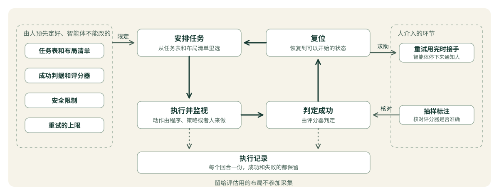
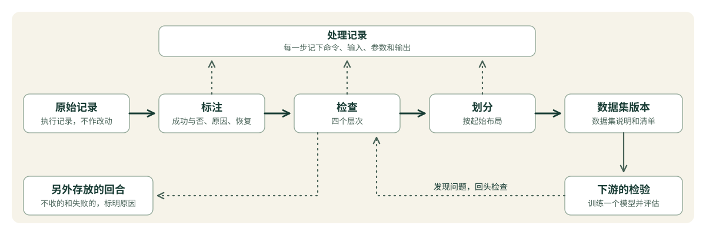

# 第 11 章 智能体采集与整理机器人数据

训练出来的模型表现如何，取决于用什么数据来训练。机器人的数据不是现成的，要有人或者机器人把任务反复执行，把过程记录下来。记录里，有的回合没有完成任务，有的结果标错了，有的中间缺了一段，所以采到的记录还要逐个检查和整理。

这些工作以往由工程师和采集人员承担。回合的数量多了以后，只靠人工逐个安排、逐个查看就难以完成。其中的许多工作可以交给智能体：安排采集，监视机器人的执行，记下评分器对每个回合给出的结果，再把记录检查一遍、整理出来。这里的智能体承担的是 [1.3 节](./chapter-01.md#sec-1-3)所说的改进机器人的角色，和执行任务的机器人智能体不同。

不过，整理数据的一方不能自己判断一份数据是否合用。既要看每个回合标注的结果能否通过独立的检查，也要看用它训练出来的模型在固定的评估上表现怎样。

本章先介绍数据有哪些来源，再说明智能体在采集中做什么，然后讨论怎样标注和检查，最后介绍怎样给数据集定版本、怎样划分，以及怎样检验它是否合用。全章用同一个例子：机器人智能体已经在仿真里把叠积木的任务执行了 60 个回合，留下 60 份执行记录，现在要把它们整理成可以用来训练的数据。这个例子的数字只是示意。

<a id="sec-11-1"></a>

## 11.1 数据从哪里来

机器人执行任务时，每隔一小段时间记下一组观测和动作，例如相机的图像、各个关节的角度，以及这一刻发给机器人的动作。相机的一幅图像称为一帧（frame）。这些记录按时间排成一串，称为一条**轨迹**（trajectory）。轨迹加上任务的指令和回合的结果，是一个回合的数据。许多回合的数据放在一起，称为**数据集**（dataset）。

记下来的动作可以有不同的形式。它可以是夹爪要到达的位置，也可以是各个关节的目标角度；可以每次工具调用记一条，也可以每秒记几十条。策略学习的正是数据里记下的这种动作，所以拿到一份数据，先要弄清其中的动作是什么形式、多久记一次。

数据有三种来源：请人示范，在仿真里生成，或者取用已有的轨迹，见表 11.1。

表 11.1 机器人数据的三种来源

| 来源 | 动作由谁做出 | 得到的内容 | 要留意的问题 |
|---|---|---|---|
| 人的示范 | 操作者 | 按固定的频率记下的图像、状态和动作 | 每个回合都要人来做，操作者的水平有高有低 |
| 仿真里生成 | 写好的程序，或者由少量示范变换而来 | 同上，另有仿真里各个物体的准确状态 | 只留成功的回合，变化容易偏少；仿真和真机有差别 |
| 已有的轨迹 | 公开数据集的采集者，或者智能体自己 | 随来源而不同 | 各个来源的动作形式不一样，合在一起之前要逐个弄清 |

第一种是人的示范。[10.1 节](./chapter-10.md#sec-10-1)说过，示范是操作者把任务执行一次时记下的观测和动作。操作者通常通过手柄或者另一只同样结构的机械臂来操纵机器人，这称为**遥操作**（teleoperation）。三种来源里，示范最费人力。有一个数据集收录了 7.6 万条轨迹、共 350 小时的示范，是 50 名采集者用 12 个月录成的 [1]。

第二种是在仿真里生成。可以运行一段写好的程序，让它在不同的起始布局下完成任务，把过程记下来。也可以从少量示范出发，把示范里的动作按新的物体位置变换以后重新执行，只把成功的留作示范。叠方块的任务就可以这样做：先录 10 条示范，再生成 1000 条成功的轨迹，生成时大约只有四成的尝试能成功 [2]。

第三种是已有的轨迹。别人公开的数据集是一类，智能体自己执行任务留下的执行记录是另一类。本例的 60 份执行记录属于后一类，不用另外采集。

不过，执行记录不能直接用来训练[第 10 章](./chapter-10.md)介绍的策略。本例的执行记录是按工具调用来记的：大模型每调用一次 `move_gripper`，记下一个目标位置，图像也只在调用之前和之后各有一帧。训练策略需要的是按固定的间隔记下的观测和动作，每秒记录几次到几十次。工具调用只给出目标位置，[2.1 节](./chapter-02.md#sec-2-1)所说的控制程序负责让夹爪移动到那里，执行记录里没有这一段过程。所以执行记录要先转换：在仿真里，可以按原来的起始布局和工具调用把这 60 个回合重新执行一次，同时按策略需要的形式记录。重新执行的结果不一定和原来相同 [2]，所以转换出来的回合要重新判定是否成功。

执行记录按原样整理好，也有它的用处。记录里有大模型每一步的输入、它的决定、调用的工具和参数，以及工具的返回。这些内容正是 [10.5 节](./chapter-10.md#sec-10-5)的蒸馏要用的数据：蒸馏时把执行任务的大模型当作教师，用这些记录对一个小模型作监督微调。本例先按原样整理出一版数据，训练策略用的另一版要在重新执行以后再整理。

不同来源的数据，用处有大有小。有一项对比实验发现，追加人的示范，比追加机器人自己采集的数据效果还好，尽管后者的数量是前者的十倍 [3]。示范有用而费人力，机器人自己采集成本低，所以一种常见的安排是以少量示范起步，再用仿真生成和自动采集来扩充。

<a id="sec-11-2"></a>

## 11.2 采集中的智能体

数据不够时要再采集。本例的 60 个回合只有 12 种起始布局，以后还要补充。采集可以交给智能体，它反复执行四个步骤：安排任务，执行并监视，判定成功，复位。图 11.1 画出了这个循环，循环之外是由人预先定好的内容和人介入的环节。

<p align="center"></p>

图 11.1 智能体采集数据的循环。中间用粗箭头画出循环的四步，左边是由人预先定好、智能体不能改动的内容，右边是人介入的两处，虚线表示每个回合都写入执行记录。

和执行任务时一样，采集时大模型不直接执行动作。动作由工具下面的程序、训练得到的策略或者操作者来完成，大模型负责选择任务、查看结果和决定下一步。

安排任务，是决定下一个回合做什么、从什么布局开始。任务要从一张事先定好的任务表里选，不让大模型自由提出，因为它提出的任务机器人未必做得到，例如去开一扇机器人到达不了的门 [4]。布局也要事先列成清单，其中留给评估用的布局不参加采集，原因在 [11.4 节](#sec-11-4)说明。安排时应当让环境和物体多变化，少在同一种条件下重复。有一项真机实验发现，环境和物体的种类比示范的总数重要得多，每个环境里的示范达到一定数量以后，再增加就作用不大 [5]。在 32 个环境里各用一种物体采 50 条示范，训练出的策略在没有见过的环境和物体上成功率约 90%。

执行并监视这一步沿用 [4.2 节](./chapter-04.md#sec-4-2)的办法：动作之前检查前提，执行过程中检查是否正常，执行结束以后检查效果。每个回合都要留下完整的执行记录，失败的回合也不例外。

判定成功要靠评分器，判为成功的回合才有可能收入训练的数据。[9.3 节](./chapter-09.md#sec-9-3)讲过，评分器使用之前要先检验，评分器是模型的时候还要和人工标注对照。用来筛选数据时，两种错误的后果不一样。漏掉一个成功的回合，只是少了一条数据。把失败的回合当成成功收进来，训练的数据里就混进了失败的做法。所以这里宁可多漏掉几个成功的回合，也要少收进失败的回合。只看总的准确率，看不出有多少失败的回合被收了进来：一个准确率为 89% 的评分模型判为成功的回合里，可能只有 15% 真正成功 [6]。

**复位**（reset）是把场景恢复到下一个回合可以开始的状态。仿真里复位是一次函数调用，按指定的布局重新摆好就可以了。真机上没有这样的函数，常用的办法有三种。一种是不单独复位，直接按上一个任务留下的场景来选下一个任务 [7]。另一种是把任务和它的反向任务配成一对。叠积木的反向任务是把积木拆开摆回桌面，叠好以后拆开，拆开以后正好可以再叠 [8]。还有一种是专门写一段复位的程序。后两种办法里，复位本身也是一个会失败的动作，要像别的动作一样检查。

智能体无法继续时要向人求助。重试的次数要有上限，到了上限就停下来通知人，并把这次求助记进执行记录。安排得当，需要人接手的情况可以很少。在一次真机上的自动采集里，1946 次尝试只有 5 次要人处理 [7]。同一次采集里有 1085 次成功，将近一半的尝试失败了。失败的回合占这么大的比例，整理数据时就必须考虑怎样标注和存放它们。

采集之前，人要定好成功判据和评分器，任务表和布局清单，速度、力和活动范围这些安全限制，以及重试的上限。采集当中，智能体不能改动这些内容。[10.2 节](./chapter-10.md#sec-10-2)说明过，成功的定义由人负责，是为了不让改进的一方自己改动衡量结果的标准，这里的理由相同。人还要抽一批回合来标注，核对评分器是否准确。

在真机上采集，还要事先考虑哪些人会出现在数据里，例如和机器人互动的访客、站在一旁的操作者。[5.1 节](./chapter-05.md#sec-5-1)已经提到，和人有关的信息要先向对方说明并取得同意才能保存。我国的《个人信息保护法》规定，处理个人信息之前要向个人告知；生物识别等信息属于敏感个人信息，处理时要取得个人的单独同意 [9]。

<a id="sec-11-3"></a>

## 11.3 标注与质量检查

采到的回合要先标注、再检查，然后才能用来训练。检查必须仔细，因为示范的质量对训练的结果影响很大。在仿真里，同样是 100 条示范，由熟练的操作者录制和由不熟练的操作者录制，训练出的策略成功率相差 27 到 35 个百分点 [10]。

**标注**（annotation）是给回合加上训练和检查时要用的信息。常见的有任务的指令，回合是成功还是失败，失败的原因和发生的时刻，回合分成了哪几个阶段，以及哪一段是失败以后的恢复。标注得到的内容称为标签。按 [10.5 节](./chapter-10.md#sec-10-5)的要求，训练大模型用的执行记录里要包含恢复的过程，所以标注时要标出这些片段，训练时才能把它们挑出来。

标注可以由代码、模型或者人来做。在仿真里，代码可以直接读取物体的状态，再按判据标出成功与否和各个阶段的起止。即使状态读得准确，判据仍然要先按 [9.3 节](./chapter-09.md#sec-9-3)的办法检验。失败的原因这类内容，可以先让模型写，再由人抽查。模型写的标注数量多，却未必准。有一项实验用模型给示范标注指令 [11]：用 80 万条准确率为 57% 的标注训练，策略的成功率是 35%；改用 3.9 万条准确率为 69% 的标注训练，成功率是 60%。数量少而较准的一批反而更好。

质量检查从细到粗分为四个层次，见表 11.2。越靠前的层次越适合由代码检查，越靠后的越要看整体的情况。

表 11.2 质量检查的四个层次

| 层次 | 检查什么 | 会查出的问题举例 |
|---|---|---|
| 时间 | 实际的帧率是否达到设定的数值，中间有没有缺帧，图像和状态的时间是否一致 | 设定每秒 30 帧，实际只录到 25 帧 |
| 状态和动作 | 数值是否在规定的范围之内，有没有突然的跳变，有没有长时间不动的片段 | 夹爪的高度在相邻两帧之间变了 10 厘米 |
| 回合 | 是否从头到尾完整，有没有几乎一样的重复，标签和画面是否相符 | 标的是成功，最后一帧里红色积木却在桌面上 |
| 数据集 | 各种布局的回合数是否均衡，成功、失败和恢复各有多少 | 一半的回合出自同一种起始布局 |

时间一项里，每秒记录的帧数称为帧率，每一帧和每一条状态记录所带的时间称为时间戳（timestamp）。检查时间不能只看时间戳，先要弄清时间戳是怎样得来的。有的工具里，时间戳是用帧的序号除以设定的帧率算出来的。录制时如果实际只有每秒 25 帧，数据集里的时间戳仍然按每秒 30 帧排列，回放出来的动作比实际快 [12]。这时应当检查实际达到的帧率，所以录制时要把它记下来，和数据一起保存。在真机上，相机和关节各有各的时钟，还要检查它们的时间是否一致。仿真里的情况不同，大模型思考时仿真通常是暂停的，要核对执行记录里的每个事件、每幅图像各对应仿真的哪一步。像本例这样按工具调用保存的记录没有固定的帧率，应当检查每次调用前后的图像是否齐全。

代码查出来的标签问题只是疑点，要由人确认。算法标出的可疑标签经人工核对，真正有错的大约只占一半 [13]。此外，训练之前每个回合至少要查看第一帧和最后一帧，再看状态和动作随时间的变化有没有异常 [12]。这项检查可以先交给智能体，由它挑出可疑的回合，再交给人查看。

拒收的标准要事先写成可以观察到的条目，不能凭检查者的感觉。遥操作的回合可以定这样的条目：和物体有多余的接触，动作抖动，抓了几次才抓住，夹爪出了画面 [14]。是否收下还要看数据的用途。这几条是针对一次就完成的动作定的。如果要训练的是失败以后的恢复，抓了几次才抓住的回合反而要留下。不收的回合和失败的回合都要另外存放，标明原因，不能删除，也不能和收下的回合混在一起。失败的回合有它的用处，按 [9.3 节](./chapter-09.md#sec-9-3)的办法检验评分器时要用，分析失败的原因时也要用。

本例的 60 个回合检查下来，2 个回合缺了几次工具调用之后的图像，1 个回合没有做完就中断了，这 3 个不收。另有 1 个回合标的是成功，最后一帧里红色积木已经滑落，经人查看以后改标为失败。这样整理下来，成功的回合有 46 个，其中 7 个包含恢复的过程；失败的有 11 个，另外存放。

数据集的质量也开始有标准可依。我国的行业标准《人工智能 关键基础技术 具身智能数据集质量要求及评价方法》从 2026 年 11 月 1 日起实施，它规定了质量要求的框架和评价的方法，包括数据生产操作规范、组织机制保障和质量评价指标三个方面 [15]。

<a id="sec-11-4"></a>

## 11.4 数据版本与用途

整理好的数据，要让使用的人能够知道它是什么、怎样得来的、现在用的是哪一份。图 11.2 画出了从原始记录到一个数据集版本的经过。

<p align="center"></p>

图 11.2 从原始记录到一个数据集版本。粗箭头是主要的路线。虚线分别表示不收的和失败的回合另外存放，每一步处理都写入处理记录，以及下游的检验发现问题以后回到检查。

**数据集说明**（dataset card）用来交代数据是什么。它至少写明数据是怎样采集的，作过哪些处理，按什么划分，别人可以怎样使用（许可），有哪些已知的问题 [16]。机器人的数据还要写明机器人和相机，动作的形式，以及给出成功标签的评分器是哪个版本。填不出来的项目写“不详”，不要编造。下面是本例这份数据的说明，内容只是示意。

```text
数据集    stack-blocks，版本 1.0.0
来源      智能体在仿真里执行叠积木任务的执行记录，60 个回合，12 种起始布局，每种 5 个回合
机器人    桌面机械臂，平行夹爪，桌子上方一台相机
记录      每次工具调用一条：大模型读到的内容、它的决定、工具的名称和参数、工具的返回
动作      工具的参数，其中 move_gripper 的参数是夹爪的目标位置，单位是米
图像      每次工具调用前后各一帧
用途      蒸馏：作为教师的记录，对小模型作监督微调；训练策略要先重新执行，另出一版
标签      成功与否由仿真里的评分程序给出，评分程序的版本是 0.3；失败的原因由人标注
处理      去掉 2 个缺图像的回合和 1 个中断的回合；1 个回合的标签由成功改为失败
内容      成功 46 个回合，其中 7 个包含恢复；失败 11 个回合，另外存放
划分      按起始布局：训练 10 种，留作检查 2 种
许可      不详
已知问题  起始布局只有 12 种；没有真机上的回合
```

处理记录用来交代数据是怎样得来的。原始的执行记录不作改动，整理出来的每一份数据都由原始记录经过若干步处理得到。每一步记下运行的命令、输入的文件、用到的参数和输出的文件 [17]。有了这些，这一步才能照原样重做，也才查得出某个回合是在哪一步被去掉的。智能体整理数据时，要把每一步写成脚本，并留下这样的记录，不能直接在数据上改动。

版本用来标明现在用的是哪一份。内容变了，版本就要变，去掉回合、改动标签、调整划分都属于内容的变化。训练和评估时要写明用的是哪个版本。还要有一份清单，逐个列出这一版收下的回合，以及每个回合出自哪一种布局、用来训练还是留作检查。一个回合要经过审核才能列入清单。审核的办法不严，不该收的回合就会混进来。有一项实验用一组真机的回合作了比较 [18]：让模型看录像直接决定是否收下时，该拒收的回合有 16% 被收下；加上按固定格式逐个审核、再由规则核对的流程以后，这个比例降到了 2%。

**划分**（split）是把数据集分成几份，各有各的用途。大的一份用来训练，小的一份留作检查，[10.1 节](./chapter-10.md#sec-10-1)提到的留作检查的示范就是这样来的。划分之后，训练时要用到的统计量只能用训练的那一份来计算。例如训练之前常常要按数据的平均值和范围换算各项数值，计算这些平均值和范围时，不能把留作检查的那一份也算进去 [19]。划分的单位是起始布局，同一种布局的回合全部放进同一份。同一种布局下的几个回合彼此很像，如果分到两边，留作检查的那一份里就都是训练时几乎见过的情况。按帧来划分更不可取。本例的 12 种布局，10 种用来训练，2 种留作检查。

划分不能代替评估。要知道策略的表现，得让它在评估用的布局上实际执行，这些布局的回合不在数据集里。留作评估的布局不参加采集，这是把 [9.3 节](./chapter-09.md#sec-9-3)防止数据泄漏的规则用到了数据上。

一份数据是否合用，最后要用它训练一个模型来检验，图 11.2 里称为下游的检验。用本例这一版数据，按 [10.5 节](./chapter-10.md#sec-10-5)的办法微调一个小模型；用重新执行得到的那一版，按 [10.1 节](./chapter-10.md#sec-10-1)的模仿学习训练一个策略。训练出的模型要在评估用的布局上实际执行，统计成功率。要找失败的原因，只看开发用的回合；验证的回合只看成绩，测试的回合留到最后（三组回合的分法见 [10.3 节](./chapter-10.md#sec-10-3)）。下游的检验能发现前面的检查没有查出的问题。例如，有一项研究用早期采到的数据训练策略，训练出的策略在动作开始时总要停顿很久。研究者回头检查，才发现数据里有大量静止不动的帧，于是修改了采集的规范，并在处理时去掉这些帧 [20]。

## 小结

本章介绍了智能体怎样参与采集和整理机器人的数据，以及整理出的数据怎样检验。数据的来源有人的示范、仿真里生成的轨迹和已有的轨迹，使用之前要先弄清动作的形式。执行记录按原样整理可以用于蒸馏，要训练策略还得重新执行，并按固定的间隔记录。采集时智能体安排任务、监视执行、取得评分器的结果、安排复位，成功判据、任务表、安全限制和重试的上限则由人事先定好。采到的回合要标注，再从时间、状态和动作、回合、整个数据集四个层次检查。代码查出的可疑标签由人确认，失败和不收的回合另外存放。整理好的数据带着数据集说明、处理记录、版本和清单，按起始布局划分，最后用它训练出的模型来检验。

采集数据要有场景和任务，评估也要有场景和任务。本章的例子只有 12 种起始布局，还需要更多的布局、更多的物体和新的任务。[下一章](./chapter-12.md)介绍智能体怎样搭建仿真的场景和任务，以及怎样检查搭出来的场景是否可用。

## 参考文献

1. Khazatsky A, Pertsch K, Nair S, 等. [DROID: A Large-Scale In-The-Wild Robot Manipulation Dataset](https://arxiv.org/abs/2403.12945). arXiv:2403.12945, 2024.
2. Isaac Lab 文档. [Synthetic Data Generation and Imitation Learning with Isaac Lab Mimic](https://github.com/isaac-sim/IsaacLab/blob/main/docs/source/features/imitation-learning/teleop_imitation.rst). 2026 年 11 月 17 日读取.
3. Mirchandani S, Belkhale S, Hejna J, 等. [So You Think You Can Scale Up Autonomous Robot Data Collection?](https://arxiv.org/abs/2411.01813). CoRL 2024. arXiv:2411.01813.
4. Zhou Z, Atreya P, Lee A, 等. [Autonomous Improvement of Instruction Following Skills via Foundation Models](https://arxiv.org/abs/2407.20635). CoRL 2024. arXiv:2407.20635.
5. Lin F, Hu Y, Sheng P, 等. [Data Scaling Laws in Imitation Learning for Robotic Manipulation](https://arxiv.org/abs/2410.18647). arXiv:2410.18647, 2024.
6. Yang J, Mark M S, Vu B, 等. [Robot Fine-Tuning Made Easy: Pre-Training Rewards and Policies for Autonomous Real-World Reinforcement Learning](https://arxiv.org/abs/2310.15145). arXiv:2310.15145, 2023.
7. Liang W, Wang S, Wang H-J, 等. [Tether: Autonomous Functional Play with Correspondence-Driven Trajectory Warping](https://arxiv.org/abs/2603.03278). ICLR 2026. arXiv:2603.03278.
8. Bousmalis K, Vezzani G, Rao D, 等. [RoboCat: A Self-Improving Generalist Agent for Robotic Manipulation](https://arxiv.org/abs/2306.11706). TMLR, 2023. arXiv:2306.11706.
9. [中华人民共和国个人信息保护法](http://www.npc.gov.cn/npc/c2/c30834/202108/t20210820_313088.html). 2021 年 8 月 20 日通过，2021 年 11 月 1 日起施行. 第十七条、第二十八条、第二十九条.
10. Mandlekar A, Xu D, Wong J, 等. [What Matters in Learning from Offline Human Demonstrations for Robot Manipulation](https://arxiv.org/abs/2108.03298). CoRL 2021. arXiv:2108.03298.
11. Xiao T, Chan H, Sermanet P, 等. [Robotic Skill Acquisition via Instruction Augmentation with Vision-Language Models](https://arxiv.org/abs/2211.11736). RSS 2023. arXiv:2211.11736.
12. LeRobot 文档. [Imitation Learning on Real-World Robots](https://github.com/huggingface/lerobot/blob/main/docs/source/il_robots.mdx) 和 [AGENT_GUIDE.md](https://github.com/huggingface/lerobot/blob/main/AGENT_GUIDE.md). 2026 年 11 月 17 日读取.
13. Northcutt C G, Athalye A, Mueller J. [Pervasive Label Errors in Test Sets Destabilize Machine Learning Benchmarks](https://arxiv.org/abs/2103.14749). NeurIPS 2021 Datasets and Benchmarks. arXiv:2103.14749.
14. Wu K, Hou C, Liu J, 等. [RoboMIND: Benchmark on Multi-embodiment Intelligence Normative Data for Robot Manipulation](https://arxiv.org/abs/2412.13877). RSS 2025. arXiv:2412.13877.
15. 工业和信息化部. [YD/T 6771—2026 人工智能 关键基础技术 具身智能数据集质量要求及评价方法](https://hbba.sacinfo.org.cn/stdDetail/4ae60948e583684607b95cd4ebf92854ea7eadfbe73b48f83a1a002fec42f3ba). 2026 年 7 月 15 日发布，2026 年 11 月 1 日实施. 行业标准信息服务平台，2026 年 11 月 17 日读取.
16. Gebru T, Morgenstern J, Vecchione B, 等. [Datasheets for Datasets](https://arxiv.org/abs/1803.09010). Communications of the ACM, 2021. arXiv:1803.09010.
17. DVC 文档. [Get Started: Data Pipelines](https://dvc.org/doc/start/data-management/data-pipelines). 2026 年 11 月 17 日读取.
18. Luo Q, Guo W, Qin Z, 等. [RoboLineage: Agent-Native Data Lifecycle Governance Across Robot Policy Iterations](https://arxiv.org/abs/2606.22142). CoRL 2026. arXiv:2606.22142.
19. scikit-learn 文档. [Common pitfalls and recommended practices](https://scikit-learn.org/stable/common_pitfalls.html) 和 [Cross-validation: evaluating estimator performance](https://scikit-learn.org/stable/modules/cross_validation.html). 2026 年 11 月 17 日读取.
20. AgiBot World Contributors. [AgiBot World Colosseo: A Large-scale Manipulation Platform for Scalable and Intelligent Embodied Systems](https://arxiv.org/abs/2503.06669). IROS 2025. arXiv:2503.06669.
