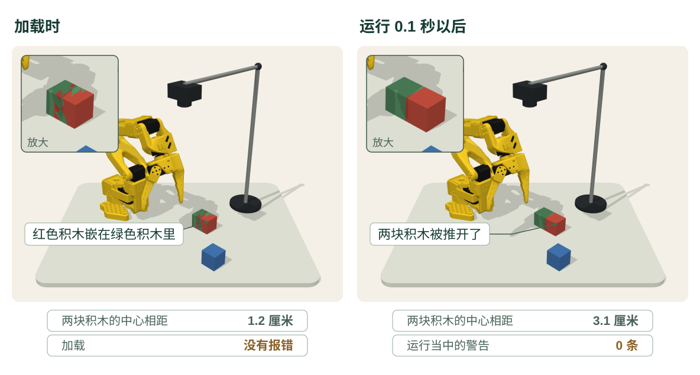
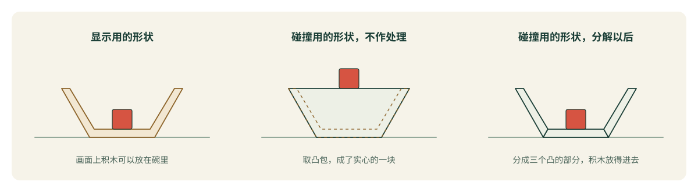
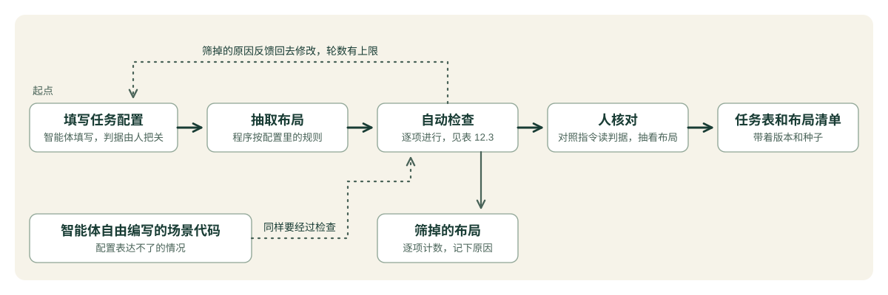

# 第 12 章 智能体搭建仿真场景与任务

[11.2 节](./chapter-11.md#sec-11-2)的例子里，叠积木的任务只有 12 种起始布局。要让数据覆盖更多的情况，或者要考察换一种摆法、换一种物体以后机器人还能不能完成任务，就得有更多的布局、更多的物体和新的任务。这些内容以往由工程师逐个搭建。现在可以交给智能体：让它编写场景的文件，填写任务的配置，成批地生成起始布局。

可是，生成出来的场景能加载、能运行，不等于能用。图 12.1 是一个例子。把红色积木的起始位置稍作移动，让它嵌进绿色积木 2 厘米，仿真软件照样加载，运行当中一条警告也没有。但是仿真一开始，两块积木就互相推开，十分之一秒以后各自移动了大约 1 厘米。回合实际开始时的布局，已经不是配置里写的那一种。

<p align="center"></p>

图 12.1 能加载、能运行的起始布局不一定可用。左边一幅是加载时的样子，红色积木嵌在绿色积木里。右边一幅是运行 0.1 秒以后的样子，两块积木已经互相推开。左上角的小图是两块积木放大以后的样子。画面由仿真软件 MuJoCo 生成，右边一幅是仿真实际运行的结果。

用这样的布局采集数据，得到的数据和记下的布局不一致，用来评估，成绩也不可靠。所以，生成的场景和任务要先经过一组检查，能加载只是其中的第一项。

本章先介绍场景和物体要写清哪些内容，再介绍一个任务怎样配置，然后比较两种生成的方式，最后列出使用之前的各项检查。[第 9 章](./chapter-09.md)说过，用示范训练策略时，要依次搭好场景、采集数据、训练和评估，本章讲的是其中的第一步。全章沿用[第 11 章](./chapter-11.md)的例子，给叠积木的任务生成更多的起始布局。本例各项检查的数字是在图 1.1 的场景上实际运行得到的，脚本在本仓库的 `tools/figures/chapter-12/` 里。这些数字只用来说明各项检查能查出什么，换一个场景就会不同。

<a id="sec-12-1"></a>

## 12.1 场景与资产

仿真环境里的机器人、物体、桌面、相机和灯光，连同它们各自的位置，合起来称为**场景**（scene）。仿真软件按很短的时间间隔逐步计算，每一步算出各个物体受的力和新的位置。这样的一步称为一个时间步（time step），本例中是 5 毫秒。

场景里的每个物体通常各有一个描述它的文件，称为**资产**（asset）。一份资产要写清的内容不多，可是漏写任何一项，仿真软件多半都不会报错：有的项目它会自己补上一个数值，有的项目则不参与计算。表 12.1 以本例的一块积木为例，列出了这些内容和漏写的后果。

表 12.1 一份资产要写清的内容，以本例的积木为例

| 内容 | 本例的积木 | 不写或者写错的后果 |
|---|---|---|
| 形状和尺寸 | 方块，边长 3.2 厘米 | 有的格式写的是边长的一半，有的写全长，转换格式时可能差一倍 [1, 2] |
| 碰撞用的形状 | 和显示的形状相同的方块 | 没有这一项的物体不参与碰撞，别的物体会从中穿过 |
| 质量 | 40 克，是估计的 | 有的格式按水的密度由形状算出，这块积木会是 33 克；有的格式当作零 [1, 2] |
| 摩擦 | 没有写 | 取仿真软件的默认值 |
| 关节 | 积木没有关节 | 抽屉、柜门这类物体要写明关节的轴和活动范围 |

仿真里的物体可以有两套形状。画面上看到的是**显示形状**（visual geometry），可以很精细。计算物体之间是否接触时用的是**碰撞形状**（collision geometry），通常要简单得多。方块、圆柱这样简单的形状可以直接用作碰撞形状。形状复杂的物体用三角形拼成的网格（mesh）来描述。本例用的仿真软件计算碰撞时，取的是包住整个网格的最小的凸的形状，称为**凸包**（convex hull）[1]。“凸”指表面上没有凹进去的地方。

凸包会把凹进去的部分填平。假设要给例子增加一个任务：把红色积木放进碗里。碗的网格如果不作处理，碰撞形状就是一个实心的块，积木只能搁在碗口上，见图 12.2。场景能加载，画面上也是一只正常的碗，任务却无法完成。这时要把碗的网格分解成几个凸的部分，各自参与碰撞。

<p align="center"></p>

图 12.2 同一只碗的显示形状和碰撞形状，从侧面看。左边是显示形状。中间是不作处理时的碰撞形状，碗口被填平，积木放不进去。右边是分解成三个凸的部分以后的碰撞形状。

反过来，画面上看得见的物体也可能根本没有碰撞形状。本例中机械臂的底座就是这样，它只有显示形状。即使积木摆进了底座所占的位置，仿真软件也不会认为两者相碰。这种情况的后果见 [12.4 节](#sec-12-4)。所以检查资产时，要把碰撞形状单独显示出来看，不能只看平常的画面。

尺寸和质量要对照实物来查。仿真软件通常以米、千克和秒为单位，资产却可能是按毫米或者厘米制作的。所以加载以后要列出每个物体的尺寸和质量，和实物比较 [3]。一块积木如果有 30 千克重，多半是单位错了。

资产里还要写明质量、摩擦这些数值是量出来的、估计的，还是取的默认值。本例中积木的 40 克是搭场景时估计的，没有称过。让大模型估计也是常见的做法，这样得到的数值可以让场景先运行起来，却不能代替实测，对依赖接触的任务尤其如此 [4]。估计的数值在训练时可以按 [10.1 节](./chapter-10.md#sec-10-1)的域随机化处理，让它在一个范围内变化。

有关节的物体还要多查一项：关节的每个取值对应物体的什么状态。有的系统让大模型生成任务时，大模型分不清关节的角度为 0 时门是开着还是关着，写出的目标也就错了 [5]。检查时可以把关节设成几个不同的角度，逐个查看画面。

<a id="sec-12-2"></a>

## 12.2 任务配置

场景说明环境里有什么，**任务配置**（task configuration）则说明要在这个场景里做什么任务。除了指令，任务配置还要写明所用的场景、抽取起始布局的规则、成功判据、参考解法、预算和用到的种子。参考解法是一段确实能完成任务的程序（见 [9.3 节](./chapter-09.md#sec-9-3)），在 [12.4 节](#sec-12-4)用来检查任务在一种布局下能否完成。下面是本例叠积木任务的配置。起始布局和成功判据两项是本章实际运行时用的，其余几项只是示意。

```text
任务      叠积木，配置版本 1.0.0
指令      把红色的放到绿色的上面
场景      桌垫、机械臂、桌子上方一台相机，红绿蓝三块积木
起始布局  三块积木都直接放在桌垫上，转角任意
          每块积木离机械臂底座 16.5 到 20.5 厘米，方向在正前方左右各 70 度以内
          离桌垫的边至少 4 厘米，离相机支架至少 8 厘米
          两块积木的中心相距至少 6.5 厘米
          不满足时重新抽取，最多 200 次
成功判据  红色积木和绿色积木的中心水平相距不超过 1 厘米
          红色积木的中心比绿色积木的中心高一个边长，误差不超过 5 毫米
          夹爪已经松开，以上状态保持 1 秒，这 1 秒里红色积木的移动不超过 1 毫米
预算      最多 20 次工具调用
参考解法  stack_red_on_green.py
种子      1 到 1000，其中 801 到 1000 留给评估
```

起始布局一项写的是抽取布局的规则。程序按这些规则和一个随机种子抽出一种布局，同一个种子抽出的布局相同。规则里要有位置的范围、物体之间的最小距离和重新抽取的上限。抽到的位置不合规则时重新抽，到了上限还抽不到就报错，不能交出一个不合规则的布局 [6]。

成功判据要写出数值，[9.1 节](./chapter-09.md#sec-9-1)已经说明了原因。同样的任务，不同的人写出的判据还可能相差很远。两个常用的仿真框架里都有叠方块的任务。一个要求两块方块水平的偏差在规定的范围之内、高度相符、上面的方块静止、夹爪已经松开 [7]。另一个只要求上面的方块离开桌面一定的高度、夹爪已经松开、两块方块互相接触 [8]。按后一种判据，上面的方块还在晃动、没有停稳的那一刻也算成功。所以判据是任务配置的一部分，按不同的判据得到的成绩不能放在一起比较。

用完了预算而没有成功的回合要单独记成一类，不和别的失败混在一起。这样的回合没有成功，可能是因为任务无法完成，也可能只是因为预算定得太少，[12.4 节](#sec-12-4)还会说到这一点。

配置要有版本。改了场景、资产或者抽取的规则，以前的回合就不能再和新的回合放在一起比较，要重新执行。只改了判据时，如果存下来的记录里有新判据要用的量和时间段，可以按新的判据重新评分，不必重新执行。本例的判据要求状态保持 1 秒，记录里就要有这 1 秒之内积木的位置和夹爪的状态。一种布局由配置的版本和种子共同确定，[11.2 节](./chapter-11.md#sec-11-2)的布局清单里，每种布局记下这两项就够了。

<a id="sec-12-3"></a>

## 12.3 生成方式

让智能体生成场景和任务，有两种方式。一种是受约束的：配置里有哪些项目由人事先定好，智能体只填写各项的取值，程序再按规则抽取物体的位置。另一种是自由的：智能体直接编写场景的文件或者生成场景的程序，每个物体放在哪里都由它写出。表 12.2 比较了这两种方式。凡是能写成规则的要求，前一种方式都由抽取的程序来保证，后一种方式没有这一层保证，要靠事后的检查。

表 12.2 生成场景和任务的两种方式

| 方面 | 填写配置 | 自由编写场景的代码 |
|---|---|---|
| 智能体给出什么 | 用哪些物体，物体之间的关系，位置的范围和规则 | 场景的文件或者程序，包括每个物体的坐标 |
| 位置由谁算出 | 抽取的程序 | 大模型直接写出 |
| 能表达什么 | 只有配置里有的项目 | 仿真软件支持的内容都可以 |
| 常出的问题 | 取值合乎格式，却不合理 | 物体重叠、出界、悬空 |

能用配置表达的内容，优先用第一种方式，因为大模型不擅长直接给出坐标。有一项研究比较了几种生成室内布局的办法：请人给各种办法的结果排名次，再按名次算出得分，满分是 1。大模型只给出物体之间的关系、由程序算出位置时，得分是 0.7。大模型直接写出坐标时，得分是 0.4，和随机摆放的一样，原因是物体常常互相重叠或者摆出了边界 [9]。

填写配置也不是填完就可以用。让大模型按规定的格式输出，只能保证每一项都在、类型都对，不能保证数值合理，所以数值要另外检查 [10]。本例中两块积木中心之间的最小距离如果填成 1 毫米，格式上没有任何问题，抽出的 1000 种布局里却有将近四成是重叠的。

配置表达不了的内容，才用第二种方式，例如给场景增加一种新的物体，或者增加一个新的任务。这样生成的内容要经过同样的检查，场景的文件本身还要按 [12.1 节](#sec-12-1)的办法查一遍。

生成的结果没有通过检查时，把原因反馈给智能体，让它修改以后再试。反馈要具体，写明是哪个物体、出了什么问题、数值是多少，例如“苹果从盘子上掉了下来，位移 0.15 米”[11]。修改的轮数要事先定一个上限，到了上限就放弃这次生成，或者交给人处理。

成功判据要由人把关。参考解法可以交给智能体写，因为可以用判据检验它是否正确。判据本身是否正确，只能由人对照指令来判断。有一项研究让大模型为家务任务编写判定成功的函数，经人工检查，只有一半是正确的。先给它一个相近任务的函数作范例，这个函数由人核对过，大模型写出的函数才有 92% 是正确的 [12]。

整个过程见图 12.3。智能体填写配置，程序抽取布局并逐项检查，没有通过的布局筛掉，筛掉的原因反馈给智能体。通过检查的布局由人抽看，判据由人对照指令核对，然后任务才登记进 [11.2 节](./chapter-11.md#sec-11-2)所说的任务表，布局登记进布局清单。登记以后，智能体在采集和评估当中不能改动它们。

<p align="center"></p>

图 12.3 生成的布局和任务从配置到清单的经过。粗箭头是主要的路线。虚线分别表示筛掉的原因反馈给智能体，以及自由编写的场景代码同样要经过检查。

<a id="sec-12-4"></a>

## 12.4 可用性检查

检查时要查有物理意义的量，不能只看程序是否报错。几个仿真项目给编写代码的智能体准备了说明，里面都有这一条，其中一份的说法是：仿真运行不报错，不算测试 [13]。

各项检查依次进行，代价小的排在前面。前八项逐个布局来查，一种布局在哪一项没有通过就在哪一项筛掉。最后一项查的是任务的判据。判据如果有问题，所有的布局都受影响，这时要修改判据。表 12.3 列出了各项检查，以及它们在本例中各筛掉了多少。表里的各项按检查的先后排列：嵌入的深度是在运行之前读取的，能运行、静置和什么都不做这三项用的是同一次 1 秒的运行。本例抽了两批布局，各 1000 种。第一批不用 [12.2 节](#sec-12-2)配置里的规则，三块积木在桌垫上任意摆放，其中三成的布局里有一块积木叠在另一块上。这一批用来说明各项检查分别能查出什么。第二批按配置抽取。第一批的 1000 种全部能加载、能运行，通过前七项自动检查的只有 18 种。后两项里，参考解法在本例中没有运行，这 18 种当中有多少可解并没有验证。

表 12.3 使用之前的各项检查，以及本例两批布局各筛掉的数量

| 检查 | 本例怎样查 | 不带规则 | 按配置 |
|---|---|---|---|
| 能加载、能运行 | 运行 1 秒，没有报错和警告，各项数值正常 | 0 | 0 |
| 起始时没有重叠 | 运行之前读取积木的各处接触，嵌入的深度不超过 1 毫米 | 268 | 0 |
| 静置以后不动 | 机械臂不动，运行 1 秒，积木移动不超过 1 厘米，转动不超过 0.1 弧度（约 6 度） | 298 | 0 |
| 什么都不做不算成功 | 静置以后判据应当不成立 | 7 | 0 |
| 目标状态成立 | 把红色积木直接摆到绿色积木上，判据应当成立 | 24 | 0 |
| 可达 | 夹爪朝下，能到达红色积木的上方和放置的位置 | 385 | 53 |
| 复位能重现 | 同一种布局复位两次，各运行 1 秒，结果应当完全相同 | 0 | 0 |
| 参考解法能完成任务 | 本例没有运行 | | |
| 判据和指令相符 | 由人对照指令来读，查的是整个任务 | | |
| 通过前七项 | | 18 | 947 |

重叠这一项查的是碰撞形状之间有没有互相嵌入。它查不出没有碰撞形状的物体。机械臂的底座就没有碰撞形状。第一批里有 212 种布局把一块积木摆进了底座所占的位置，这一项检查都查不出来。这个数是另外按底座的显示形状所占的范围数出来的。这 212 种里有 71 种因为别处有重叠被筛掉，其余 141 种通过了这一项，靠后面的检查才筛掉。

静置指不给机器人任何动作，让仿真运行一段时间，看物体是否移动。第一批里筛掉的 298 种，六成是积木搭在桌垫的边上，其余的是叠在另一块积木上而偏得太多，一运行就歪倒了。判断物体是否移动，要有明确的界限，本例的 1 厘米和 0.1 弧度沿用了已有系统的数值 [4]。界限要随结果一起写明，因为界限放宽以后，通过的比例自然就高。

接下来的两项沿用 [9.3 节](./chapter-09.md#sec-9-3)检验评分器的办法，用来检查筛到这一步的每一种布局。一项是让机器人什么都不做，判据应当不成立。第一批里有 7 种布局的红色积木一开始就端正地叠在绿色积木上，任务还没有开始就已经成功。另一项是把物体直接摆成完成以后的样子，判据应当成立，并且能够保持。这一项不需要机器人，也不动别的积木，只看红色积木能不能直接摆稳。筛掉的 24 种里，17 种是绿色积木上面已经压着别的积木，目标的位置被占了。另外 7 种是绿色积木自己叠在别的积木上，红色积木再摆上去，三块积木叠成一摞。在这个场景的设置下，这一摞一直有轻微的晃动，达不到判据里保持 1 秒不动的要求。目前还没有查清，原因是这种摆法本来就不稳，还是场景的设置需要调整。

任务在一种布局下能够完成，就说这种布局是可解的（solvable）。夹爪能够到达要去的位置，称为可达。本例查的是夹爪朝下能否到达红色积木的上方和放置的位置，只计算机械臂能否到达，不考虑途中的碰撞。对从上方抓取和放置的做法来说，可达是任务能够完成的必要条件，计算也很快，所以这一项放在参考解法之前。第一批里这一项筛掉的布局最多，多数是因为积木离机械臂太远、太近，或者在它的背后，也有的是因为积木叠在别的积木上，位置太高。

复位能重现，是指同一个种子每次得到同样的布局，同样的布局和动作得到同样的结果。[9.4 节](./chapter-09.md#sec-9-4)的配对比较要求两个版本从相同的布局开始，靠的就是这一点。本例查的是其中一部分：同一种布局复位两次，各静置 1 秒，结果完全相同。带动作时能否重现，本例没有查。能否重现还和环境有关：仿真软件只保证在同一个版本、同一种机器上结果完全相同，换了版本或者操作系统就可能不同 [14]。对于含有布料、软体的场景，有的仿真软件不保证结果可以重复 [15]。

通过了可达的检查，也不等于任务能够完成。要证明一种布局可解，需要用一段参考解法实际执行一次。通过了前面各项的 18 种布局里，有 1 种是蓝色积木压在红色积木上，一段直接去抓红色积木的参考解法在这里会失败。能运行的比例和能够完成任务的比例要分别报告。在一组生成的仿真任务里，从头到尾不报错的占 94%，而一同生成的解法能够完成任务的只占 78% [16]。

反过来，参考解法失败，也不等于这种布局不可解。[9.4 节](./chapter-09.md#sec-9-4)举过例子，预算放宽以后成功率大幅提高，可见预算定得太紧也会让本来能够完成的任务失败。所以判定一种布局不可解，要有确实的理由，例如用哪一种抓法都无法到达或者无法放置，不能只凭一次失败。参考解法在有接触的任务上也未必每次都成功，可以定一个标准，例如在一种布局上把物体的位置稍作变动，执行 5 次，成功 4 次以上才收进布局清单。前面几项筛掉的布局也不都是不可解的。绿色积木上压着别的积木的那 17 种，先把上面的积木移开就可以再放，它们只是不适合用从上方直接抓放的办法来做。

自动的检查查不出判据和指令是否相符，[12.3 节](#sec-12-3)已经说过要由人来读。核对时要有写成文字的标准，因为不同的人判断可能相差很大。三个人各自去看同一批已经通过自动检查的生成任务，认为合格的比例分别是 80%、63% 和 41% [17]。判据核对以后如果改了，各种布局要按新的判据重查一遍。

再看第二批。把规则写进配置以后，前五项检查没有筛掉一种布局，因为规则在抽取时已经起了作用：程序一共抽了 2732 次，才得到这 1000 种合乎规则的布局。检查仍然筛掉了 53 种，都是因为不可达：配置里按距离和方向划出的范围，仍然包含一些夹爪朝下时无法到达的放置位置。反过来，规则也排除了通过检查的布局：图 1.1 的布局里，三块积木离底座 21 到 30 厘米，都在配置的范围之外，前七项检查却全部通过。规则只能近似地表达要求，所以即使把规则写进了配置，检查也不能省。

要像表 12.3 那样，记下每一项检查筛掉的数量。某一项筛掉的比例突然变高，通常说明配置或者资产出了问题。

场景通过了检查，使用时还要看用途。用来训练时，场景不必和真实的环境一模一样，但要有变化，并且真实的情况要落在变化的范围之内。照着一个真实场景做出的副本，常称为数字孪生（digital twin）。在一个开柜门的任务上，只在这样一个副本里训练的策略，仿真里的成功率是 100%，到了真机上只有 25% [18]。在一批和它相近而各不相同的场景里训练，仿真里是 94%，真机上是 90%。

要用仿真里的评估推断策略在真机上的表现时，场景要尽量和真实的环境一致。[9.4 节](./chapter-09.md#sec-9-4)说过，仿真要先用真机上的结果校准。除了物体的位置，机器人的响应和相机里的画面也要一致，连机械臂的外观都有影响。有一组对照实验发现，仿真里机械臂的外观没有按真机调整时，一个策略的成功率是 0，调整以后是 29%，和它在真机上的成功率相同 [19]。生成的场景如果没有对应的真实环境，也没有真机上的结果可以校准，就只适合用来训练和调试。在这样的场景上得到的成绩只能说明仿真里的情况，不能当作真机上的成绩。评估用的种子还要在生成之前留出，智能体调整规则时只看其余种子上的检查结果。

上面的检查是按桌面机械臂的情况写的：机械臂固定在桌上，要查的是物体。换一种机器人，起始状态里还要包括机器人自己。双足机器人的模型加载以后，如果没有控制器在运行，从第一步起就会倒下。所以静置时要让保持站立的控制器照常运行，只是不给行走的指令，查的是它能不能站稳。检查可解时要查的内容也不同：能走动的机器人可以走到物体旁边，所以不可解多半是指没有稳定的路线可以接近物体，或者目标根本看不见。真机上的布局如果由人来摆，重现时只能达到卷尺测量的精度，上面的各项检查在真机上也大多要由人来做。

## 小结

本章介绍了智能体怎样生成仿真的场景和任务，以及生成的结果在使用之前要查什么。一份资产要写清形状和尺寸、碰撞形状、质量、摩擦和关节。没有写的项目，有的由仿真软件补上默认值，有的不参与计算。估计的数值要标明。任务配置由指令、场景、抽取起始布局的规则、成功判据、参考解法和预算组成，带着版本和种子。生成时，能写成规则的要求写进配置，由程序抽取位置，判据由人把关。使用之前逐项检查：能加载、能运行，起始时没有重叠，静置以后不动，什么都不做不算成功，目标状态成立，可达，复位能重现，参考解法能完成任务，判据和指令相符。训练要的是有变化的场景；要用仿真里的成绩推断真机上的表现，场景要尽量和真实的环境一致，并且先用真机上的结果校准。

第 9 到 12 章分别介绍了评估、训练、数据和场景，每一章里智能体都承担了一部分工作，也都有一部分内容由人事先定好、智能体不能改动。[第 13 章](./chapter-13.md)介绍怎样把这四章的内容和第二部分的技能修订连成一个循环，并讨论智能体能在多大程度上自己完成整个改进的过程。

## 参考文献

1. MuJoCo 文档. [XML Reference](https://mujoco.readthedocs.io/en/stable/XMLreference.html). 2026 年 11 月 18 日读取.
2. ROS Wiki. [urdf/XML/link](https://wiki.ros.org/urdf/XML/link). 2026 年 11 月 18 日读取.
3. MuJoCo 文档. [Modeling](https://mujoco.readthedocs.io/en/stable/modeling.html). 2026 年 11 月 18 日读取.
4. Pfaff N, Cohn T, Zakharov S, 等. [SceneSmith: Agentic Generation of Simulation-Ready Indoor Scenes](https://arxiv.org/abs/2602.09153). ICML 2026. arXiv:2602.09153.
5. Wang Y, Xian Z, Chen F, 等. [RoboGen: Towards Unleashing Infinite Data for Automated Robot Learning via Generative Simulation](https://arxiv.org/abs/2311.01455). ICML 2024. arXiv:2311.01455.
6. robosuite 代码仓库. [placement_samplers.py](https://github.com/ARISE-Initiative/robosuite/blob/master/robosuite/utils/placement_samplers.py). 2026 年 11 月 18 日读取.
7. ManiSkill 代码仓库. [stack_cube.py](https://github.com/haosulab/ManiSkill/blob/main/mani_skill/envs/tasks/tabletop/stack_cube.py). 2026 年 11 月 18 日读取.
8. robosuite 代码仓库. [stack.py](https://github.com/ARISE-Initiative/robosuite/blob/master/robosuite/environments/manipulation/stack.py). 2026 年 11 月 18 日读取.
9. Yang Y, Sun F-Y, Weihs L, 等. [Holodeck: Language Guided Generation of 3D Embodied AI Environments](https://arxiv.org/abs/2312.09067). CVPR 2024. arXiv:2312.09067.
10. OpenAI 文档. [Structured model outputs](https://developers.openai.com/api/docs/guides/structured-outputs). 2026 年 11 月 18 日读取.
11. Yang J X, Dagli R, Zook A, 等. [RoboLab: A High-Fidelity Simulation Benchmark for Analysis of Task Generalist Policies](https://arxiv.org/abs/2604.09860). RSS 2026. arXiv:2604.09860.
12. Chang M, Chhablani G, Clegg A, 等. [PARTNR: A Benchmark for Planning and Reasoning in Embodied Multi-agent Tasks](https://arxiv.org/abs/2411.00081). arXiv:2411.00081, 2024.
13. Genesis 代码仓库. [AGENTS.md](https://github.com/Genesis-Embodied-AI/Genesis/blob/main/AGENTS.md). 2026 年 11 月 18 日读取.
14. MuJoCo 文档. [Computation](https://mujoco.readthedocs.io/en/stable/computation/index.html). 2026 年 11 月 18 日读取.
15. Isaac Lab 文档. [Reproducibility and Determinism](https://github.com/isaac-sim/IsaacLab/blob/main/docs/source/how-to/reproducibility.rst). 2026 年 11 月 18 日读取.
16. Hua P, Liu M, Macaluso A, 等. [GenSim2: Scaling Robot Data Generation with Multi-modal and Reasoning LLMs](https://arxiv.org/abs/2410.03645). CoRL 2024. arXiv:2410.03645.
17. Wang L, Ling Y, Yuan Z, 等. [GenSim: Generating Robotic Simulation Tasks via Large Language Models](https://arxiv.org/abs/2310.01361). ICLR 2024. arXiv:2310.01361.
18. Dai T, Wong J, Jiang Y, 等. [Automated Creation of Digital Cousins for Robust Policy Learning](https://arxiv.org/abs/2410.07408). CoRL 2024. arXiv:2410.07408.
19. Li X, Hsu K, Gu J, 等. [Evaluating Real-World Robot Manipulation Policies in Simulation](https://arxiv.org/abs/2405.05941). arXiv:2405.05941, 2024.
