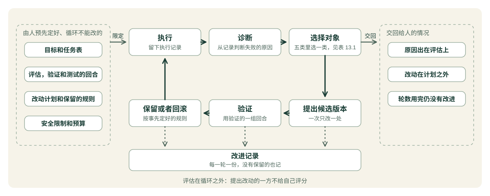
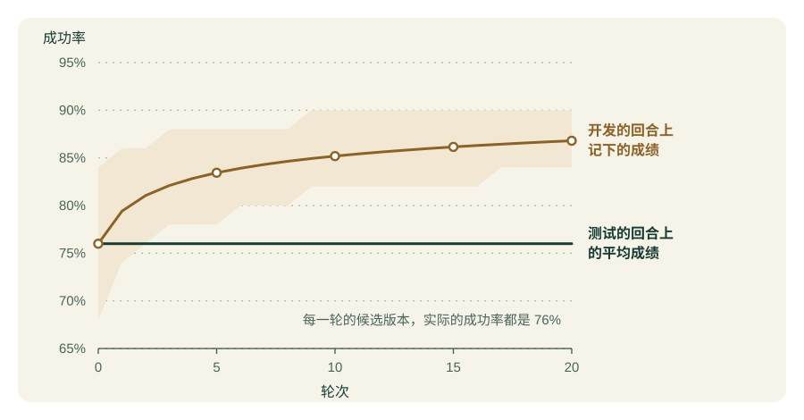

# 第 13 章 闭环：递归自我改进与证据

前面几章各介绍了改进工作的一个环节。[第 8 章](./chapter-08.md)介绍怎样根据失败修订技能，[第 9 章](./chapter-09.md)介绍怎样判定一次修订有没有效果，第 10 到 12 章介绍训练策略、整理数据和搭建场景。在每一个环节里，智能体都承担了一部分工作。

把这几个环节首尾相接，就成了一个循环：执行任务，从失败里找出原因，改动系统的某一部分，验证改动是否有效，再去执行。本教程把这个循环称为**闭环**（closed loop）。[1.3 节](./chapter-01.md#sec-1-3)说智能体有两种角色，智能体即是机器人，智能体改进机器人。在闭环里，这两种角色连在了一起。

连成闭环以后，前面还有四个问题没有回答：出现一次失败，应当改动哪一部分；哪些工作交给智能体，哪些留给人；改了许多轮以后，怎样知道系统确实在变好；这个循环本身能不能变得越来越有效。本章依次讨论这四个问题，讲分工之前，[13.2 节](#sec-13-2)先以一次改动为例，说明它从提出到保留经过哪些步骤。

全章沿用[第 8 章](./chapter-08.md)夹偏以后放置失败的例子，并另外设想一组回合：智能体执行叠积木的任务，开发的一组有 50 个回合，评分器判定其中 38 个成功，其余 12 个需要逐个检查。这组数字只是示意，[13.4 节](#sec-13-4)里另有一次实际的计算，用的数字在那一节说明。

<a id="sec-13-1"></a>

## 13.1 选择改进对象

[1.3 节](./chapter-01.md#sec-1-3)把可以修改的内容分成技能和权重两类，这里分得细一些。出现一次失败以后，可以改动的对象有五类：Harness，策略，数据，场景和任务，大模型本身。技能属于 Harness，权重分属策略和大模型，数据、场景和任务则是训练和评估要用的。另有一种情况，问题出在评估上。表 13.1 按排查的先后次序列出了这五类对象和评估的问题，前两行要先排除。后面几行里，修订 Harness 不用训练，代价最小，也最容易回滚，所以排在训练之前。

表 13.1 出现的迹象和应当改动的对象

| 迹象 | 应当改动的对象 | 参照的章 | 本例的回合 |
|---|---|---|---|
| 记录里物体的状态和评分的结果不一致 | 评估，交给人 | [第 9 章](./chapter-09.md) | 末帧里积木叠好了却判为失败，2 个 |
| 起始布局有问题，无论由谁执行都无法完成 | 场景和任务 | [第 12 章](./chapter-12.md) | 绿色积木在无法到达的位置，2 个 |
| 做法有错，或者少了一步检查，换一种写法就能避免 | Harness：技能、提示词、工具的说明 | [第 7 章](./chapter-07.md)、[第 8 章](./chapter-08.md) | 夹偏了没有重新对准，5 个 |
| 几种不同的做法都因为同一个物理原因而失败 | 策略 | [第 10 章](./chapter-10.md) | 小积木夹不稳，3 个 |
| 策略在某一类情况上集中失败，数据里这类情况很少 | 数据 | [第 11 章](./chapter-11.md) | 训练以后才会出现 |
| 做得对，可是每一步都要等大模型，太慢或者太贵 | 大模型本身 | [第 10 章 10.5 节](./chapter-10.md#sec-10-5) | 没有 |

先排除评估和场景，因为这两项出了错，后面改什么都没有意义。本例中有 2 个回合，执行记录的最后一帧里红色积木端正地叠在绿色积木上，评分器却判为失败。这是误判的迹象，要由人对照完整的记录核对。如果确实判错了，要改的是评分器，而 [9.2 节](./chapter-09.md#sec-9-2)规定它不归执行的一方改动，所以也交给人。另有 2 个回合，绿色积木摆在机械臂到达不了的地方。这样的布局本该由 [12.4 节](./chapter-12.md#sec-12-4)的可达检查筛掉，要回去查明它为什么通过了检查。

然后看 Harness。修订技能、提示词和工具的说明不需要训练，修订的内容人能读懂，效果不好时还可以回滚。修订 Harness 可能带来很大的提高。有一项仿真实验保持大模型的权重不变，只修订 Harness，500 个回合上的成功率从 33% 提高到了 64% [1]。本例的 5 个回合属于这一类：红色积木夹偏了，`place_on` 没有按积木的实际位置对准，[第 8 章](./chapter-08.md)已经给出了修订的办法。

接着看策略。有一条规则可以用来判断什么时候该训练：几种不同但都合理的做法因为同一个物理原因而失败 [2]。本例有 3 个回合用的积木比平常的小，夹起来以后在搬运途中滑落。智能体换了三种夹法（从上方夹、从侧面夹、夹得更紧），积木还是滑落。如果检查过观测和夹爪，没有发现问题，几种做法仍然夹不稳，缺的多半是一种写不成代码的动作能力，这时才考虑训练。训练之前要把这个原因写下来，训练以后才知道该检查什么。

还有一类情况也值得考虑训练：环境里有事先没有写进程序的变化。有一项仿真实验把相机移到另一个位置，结果，按原来的相机位置换算坐标的程序，成功率降到 9%，而训练得到的策略还有 69% [3]。[10.1 节](./chapter-10.md#sec-10-1)也已经说明，策略并不总比代码强，所以决定训练时，要把希望它适应的变化也写进测试。

策略训练出来以后如果还有失败，再看数据。补充的数据应当针对失败的情况来采集。有一项实验在叠放任务上作过这样的比较 [4]：起初的策略成功率是 25%，补采三轮数据，每一轮都按当时最主要的失败来决定采什么，最后是 83%；随意补采同样的三轮，最后是 37%。

大模型本身排在最后。表里这一行的迹象是任务能够完成，但太慢或者太贵，并不是任务失败。按 [10.5 节](./chapter-10.md#sec-10-5)的做法，先把 Harness 修订到位，再考虑用执行记录微调大模型。

上面的判断都依赖一个步骤：从执行记录判断失败出在哪里，这称为**诊断**（diagnosis）。[8.1 节](./chapter-08.md#sec-8-1)已经说明，这一步很容易出错。诊断时可以按动作的先后核对执行记录里各步的检查结果，从最早没有通过的一项查起，不从失败显现的位置查起 [5]。最早没有通过的一项也只是查找的起点，起因可能在更早的一步，而那一步的检查是通过了的：[8.1 节](./chapter-08.md#sec-8-1)的例子里，夹偏就发生在抓取时。所以诊断的结论只是一个假设。要按 [8.1 节](./chapter-08.md#sec-8-1)的办法，根据这次失败编写一条测试，改动以后测试通过了，假设才算得到了支持。候选版本还要经过 [13.2 节](#sec-13-2)的验证。

在技能和策略之间选择，前提是有可以训练的环境。手头只有评估用的基准，既没有可以训练的环境，也没有可用的数据时，能直接改的只有 Harness，表里后三行的失败要记下来，留到条件具备的时候再处理。

<a id="sec-13-2"></a>

## 13.2 连接改进流程

闭环有六步：执行，诊断，选择对象，提出候选版本，验证，保留或者回滚。图 13.1 画出了这六步，以及循环之外的三项：由人预先定好的内容，每一轮留下的记录，交回给人的情况。最后一步有三种情形：通过了验证，就保留候选版本，分步启用；没有通过，就放弃它，继续用原来的版本；已经启用的版本后来出了问题，再退回原来的版本，这是 [8.4 节](./chapter-08.md#sec-8-4)所说的回滚。

<p align="center"></p>

图 13.1 智能体改进机器人的循环。中间用粗箭头画出循环的六步，左边是由人预先定好、循环不能改动的内容，右边是交回给人的三种情况，虚线表示每一轮都写入改进记录。

提出候选版本的做法因对象而不同，检验的办法也不同。修订技能时按[第 8 章](./chapter-08.md)的办法，先重新运行复现失败的那条测试，再查原来能完成的任务有没有变差；训练策略时按[第 10 章](./chapter-10.md)的办法，在固定的预算里训练，按成功率挑选检查点；补数据时按[第 11 章](./chapter-11.md)的办法，先检查和划分新的数据集，再用它训练一个策略，看策略的表现；改场景和调整大模型本身，分别按[第 12 章](./chapter-12.md)和[第 10 章 10.5 节](./chapter-10.md#sec-10-5)的办法，前者逐项检查以后才登记，后者评估以后才使用。这些都是各类对象各自的检查，通过以后再把候选版本接回系统，进入验证。

五类对象的验证依据同一条原则：把候选版本接回系统，和原来的版本在同样的条件下比较，看整个系统在智能体开发时没有用过的回合上，是否达到了由人预先定好的目标。回合按 [10.3 节](./chapter-10.md#sec-10-3)分成三组：开发的一组用来诊断和修改；验证的一组用来决定是否保留，智能体只知道成绩；测试的一组不参与任何决定，只在最后使用。修订技能、训练策略和补数据的目标都是提高成功率，这时每一轮让候选版本和原来的版本在验证的一组上作 [9.4 节](./chapter-09.md#sec-9-4)的配对比较：两个版本在同样的回合上各执行一次，数出由失败变成功的有多少，由成功变失败的又有多少。目标不是成功率时，比较的内容也要更换。例如为了省时间而调整大模型时，比较的是调用所用的时间，同时用配对比较确认成功率的下降没有超出事先定好的幅度。评估用的布局由人改正以后，评估的条件变了，换布局以后增加的成功回合不能算作提高。这时按 [12.2 节](./chapter-12.md#sec-12-2)的办法更新任务配置的版本，候选版本和原来的版本都在新的配置上重新执行，得到的结果作为以后比较的起点。

就修订技能而言，这条验证的原则和 [8.4 节](./chapter-08.md#sec-8-4)一次修订的规则有一处不同。那里的第三项条件是在留出的任务上有提高。闭环要进行许多轮，每一轮都要有一组回合来决定是否保留，这一组用过以后，按 [8.3 节](./chapter-08.md#sec-8-3)的说法就不能再算留出。所以在循环里，每一轮按三项检验的结果决定是否保留：原来失败的任务是否通过，原来能完成的任务有没有变差，在验证的一组上有没有提高。至于这样得到的提高换一批没有用过的回合是否仍然存在，[13.4 节](#sec-13-4)介绍怎样在循环结束以后用测试的一组来检验。

每一轮要留一份**改进记录**（improvement record）。它写明这一轮的假设、改动的内容、改动前后的版本、用到的配置和数据、预算、结果和决定，失败的回合也要留着 [6]。没有保留的改动同样要有记录。下面是本例的一份，内容只是示意。

```text
改进记录  第 3 轮
失败      开发的回合里有 5 个：红色积木夹偏，放上去以后滑落
诊断      place_on 按夹爪的位置对准，没有用积木的实际位置
对象      技能 place-block，1.2.0 改为 1.3.0（候选）
改动      对准这一步改用 locate 返回的积木位置；清单的前置条件加上
          夹爪里的积木要在画面里；其余不动
检验      原来失败的 5 个回合，各重复运行 3 次：全部通过
          回归，入库时验证用过的 30 个回合：原来成功的 28 个仍然成功，
          另有 1 个由失败变成功
          回归，共用 place-block 的另外两个任务各 20 个回合：
          原来成功的 18 个和 17 个仍然成功，没有由成功变失败的
          验证的一组 50 个回合，两个版本各执行一次：原来的版本成功 37 个，
          候选版本成功 44 个；由失败变成功 8 个，由成功变失败 1 个
参照      原来的版本在验证的一组上，上一轮的记录是成功 34 个，和这一轮相差 3 个
版本      任务配置 1.0.0，评分器 0.4，大模型、提示词和上一轮相同
花费      大模型调用 2100 次，仿真 185 个回合
决定      保留
```

记录里“检验”一栏列的是这三项检验的结果。通过的标准写在改动计划里，[13.3 节](#sec-13-3)介绍这份计划。原来失败的 5 个回合各重复运行了 3 次，全部通过。单个回合的结果容易翻转（见 [8.3 节](./chapter-08.md#sec-8-3)），所以每条测试要重复几次。回归按 [8.4 节](./chapter-08.md#sec-8-4)的做法逐个回合对照，三个任务里原来成功的回合这次都仍然成功。验证的一组上，这一轮两个版本各执行了一次，8 个回合由失败变成功，只有 1 个反过来。两个版本如果其实一样好，这样悬殊的结果出现的可能只有 4% 左右，低于计划里定的 5%。计划的三条都通过了，所以保留。

回归的这一条比 [9.4 节](./chapter-09.md#sec-9-4)的要求宽。那里要先规定最多允许下降多少，回合要多到足以排除比这更大的下降。这里每个任务只有 20 到 30 个回合，只查得出明显的变差。所以这里的保留不等于证明了没有变差：新版本按 8.4 节分步启用，启用以后继续看这三个任务，出了问题就回滚。

“参照”一项记的是同一个版本执行两次会相差多少。原来的版本在验证的一组上，上一轮的记录是成功 34 个，这一轮重新执行是 37 个，相差 3 个。大模型每次的输出不完全相同，有些回合的结果会翻转。重新执行一次只能说明同一个版本的成绩也会变化，[13.4 节](#sec-13-4)估计了通常会相差多少。候选版本比原来的版本多成功 7 个，读记录的人要拿这个数和这种波动相比，所以这一项每一轮都记。保留与否仍然按计划里的三项来定，这一项不参与决定。

各类对象都有自己的版本，记录时要互相对应。每一份执行记录都要写明当时用的技能库、策略的检查点、任务配置、评分器和大模型各是哪个版本。本例的评分器是 0.4 版。[13.1 节](#sec-13-1)里积木叠好却判为失败的 2 个回合，经人核对确实判错了。人改正评分器以后，存下来的记录按新的版本重新评分（[12.2 节](./chapter-12.md#sec-12-2)介绍过什么时候可以这样做），此后各轮都用这一版。一轮只检验一处改动，本例的代码和清单是为同一处改动一起改的。如果同时改了技能又换了检查点，成功率变化以后就分不清是哪一项起的作用。

循环还要有停下来的规则，写在预算里。常用的有两条：轮数用完就停；连续几轮没有保留下来的改动就停，把情况交给人。网站的运维里有类似的做法，事先定一个容许出错的额度，四个星期之内用完了，除了紧急的修复，停止一切改动和发布，直到恢复正常 [7]。

<a id="sec-13-3"></a>

## 13.3 人与智能体的分工

循环里的六步都可以自动进行。前五步交给智能体，其中验证这一步它只负责发起，是否成功由独立的评分器判定。保留或者回滚由 Harness 按人定的规则执行，循环的规则本身则不能交给智能体。表 13.2 汇总了前面各章已经定下的分工。

表 13.2 闭环里人和智能体的分工

| 事项 | 负责的一方 | 出处 |
|---|---|---|
| 提出目标，定任务表 | 人 | [第 11 章](./chapter-11.md) |
| 写成功判据，保管评分器以及验证和测试的回合 | 人 | [第 9 章](./chapter-09.md)、[第 12 章](./chapter-12.md) |
| 写改动计划和保留的规则，定预算 | 人 | [第 8 章](./chapter-08.md)、[第 10 章](./chapter-10.md)，本章 |
| 定速度、力和活动范围这些安全限制 | 人 | [第 2 章](./chapter-02.md)、[第 8 章](./chapter-08.md) |
| 执行，诊断，选择对象，提出候选版本，运行检验 | 智能体 | 本章 |
| 按规则保留或者回滚 | Harness 按人定的规则执行 | [第 8 章](./chapter-08.md)、[第 10 章](./chapter-10.md) |
| 计划之外的改动，上真机，不能撤销的动作 | 人批准 | [第 10 章](./chapter-10.md)，本章 |

前面各章已经讲过保留的规则和预算，本章新增的做法是把它们写进一份计划。循环开始之前，人要写一份**改动计划**（change plan），写明允许改哪几类内容，每一类怎样检验、通过的标准是什么，以及改动可能影响到其他哪些任务。落在计划之内的改动，通过了检验就可以保留，不必逐个请人批准。计划之外的改动交回给人。下面是本例的改动计划，内容只是示意。

```text
改动计划    叠积木，第 1 版
允许的改动  技能 place-block、pick-block 的说明、代码和清单
            提示词里讲放置顺序的一段
            抓取策略的重新训练，数据限于重新执行 stack-blocks 的回合得到的那一版
不允许      成功判据和评分器，验证和测试的回合，安全限制，本计划
检验        原来失败的任务；回归，也就是原来能完成的任务；验证的一组上的配对比较
通过        三项都要满足
            1. 原来失败的任务各重复运行 3 次，全部通过
            2. 回归的回合里，原来成功的没有变成失败；有的话两个版本
               各重复运行来核实，分不清就不保留
            3. 配对比较里变好的回合多于变差的，两个版本一样好时
               出现这种结果的可能低于 5%
影响        place-block 被三个任务共用，改动以后三个任务都要回归
预算        每一轮最多 200 个仿真回合，最多 10 轮，连续 3 轮没有保留的改动就停
交回给人    计划之外的改动，原因出在评估或者场景上，上真机之前
```

对于上线以后还会变化的系统，通行的管理办法也是这样。例如美国的医疗器械监管机构为带有人工智能功能的软件发布过一份指南 [8]。按这份指南，制造商事先提交一份变更计划，列出以后打算作的改动，数量要有限，每一项要具体、可以检验。计划里还要写明每一项改动怎样验证，接受的标准事先定好。改动没有达到标准，就不实施，并且记录在案。汽车的软件升级也是这个思路。按我国的规定，不涉及产品主要技术参数变更的在线升级，企业完成备案以后即可实施；涉及的，要先取得产品变更许可 [9]。

保留还有一条规则：提出改动的一方不能批准自己的改动。这和 [7.4 节](./chapter-07.md#sec-7-4)的规定相同：技能的作者不能审核自己的技能。让智能体修改代码的产品里也有同样的规定，智能体不能批准、也不能合并它自己提交的修改 [10]。[9.3 节](./chapter-09.md#sec-9-3)已经说明，只在提示词里提要求是不够的，所以闭环里这条规则靠权限来实现：保留的规则由 Harness 执行，验证用的回合和评分器放在智能体接触不到的位置。

现在可以回答 [1.3 节](./chapter-01.md#sec-1-3)留下的问题：两种角色合到一个系统以后，它能不能自己完成整个改进的过程，需要什么条件。按前面各章的做法，在改动计划之内可以，计划要求人核对或者批准的步骤除外。同一个系统可以执行任务，发现失败，决定改什么，再发起验证。条件有两个。第一，表 13.2 里由人负责的四项内容不归它改动：目标，评估，改动计划和保留的规则，安全限制。第二，改动计划没有列入的事情交回给人。本例的计划只允许改两条技能、一段提示词和抓取策略，所以原因出在场景上也要交回给人；换一份允许生成训练布局的计划，这一类就可以由智能体来改，人按 [12.3 节](./chapter-12.md#sec-12-3)核对。评估出了问题，或者要上真机，不论计划怎样写都由人处理。目前没有证据表明，去掉这些条件以后系统还能可靠地改进自己。

<a id="sec-13-4"></a>

## 13.4 递归与边界

改进有三个层次，它们需要的证据一层比一层多，见表 13.3。

表 13.3 改进的三个层次和各自需要的证据

| 层次 | 含义 | 需要的证据 |
|---|---|---|
| 一次改进 | 改动以后的系统比原来的好，改动保留下来，以后的任务都用得上 | 候选版本和原来的版本在同样的回合上作配对比较，在这次改动没有用过的回合上有提高 |
| 持续改进 | 用固定的办法连续改动许多轮，系统越改越好 | 在没有参与过任何决定的回合上，后面各轮的版本总体上比前面的好；整个循环重做一次仍然有提高；提高超出同一个版本重复执行时的波动，也好于把同样的预算拆成几次互不相干的尝试 |
| 递归改进 | 系统连改进的办法也在改，后来的办法比早先的办法更有效 | 有记录表明办法是系统自己根据前面的结果改的；早先的和后来的办法从同一个起点出发，用同样的预算各改进一次，后来的结果更好，重复几次仍然如此 |

[第 8 章](./chapter-08.md)、[第 9 章](./chapter-09.md)已经讲过一次改进的证据。持续改进多出来的问题是，同一组回合用了许多次。每一轮都根据候选版本在这组回合上的成绩来决定是否保留，轮数多了，留下来的往往是恰好在这组回合上运气好的版本。

下面用一次实际的计算来说明。计算时有意采用一种有缺陷的挑选办法，起点取本例的水平，即 50 个回合成功 38 个。假设叠积木的智能体每个回合的成功率是 76%，各个回合互不影响。每一轮提出一个候选版本，它实际的成功率和原来的一样，也是 76%，也就是说各轮都没有带来真正的提高。每一轮让候选版本在开发的同一组 50 个回合上执行一次，如果成功率高于记下的成绩，就保留它，并把记下的成绩换成它的成绩。图 13.2 是这样进行 20 轮的结果。平均有 2 个候选版本被保留，记下的成绩从 76% 涨到了 87%，换到没有用来挑选的测试回合上，平均仍然是 76%。这种虚高在机器学习里是已知的现象 [11]。本章的循环用验证的一组和配对的检验来决定保留，虚高会小一些，但同一组回合反复使用，仍然免不了。

<p align="center"></p>

图 13.2 在同一组回合上反复挑选，记下的成绩会虚高。每一轮的候选版本实际的成功率都是 76%，没有真正的提高。上面一条线是开发的回合上记下的成绩，浅色的带表示十次里有八次成绩落入的范围。下面一条线是没有用来挑选的测试回合上的平均成绩。数据出自一次随机数的计算，不是机器人实验，计算的脚本在本仓库的 `tools/figures/chapter-13/` 里。

对策有四条。第一，沿用 [10.3 节](./chapter-10.md#sec-10-3)的三组回合。开发的一组随意使用，验证的一组用来决定是否保留，测试的一组只在最后用一次。要说明系统逐轮变好，就在循环结束以后，让各轮留下的版本在测试的一组上各执行一次，画出成绩随轮次的变化。事先定好要测哪些版本，测完以后不再根据测试的成绩挑选。第二，先量出同一个版本执行两次，成功的回合数会相差多少。按上面的假设，50 个回合执行两次，相差 4 个以上的情况占四成。改进记录里的“参照”一项，量的就是这个差别。第三，把整个循环从头重做一次。50 个回合是 50 次执行，整个循环却只进行了一次，一次的结果可能出于偶然。第四，和只是多试几次的做法比较。把同样的预算拆成几次互不相干的较短的尝试，取验证成绩最好的一次。改进的循环得到的结果比这更好，才说明它确实积累了改进。有一项机器人的仿真实验把智能体连续改进自己程序的两个小时拆成三次各 40 分钟的尝试，结果五个大模型里有两个的成绩比连续改进时高出 2 到 3 个百分点，另外三个低 5 到 24 个百分点 [3]。

在开发时的任务上有了提高，还要看换一批任务是否仍然有提高。留出的任务和开发时的任务相差多少，决定了结论可以推广到多大的范围（见 [9.4 节](./chapter-09.md#sec-9-4)）。有一项实验在 45 个软件任务上自动修订智能体的 Harness，再到另外 34 个任务上测试，三个大模型在新任务上的平均成绩没有提高 [12]。

改过许多轮，有些任务仍然失败。有一项实验连续修订了 15 轮，最后剩下的 11 次失败有 7 次出在叠毛巾上 [13]。查看各轮的记录，同一类失败如果几轮都没有减少，就回到表 13.1 换一类对象，或者如实记下这个任务目前无法完成。

每一轮还要记下花费：大模型调用了多少次，训练用了多少算力，机器人运行了多长时间，人花了多少时间。有了这些数字，就能算出提高一个百分点要花多少，据此决定是否再进行一轮。

再看递归。前面说的闭环里，改进的办法是固定的，诊断、提出候选版本和验证的办法都不变。如果这些办法本身也成了改动的对象，而且改过以后的办法比原来的更有效，就称为**递归自我改进**（recursive self-improvement，RSI）[14]。如果只是多进行了几轮，办法没有变，就不是递归。这时系统如果确实逐轮变好，属于持续改进。按这个定义，机器人上还没有系统做到递归 [14]。

在软件上已经有人作过这样的尝试。研究者先写了一个用来改进别的程序的程序，再让它改写自己的代码。用能力强的大模型时，改写以后的程序更有效；换成弱一些的大模型，越改越差 [15]。这里被改动的正是改进的办法。不过这项研究的作者自己不把它算作完整的递归，理由是大模型的权重始终没有动 [15]。自己改写自己的过程也不平稳。另一项研究记录了 100 次这样的尝试，其中 92 次中途变差过，14 次最后比开始时还差 [16]。所以，中间的版本不经过验证，不能用来指挥机器人。

模型用自己产生的数据训练自己，也是一种自我改进的做法。办法是固定的，算不上递归，却同样可能越改越差。模型是否越改越差，取决于训练时是否还保留着原来的数据。如果训练数据全部换成模型生成的内容，这样重复若干代，模型会退化；如果每一代保留十分之一的原有数据，就只有轻微的下降 [17]。机器人上也出现过下降：让策略靠自己的练习继续提高，成绩达到最高以后仍不停止，成功率反而下降 [18]。[11.1 节](./chapter-11.md#sec-11-1)的一组对比里，追加人的示范比追加机器人自己采集的数据更有效。原有的示范该保留多少，这几项实验没有直接比较过。稳妥的做法是先保留原有的示范，要去掉时，在同样的评估上比较去掉前后的结果。

最后是边界。闭环可以改动的五类对象都在循环之内，改动计划规定一次循环里能改其中的哪几类。循环的规则在循环之外。[13.3 节](#sec-13-3)列的四项内容，智能体不能改动。即使将来把改进的办法也交给智能体去改，它能改的也只是怎样诊断、怎样提出候选版本，这四项仍然由人掌管。改动计划需要修改时，由人来改，这相当于开始一个新的循环。医疗器械的指南也这样规定，超出变更计划的改动要重新申报 [8]。[8.4 节](./chapter-08.md#sec-8-4)提到的机械法规要求机器的动作不随着自我演化超出规定的任务和活动空间，划的也是这条边界。

对会改进自己的系统，目前了解得还很少。几家大模型的开发者已经把人工智能自动改进自己列为要专门监测的能力。人工智能如果自动完成自身的研发，就形成了反馈的回路，这个过程会怎样发展，目前很少有实验依据 [19]。机器人要到物理世界里去试，每一次尝试都有成本，有的后果无法撤销，更需要把规则定在前面。

还要说明本教程的范围：各章讲的是怎样完成单个任务，以及围绕这些任务的改进，没有讲机器人连续工作时的情况。把几个互相关联的任务安排成一段工作流程，或者让机器人长期承担一项职责，例如每天收拾同一张桌子，还要在任务之间、在几天之间保存状态和安排先后。这方面目前只有个别公司的演示，也还没有专门的基准 [20]。

## 小结

本章把前面各章的内容连成了一个闭环。出现一次失败以后，先排除评估和场景的问题，再修订 Harness。几种做法都因为同一个物理原因而失败，或者环境里有难以事先写进程序的变化时，才考虑训练策略；策略的失败集中在某一类情况、数据里这类情况又很少时补数据；任务做得对而大模型太慢或者太贵时，才调整大模型本身。诊断的结论只是假设，要编写测试来验证。每一轮留一份改进记录，一轮只改一处。循环开始之前，人写好改动计划，计划之内的改动通过检验就保留，计划之外的交回给人。智能体不能改动四项内容：目标，评估，改动计划和保留的规则，安全限制。要说明系统持续变好，就要在循环结束以后，让各轮的版本在没有参与挑选的测试回合上执行，还要量出同一个版本重复执行时成绩的波动，把循环重做一次，并和只是多试几次的做法比较。改进的办法本身变强才算递归，机器人上还没有做到。

回过头看，前面各章反复遇到的是同一类困难：编写代码、处理文档的智能体所依靠的条件，到了机器人上不再成立 [20]。表 13.4 的前四行是机器人缺少的条件，后三行是物理世界增加的限制，最后一列是本教程讨论这一项的章。

表 13.4 编写代码的智能体所依靠的条件，以及机器人上的情况

| 编写代码的智能体 | 机器人智能体 | 本教程中对应的章 |
|---|---|---|
| 状态和动作都是文字，大模型直接读写 | 状态要从相机和传感器的读数估计，动作要经过控制程序才到电机 | [第 2 章](./chapter-02.md)、[第 5 章](./chapter-05.md) |
| 结果通常可以由程序直接检查 | 工具返回成功不等于动作有了效果，结果要另外观测和判定，判定时也会出错 | [第 4 章](./chapter-04.md)、[第 9 章](./chapter-09.md) |
| 可供学习的数据很多 | 新的数据要让机器人逐个回合地执行才能得到，或者在仿真里生成 | [第 11 章](./chapter-11.md) |
| 环境可以随意复制和复位 | 仿真和真实的环境有差别，真机复位费时费人 | [第 11 章](./chapter-11.md)、[第 12 章](./chapter-12.md) |
| 可以等待，也可以暂停 | 真机上大模型思考的时候，环境不会停下 | [第 6 章](./chapter-06.md) |
| 出了错可以撤销 | 动作一旦执行，往往无法撤销 | 第 2、4、8 章 |
| 没有本体 | 本体各不相同，还会磨损和变化，换了以后要重新验证 | [第 2 章](./chapter-02.md)、[第 7 章](./chapter-07.md) |

本教程的出发点是两句话：智能体即是机器人，智能体改进机器人。第 2 到 6 章对应前一句，介绍怎样让大模型通过 Harness 指挥机器人完成任务。第 7 到 12 章对应后一句，介绍怎样把一次有效的做法保存下来，怎样在失败以后修订技能、训练策略、整理数据、搭建场景，以及怎样判断这些改动有没有效果。本章说明了执行和改进怎样接成一个循环，循环的哪些部分可以交给智能体，哪些部分要留给人。读到这里，读者应当能够搭建一个机器人智能体，让它完成一个任务，在它失败时找出原因，改动合适的部分，并且拿得出证据，说明这次改动确实让它变好了。

## 参考文献

1. Gong K, Zheng X, Hou G, 等. [TinyAstral: Transferring Self-Evolving Harnesses to Tiny Generalist Manipulation Agents](https://arxiv.org/abs/2610.41216). arXiv:2610.41216, 2026.
2. Liu S, Corcodel R, Zhao D. [ELEVATE: Agentic Controller Acquisition from Task Failure for Quadrupedal Manipulation](https://arxiv.org/abs/2610.38388). arXiv:2610.38388, 2026.
3. Wang X, Li B, Wang H, 等. [SEAR: Self-Evolving Agentic Robotics](https://arxiv.org/abs/2610.18792). arXiv:2610.18792, 2026.
4. Luo Q, Guo W, Qin Z, 等. [RoboLineage: Agent-Native Data Lifecycle Governance Across Robot Policy Iterations](https://arxiv.org/abs/2606.22142). CoRL 2026. arXiv:2606.22142.
5. Wen Z, Chen Y, Cao Y, 等. [RoboRSI: Stable, efficient, and reusable robot self-evolution in complex real-world environments](https://arxiv.org/abs/2610.12424). arXiv:2610.12424, 2026.
6. ENPIRE 代码仓库. [Auto-Research Contract](https://github.com/NVlabs/ENPIRE/blob/main/enpire/policy/autoresearch_instruction.md). 2026 年 11 月 18 日读取.
7. Google. [The Site Reliability Workbook: Example Error Budget Policy](https://sre.google/workbook/error-budget-policy/). 2026 年 11 月 18 日读取.
8. U.S. Food and Drug Administration. [Marketing Submission Recommendations for a Predetermined Change Control Plan for Artificial Intelligence-Enabled Device Software Functions](https://www.fda.gov/media/166704/download). 2024 年 12 月 4 日发布，2025 年 8 月 18 日重新发布.
9. 工业和信息化部, 市场监管总局. [关于进一步加强智能网联汽车产品准入、召回及软件在线升级管理的通知](https://www.gov.cn/zhengce/zhengceku/202503/content_7009422.htm). 工信部联通装〔2025〕45 号.
10. GitHub 文档. [Risks and mitigations for GitHub Copilot cloud agent](https://docs.github.com/en/copilot/concepts/security-governance-and-network-settings/risks-and-mitigations). 2026 年 11 月 18 日读取.
11. Dwork C, Feldman V, Hardt M, 等. [The reusable holdout: Preserving validity in adaptive data analysis](https://doi.org/10.1126/science.aaa9375). Science, 2015, 349(6248): 636–638.
12. Wang Y, Zhu H, Hu Z, 等. [Rethinking the Evaluation of Harness Evolution for Agents](https://arxiv.org/abs/2607.12227). arXiv:2607.12227, 2026.
13. Wang Y-J, Jiang H, Deng S, 等. [Reconstruct, Practice, Go Real: Guided Self-Improvement for Embodied Agents](https://arxiv.org/abs/2610.02204). arXiv:2610.02204, 2026.
14. Zhou H, Yang F, Chen Z, 等. [Who Improves the Robot? Toward Physical Recursive Self-Improvement](https://arxiv.org/abs/2610.18842). arXiv:2610.18842, 2026.
15. Zelikman E, Lorch E, Mackey L, 等. [Self-Taught Optimizer (STOP): Recursively Self-Improving Code Generation](https://arxiv.org/abs/2310.02304). COLM 2024. arXiv:2310.02304.
16. Yin X, Wang X, Pan L, 等. [Gödel Agent: A Self-Referential Agent Framework for Recursive Self-Improvement](https://arxiv.org/abs/2410.04444). ACL 2025. arXiv:2410.04444.
17. Shumailov I, Shumaylov Z, Zhao Y, 等. [AI models collapse when trained on recursively generated data](https://doi.org/10.1038/s41586-024-07566-y). Nature, 2024, 631(8022): 755–759.
18. Ghasemipour S K S, Wahid A, Tompson J, 等. [Self-Improving Embodied Foundation Models](https://arxiv.org/abs/2509.15155). NeurIPS 2025. arXiv:2509.15155.
19. [International AI Safety Report 2026](https://internationalaisafetyreport.org/publication/international-ai-safety-report-2026). 2026. 中文版《国际人工智能安全报告 2026》.
20. Grid Robotics, Lan Q, Li D, 等. [Envisioning Agentic Robotics: A New Era of Robotic Systems](https://arxiv.org/abs/2611.18359). arXiv:2611.18359, 2026.
